## Simple definition

A **virtual thread** (Java 21, Project Loom) is a `Thread` managed by the JVM rather than the operating system. It is so cheap that you can create **millions**, one per request or task. When it blocks on I/O, the JVM **parks** it and frees the underlying OS thread for other work.

## The problem

Classic "thread-per-request" servers use platform threads, about 1 MB of stack each, limited to a few thousand. Under load, threads sit **blocked waiting for I/O** while requests queue. The workaround was **asynchronous and reactive** code (callbacks, `CompletableFuture`, Reactor), which scales but is harder to write, debug and profile. Virtual threads give async-level scalability with **simple blocking code**.

## How it works

```mermaid {title="Virtual threads mount on a few carrier threads"}
flowchart TB
    subgraph VT["Millions of virtual threads"]
        V1["VT 1: handling request"]
        V2["VT 2: waiting for DB"]
        V3["VT 3: waiting for HTTP"]
    end
    subgraph FJ["Carrier threads (ForkJoinPool ≈ cores)"]
        C1["carrier 1"]
        C2["carrier 2"]
    end
    V1 -->|"mounted"| C1
    V2 -.->|"parked: stack saved to heap"| HEAP["Heap"]
    V3 -.->|"parked"| HEAP
```



- A virtual thread **mounts** on a **carrier** (platform) thread to run.
- On a blocking call (socket read, `sleep`, `BlockingQueue.take`, JDBC), the JDK **unmounts** it. Its stack frames are saved as a **continuation** on the heap, and the carrier runs another virtual thread.
- When the I/O completes, the virtual thread is rescheduled on any carrier.

## Using them

```java
// One virtual thread per task
try (var executor = Executors.newVirtualThreadPerTaskExecutor()) {
    List<Future<Quote>> quotes = suppliers.stream()
        .map(s -> executor.submit(() -> s.quote(sku)))      // simple blocking call
        .toList();
    ...
}

Thread.ofVirtual().name("importer").start(() -> importFile(path));
```

**In Spring Boot (3.2+):**

```properties
spring.threads.virtual.enabled=true
```

Tomcat or Jetty request handling, `@Async`, scheduled tasks, Kafka and RabbitMQ listeners and more then run on virtual threads.

## When they help, and when they don't

| Helps | Doesn't help |
|---|---|
| Many concurrent tasks that **wait** (HTTP calls, DB queries, messaging) | **CPU-bound** work: you still have only N cores |
| Thread-per-request servers under high concurrency | Workloads already limited by a **downstream** resource (DB pool of 20 connections) |
| Replacing complex async code with straightforward blocking code | Code that pins carriers heavily (see below) |

> [!KEY] Virtual threads are not faster, they are more numerous
> They raise **throughput** for I/O-bound concurrency, not the latency of a single task. Downstream limits still apply: guard them with semaphores or bounded pools (for example the HikariCP pool size).

## Pinning

A virtual thread is **pinned** (it cannot unmount, so it blocks its carrier) when:

- inside a `synchronized` block, **up to Java 23**. **Java 24 (JEP 491) removed this** for most cases.
- while calling native code (JNI) or in some class-initialisation paths.

On Java 21–23, replace `synchronized` around blocking I/O with `ReentrantLock`, and diagnose pinning with JFR (`jdk.VirtualThreadPinned`). On Java 24+ (including 25 LTS), this is rarely a concern.

## Other things to know

- **Do not pool virtual threads.** Create one per task; pooling defeats the point.
- **ThreadLocal** works, but with millions of threads, large per-thread caches waste memory. Prefer **scoped values**.
- Thread dumps: `jcmd <pid> Thread.dump_to_file -format=json` shows virtual threads.

## Structured concurrency

**Structured concurrency** treats a group of related subtasks as one unit: they start together, finish together, and failures and cancellation propagate cleanly. No thread leaks.

```java
// Preview API (JDK 25+ shape); requires --enable-preview
Response handle(String userId) throws InterruptedException {
    try (var scope = StructuredTaskScope.open()) {                 // default: fail if any subtask fails
        Subtask<User>   user   = scope.fork(() -> users.find(userId));
        Subtask<Orders> orders = scope.fork(() -> orderService.recent(userId));
        scope.join();                                              // wait; cancels siblings on failure
        return new Response(user.get(), orders.get());
    }
}
```

> [!VERSION] Status
> Structured concurrency (JEP 505 and successors) is still a **preview** API in Java 25–27, and its API shape changed in Java 25. Use it in experiments; in production on Java 21, use executors with try-with-resources.

## Scoped values (final in Java 25)

**Scoped values** (JEP 506) are an immutable, bounded alternative to `ThreadLocal`, for passing context (request ID, tenant, user) down the call stack and into child threads:

```java
static final ScopedValue<String> TENANT = ScopedValue.newInstance();

ScopedValue.where(TENANT, "acme").run(() -> service.process());   // TENANT.get() == "acme" inside
```

They cannot be modified, they are automatically cleared when the scope ends, and they are inherited cheaply by structured-concurrency subtasks.

## Virtual threads vs reactive

| | Virtual threads | Reactive (WebFlux, Reactor) |
|---|---|---|
| Programming model | Blocking, imperative | Non-blocking, functional pipelines |
| Debugging and stack traces | Normal | Harder |
| Backpressure | Manual (semaphores, bounded queues) | Built in (Reactive Streams) |
| Streaming, event-driven data flows | Possible | Excellent fit |
| Ecosystem requirement | Blocking libraries are fine | Every library must be non-blocking |

For typical request/response services, virtual threads with Spring MVC are now the simpler default. Reactive still shines for **streaming**, high fan-out with backpressure, and existing reactive stacks. See [WebFlux](/spring/web/webflux-and-reactive-programming).

## Common mistakes

> [!MISTAKE] Pooling virtual threads
> Use `newVirtualThreadPerTaskExecutor()`. Limit concurrency with a `Semaphore`, not a pool size.

> [!MISTAKE] Expecting CPU-bound speed-ups
> Virtual threads help only when tasks wait. CPU-bound work still needs about as many threads as cores.

> [!MISTAKE] Overwhelming downstream systems
> 10,000 virtual threads can open 10,000 calls to a database that handles 50. Keep connection pools and rate limits.

## Quick check

**What happens when a virtual thread blocks on I/O?**
It unmounts from its carrier thread, its stack is saved on the heap, and the carrier runs other virtual threads until the I/O completes.

**What is pinning, and what changed in Java 24?**
Pinning is when a virtual thread cannot unmount and blocks its carrier, classically inside `synchronized`. JEP 491 in Java 24 removed pinning for `synchronized`.

**How do you enable virtual threads in Spring Boot?**
Set `spring.threads.virtual.enabled=true` (Spring Boot 3.2+).

**Should you pool virtual threads?**
No. Create one per task, and limit concurrency to scarce resources with semaphores or connection pools.

**What are scoped values?**
Immutable, scope-bound context values (final in Java 25), a safer and cheaper alternative to ThreadLocal, inherited by structured subtasks.

## Summary

- Virtual threads make blocking code scale for I/O-bound concurrency.
- Do not pool them; protect downstream resources; on Java 21–23 avoid `synchronized` around blocking calls.
- Structured concurrency (preview) and scoped values (final in 25) complete the model.
- For most request/response services, Spring MVC + virtual threads is simpler than reactive.

## References

- OpenJDK, [JEP 444: Virtual Threads](https://openjdk.org/jeps/444), [JEP 491](https://openjdk.org/jeps/491), [JEP 505: Structured Concurrency](https://openjdk.org/jeps/505), [JEP 506: Scoped Values](https://openjdk.org/jeps/506).
- Oracle, [Virtual Threads guide](https://docs.oracle.com/en/java/javase/21/core/virtual-threads.html).
- Spring, [Virtual threads in Spring Boot](https://docs.spring.io/spring-boot/reference/features/task-execution-and-scheduling.html).
