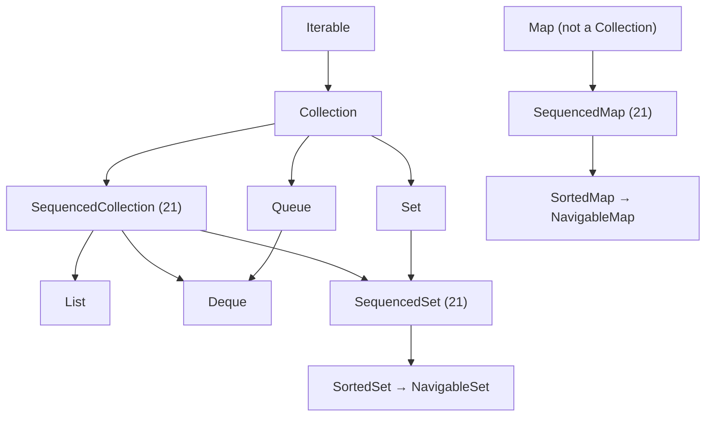
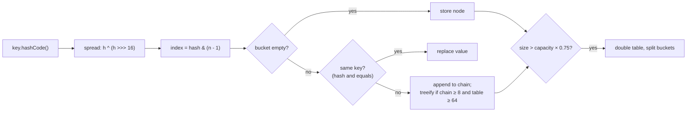

## Simple definition

The **Java Collections Framework (JCF)** is a set of **interfaces** (`List`, `Set`, `Map`, `Queue`, `Deque`), **implementations** (`ArrayList`, `HashMap`, `TreeMap` and others) and **algorithms** (`Collections.sort`, `binarySearch`) for storing and processing groups of objects.

## The problem

Choosing the wrong collection is one of the most common hidden performance bugs: `contains` on a large `ArrayList` is O(n), and `LinkedList.get(i)` walks the list. Mutable keys break `HashMap`. Knowing the internals tells you the costs.

## The hierarchy



**Sequenced collections (JEP 431, Java 21)** add a uniform API for collections with a defined encounter order: `getFirst()`, `getLast()`, `addFirst()`, `addLast()`, `removeFirst()`, `removeLast()` and `reversed()`. Maps get `firstEntry()`, `pollLastEntry()`, `putFirst()` and `sequencedKeySet()`.

## Lists

| | `ArrayList` | `LinkedList` |
|---|---|---|
| Structure | Resizable array (grows by about 1.5×) | Doubly linked nodes |
| `get(i)` | **O(1)** | O(n) |
| Add at end | Amortised O(1) | O(1) |
| Insert or remove in the middle | O(n) (shifts elements) | O(1) once positioned, but finding the position is O(n) |
| Memory and cache | Compact, CPU-cache friendly | About 24+ bytes overhead per node, pointer chasing |

> [!TIP] Default to ArrayList
> `LinkedList` rarely wins in practice. For queue or stack behaviour, use `ArrayDeque`.

## HashMap internals



- **Table:** an array of buckets whose length is a power of two (default 16). The index is `hash & (n-1)`.
- **Hash spreading:** the high bits are XOR-ed into the low bits, so poor `hashCode`s spread better.
- **Collisions:** stored as a linked list, which **treeifies** into a red-black tree when one bucket reaches 8 entries (and the table has at least 64 buckets). The worst case improves from O(n) to O(log n).
- **Load factor 0.75:** when size exceeds capacity × 0.75 the table **doubles**, and each entry either stays or moves by exactly `oldCapacity`.
- **Pre-size** when you know the count: `HashMap.newHashMap(expectedSize)` (Java 19+) computes the right capacity.
- One `null` key is allowed. **Not thread-safe.** Use `ConcurrentHashMap` for concurrent access.

### The equals and hashCode contract

- Equal objects **must** have equal hash codes.
- Hash codes should be stable while the object is a key, so **never mutate a key** after insertion or it becomes unreachable.
- Records generate correct `equals` and `hashCode` automatically, which makes them excellent keys.

## Other maps

| Map | Order | Structure | Notes |
|---|---|---|---|
| `HashMap` | None | Hash table | Fastest general purpose |
| `LinkedHashMap` | Insertion (or **access**) order | Hash table + doubly linked list | Access order + `removeEldestEntry` = an **LRU cache** |
| `TreeMap` | Sorted by key | **Red-black tree**, O(log n) | `NavigableMap`: `floorKey`, `ceilingEntry`, `subMap` |
| `EnumMap` | Enum ordinal | Array | Very fast for enum keys |
| `IdentityHashMap` | None | Uses `==` | Special cases (graphs, serialisation) |
| `WeakHashMap` | None | Weak keys | Entries vanish when keys are garbage collected |
| `ConcurrentHashMap` | None | CAS + per-bin locking | Thread-safe; see [concurrency](/java/advanced/concurrency-api#concurrent-collections) |

```java
// LRU cache in a few lines
class Lru<K, V> extends LinkedHashMap<K, V> {
    private final int max;
    Lru(int max) { super(16, 0.75f, true); this.max = max; }        // true = access order
    @Override protected boolean removeEldestEntry(Map.Entry<K, V> e) { return size() > max; }
}
```

## Sets, queues and deques

- `HashSet` is a `HashMap` with dummy values. `LinkedHashSet` keeps insertion order. `TreeSet` is sorted (it uses a `TreeMap`).
- `ArrayDeque` is a circular array and the best **stack and queue**. Do not use `Stack` or `Vector` (legacy and synchronised).
- `PriorityQueue` is a binary heap: O(log n) offer and poll, ordered by a comparator. It does not sort on iteration.

## Immutable and unmodifiable collections

| Method | Result |
|---|---|
| `List.of(...)`, `Set.of`, `Map.of`, `Map.ofEntries` | **Truly immutable**, null-hostile, compact |
| `List.copyOf(coll)` | Immutable copy (no copy if the source is already immutable) |
| `Collections.unmodifiableList(list)` | A read-only **view**: changes to the backing list show through |
| `stream.toList()` (Java 16) | Unmodifiable list |

## Iteration and fail-fast behaviour

Most collections keep a `modCount`. Structural modification during iteration (other than through the iterator) throws `ConcurrentModificationException` on a best-effort basis. Use `iterator.remove()`, `removeIf(...)` or concurrent collections.

## Choosing a collection

| Need | Choose |
|---|---|
| Indexed list | `ArrayList` |
| Unique elements, fast lookup | `HashSet` |
| Key → value lookup | `HashMap` |
| Sorted keys or range queries | `TreeMap` / `TreeSet` |
| Predictable iteration order | `LinkedHashMap` / `LinkedHashSet` |
| Stack or FIFO queue | `ArrayDeque` |
| Priority order | `PriorityQueue` |
| Shared between threads | `ConcurrentHashMap`, `CopyOnWriteArrayList`, `BlockingQueue` |
| Constant data | `List.of`, `Map.of` |

## Common mistakes

> [!MISTAKE] Mutable objects as map keys
> Changing a field used by `hashCode` after insertion "loses" the entry. Use immutable keys such as records.

> [!MISTAKE] `contains` on large lists in a loop
> That is O(n²). Convert to a `HashSet` first.

> [!MISTAKE] Assuming `Collections.unmodifiableList` is immutable
> It is a view; the owner can still change the underlying list.

## Quick check

**How does HashMap find a bucket?**
It spreads the key's `hashCode` (`h ^ (h >>> 16)`) and computes `hash & (n - 1)`, where n is the power-of-two table length.

**What happens when many keys collide in one bucket?**
The chain grows. At 8 entries (with a table of at least 64) it becomes a red-black tree, so lookups become O(log n).

**When does HashMap resize?**
When the size exceeds capacity × load factor (0.75 by default). The table doubles and entries are redistributed.

**How do you build an LRU cache with the JDK?**
Use `LinkedHashMap` with access order (`true` in the constructor) and override `removeEldestEntry`.

**What did Java 21 add to collections?**
Sequenced collections: `SequencedCollection`, `SequencedSet` and `SequencedMap`, with first and last operations and `reversed()`.

**`List.of` vs `Collections.unmodifiableList`?**
`List.of` is truly immutable and rejects nulls. `unmodifiableList` is a read-only view of a list that can still change underneath.

## Summary

- Know the interfaces, then the implementations' costs.
- HashMap: power-of-two buckets, spread hash, treeified collisions, 0.75 load factor, doubling resize.
- `ArrayList`, `HashMap` and `ArrayDeque` are the right default far more often than the alternatives.
- Prefer immutable collections, and never mutate keys.

## References

- Oracle, [Collections Framework overview (Java 21)](https://docs.oracle.com/en/java/javase/21/core/java-collections-framework.html).
- OpenJDK, [JEP 431: Sequenced Collections](https://openjdk.org/jeps/431).
- OpenJDK source, [HashMap.java](https://github.com/openjdk/jdk/blob/master/src/java.base/share/classes/java/util/HashMap.java), with implementation notes at the top of the class.
