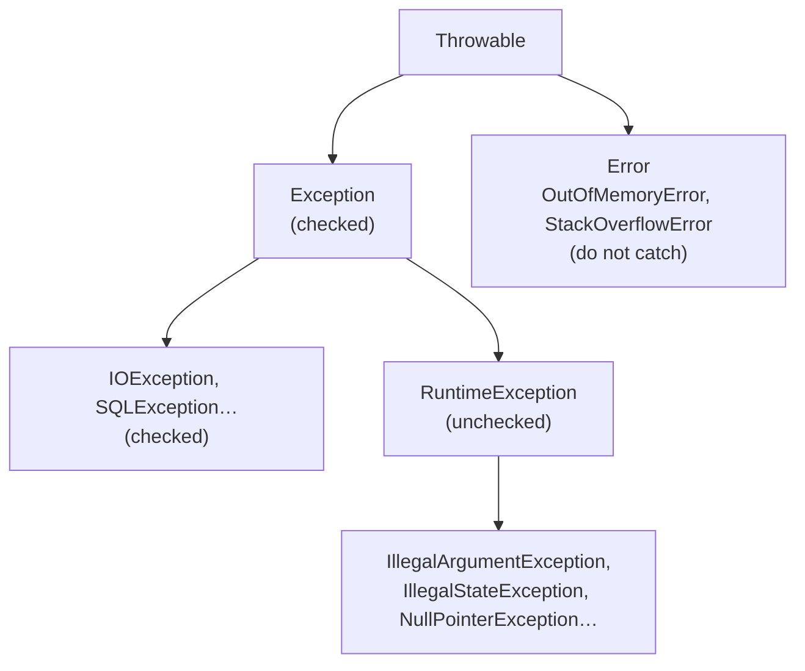

## Simple definition

An **exception** is an object that signals that something went wrong and transfers control to the nearest matching `catch`. **Try-with-resources** automatically closes resources such as files, connections and streams, even when exceptions occur.

## The problem

Error codes are easy to ignore, and manual cleanup in `finally` blocks is verbose and buggy: a second exception during cleanup hides the first. Badly designed exceptions leak implementation details, lose root causes or force callers into empty `catch` blocks.

## The hierarchy



| Kind | Compiler forces handling? | Use for |
|---|---|---|
| **Checked** (`Exception`, not runtime) | Yes: catch or declare `throws` | Recoverable conditions the caller can reasonably act on |
| **Unchecked** (`RuntimeException`) | No | Programming errors (bad arguments, illegal state) and most business failures in frameworks such as Spring |
| **Error** | No | JVM problems. Do not catch, except at the very top level for logging. |

Modern Java and Spring code leans towards **unchecked** exceptions. Checked exceptions do not compose with lambdas and leak layers (`SQLException` through a service API). Spring translates checked data-access exceptions into its unchecked `DataAccessException` hierarchy.

## try, catch, finally

```java
try {
    process(order);
} catch (PaymentDeclinedException | InsufficientStockException e) {   // multi-catch
    log.warn("Order {} rejected: {}", order.id(), e.getMessage());
    throw new OrderRejectedException(order.id(), e);                   // translate + chain
} finally {
    metrics.increment("orders.processed");                              // always runs
}
```

- Catch the **most specific** type first.
- `finally` runs on normal exit, on an exception and on `return`. Do not `return` from `finally`, because it swallows exceptions.

## Try-with-resources

Any `AutoCloseable` declared in the header is closed automatically, in **reverse order**:

```java
try (var conn = dataSource.getConnection();
     var stmt = conn.prepareStatement("SELECT total FROM orders WHERE id = ?")) {
    stmt.setLong(1, id);
    try (var rs = stmt.executeQuery()) {
        return rs.next() ? rs.getBigDecimal(1) : BigDecimal.ZERO;
    }
}   // rs, stmt and conn are closed, even on exceptions
```

**Suppressed exceptions:** if the body throws and `close()` also throws, the body's exception is kept and the close exception is attached to it through `getSuppressed()`. Nothing is lost, unlike hand-written `finally` cleanup.

Since Java 9 you can also use an effectively final variable: `try (existingResource) { ... }`.

## Designing exceptions

```java
public class OrderNotFoundException extends RuntimeException {
    private final OrderId orderId;
    public OrderNotFoundException(OrderId orderId) {
        super("Order " + orderId + " not found");
        this.orderId = orderId;
    }
    public OrderId orderId() { return orderId; }
}
```

**Guidelines:**

1. **Throw early, catch late.** Validate at the boundary; handle where you can act, usually at the top in a global handler.
2. **Translate at layer boundaries**, and always **chain the cause**: `throw new X(msg, e)`.
3. Use **standard exceptions** where they fit (`IllegalArgumentException`, `IllegalStateException`, `UnsupportedOperationException`).
4. Use **domain-specific exceptions** for business rules, carrying the data a handler needs (IDs, codes), not formatted text only.
5. Do not use exceptions for normal control flow; they are expensive mainly because of stack-trace capture.
6. Never swallow: `catch (Exception e) {}` hides failures. At least log the exception with context, and usually rethrow.
7. **Log or rethrow, not both** at every layer, or you get the same stack trace five times.
8. For expected "not found" lookups in APIs, `Optional` is often clearer than an exception.

## Exceptions in lambdas, streams and async code

- Functional interfaces such as `Function` do not declare checked exceptions. Wrap them in unchecked exceptions (`UncheckedIOException`) or handle them inside the lambda.
- **CompletableFuture** wraps failures in `CompletionException`. Handle them with `exceptionally`, `handle` or `whenComplete`. See [concurrency](/java/advanced/concurrency-api#completablefuture-composing-async-work).
- **Virtual threads and structured concurrency** propagate failures to the scope owner. See [virtual threads](/java/advanced/virtual-threads-and-structured-concurrency).

## Exceptions in Spring applications

- Controllers: map exceptions to **RFC 9457 Problem Details** with `@RestControllerAdvice`. See [REST error handling](/spring/web/rest-api-design-and-error-handling).
- Transactions: by default Spring rolls back on **unchecked** exceptions and `Error`, not on checked ones. See [transactions](/spring/data/transactions#rollback-rules).

## Common mistakes

> [!MISTAKE] Catching `Exception` or `Throwable` deep in the code
> It hides bugs and catches things you cannot handle. Catch specific types; let the rest propagate to a global handler.

> [!MISTAKE] Losing the cause
> `throw new ServiceException("failed")` without `e` destroys the root cause. Always chain it.

> [!MISTAKE] Closing resources manually
> Forgotten or failing `close()` calls leak connections. Use try-with-resources.

## Quick check

**Checked vs unchecked exceptions?**
The compiler forces handling or declaring of checked exceptions (subclasses of `Exception`, but not `RuntimeException`). Unchecked exceptions (`RuntimeException` and `Error`) are not checked at compile time.

**What does try-with-resources guarantee?**
Every declared `AutoCloseable` is closed in reverse order, even when exceptions occur. Close failures are recorded as suppressed exceptions.

**What is exception chaining and why does it matter?**
Passing the original exception as the cause of a new one, so the root cause and its stack trace are preserved when translating between layers.

**Why does Spring prefer unchecked exceptions?**
They do not leak implementation details through method signatures, they compose with lambdas, and callers handle them only where they can act.

**What happens if `finally` contains `return`?**
It overrides any return value or exception from the `try` block, silently swallowing the exception. Avoid it.

## Summary

- Checked exceptions are for recoverable conditions; unchecked are for programming errors and most framework code.
- Use try-with-resources for anything closeable; suppressed exceptions keep both failures.
- Translate at boundaries, always chain causes, and handle centrally.
- Never swallow, and do not log-and-rethrow at every layer.

## References

- Oracle, [The Java Tutorials: Exceptions](https://docs.oracle.com/javase/tutorial/essential/exceptions/) and [try-with-resources](https://docs.oracle.com/javase/tutorial/essential/exceptions/tryResourceClose.html).
- Joshua Bloch, *Effective Java* (3rd edition), chapter 10 "Exceptions".
- [RFC 9457: Problem Details for HTTP APIs](https://www.rfc-editor.org/rfc/rfc9457).
