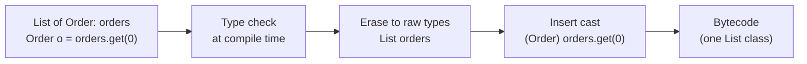

## Simple definition

**Generics** let classes, interfaces and methods take **types as parameters**, such as `List<Order>` or `Map<String, Price>`. The compiler checks that you put in and take out only the right type. At runtime most of that type information is **erased**.

## The problem

Before Java 5, collections held `Object`:

```java
List orders = new ArrayList();
orders.add("not an order");             // compiles
Order o = (Order) orders.get(0);        // ClassCastException at runtime
```

Generics move that error to **compile time** and remove the casts.

## Core concepts

### Type parameters and generic methods

```java
public final class Result<T> {                       // generic class
    private final T value; private final String error;
    private Result(T value, String error) { this.value = value; this.error = error; }
    public static <T> Result<T> ok(T value) { return new Result<>(value, null); }   // generic method
    public static <T> Result<T> failed(String error) { return new Result<>(null, error); }
    public <R> Result<R> map(Function<? super T, ? extends R> f) {
        return error == null ? ok(f.apply(value)) : failed(error);
    }
}
```

Naming convention: `T` for type, `E` for element, `K`/`V` for key and value, `R` for return type.

### Bounded type parameters

```java
static <T extends Comparable<? super T>> T max(List<? extends T> list) { ... }
```

- `T extends Number` is an **upper bound**: T must be Number or a subtype.
- Multiple bounds: `<T extends Entity & Auditable>` (a class first, then interfaces).

### Invariance and wildcards

`List<Integer>` is **not** a `List<Number>`. Generics are **invariant**, unlike arrays, which are covariant and therefore unsafe. Wildcards add controlled flexibility:

| Wildcard | Meaning | You can |
|---|---|---|
| `List<?>` | A list of some unknown type | Read as `Object`; add only `null` |
| `List<? extends Number>` | Some subtype of Number | **Read** Numbers (a producer) |
| `List<? super Integer>` | Some supertype of Integer | **Write** Integers (a consumer) |

> [!KEY] PECS: Producer Extends, Consumer Super
> If a parameter **produces** values you read, use `? extends T`. If it **consumes** values you write, use `? super T`. `Collections.copy(List<? super T> dest, List<? extends T> src)` is the canonical example.

### Type erasure

The compiler checks types, then **erases** them. Type parameters become their bound (or `Object`), and casts are inserted where needed.



Consequences of erasure:

| You cannot | Why | Workaround |
|---|---|---|
| `new T()` or `new T[10]` | T is unknown at runtime | Pass a `Supplier<T>`, `Class<T>` or `IntFunction<T[]>` |
| `obj instanceof List<String>` | The runtime only knows `List` | `instanceof List<?>` |
| Overload `m(List<String>)` and `m(List<Integer>)` | Same erasure | Use different names |
| Use primitives: `List<int>` | Type arguments must be references | Use `List<Integer>` or primitive streams. Project Valhalla aims to change this. |
| Catch `T` or create a generic exception | Exceptions must be reifiable | — |

**Bridge methods:** when a generic class is subclassed with a concrete type, the compiler generates a synthetic bridge method so that overriding still works after erasure.

**Reifiable types** keep their full type at runtime: primitives, non-generic classes, raw types and `List<?>`. Non-reifiable types (`List<String>`) cause **heap pollution** risks with varargs. Use `@SafeVarargs` only on methods that do not store or expose the varargs array.

### Recovering type information

Erasure removes types from **objects**, not from **declarations**. Class, field and method signatures keep generic information. Frameworks read it through reflection, for example Spring's `ResolvableType`, Jackson's `TypeReference<List<Order>>` or `ParameterizedTypeReference` in `RestClient`:

```java
List<OrderDto> orders = restClient.get().uri("/orders")
        .retrieve().body(new ParameterizedTypeReference<List<OrderDto>>() {});
```

The anonymous subclass captures `List<OrderDto>` in its superclass signature. This is the "super type token" trick.

## Practical guidance for API design

- Return specific types (`List<Order>`); accept flexible ones (`Collection<? extends Order>`).
- Do not use wildcards in **return types**, because they push complexity onto every caller.
- Prefer generic methods to raw types. **Never** use raw types in new code; the compiler warns for a reason.
- Use `var` for local variables with long generic types, but keep the declared type visible where it helps readers.
- Keep type-parameter lists short. More than two parameters usually signals a design problem.

## Common mistakes

> [!MISTAKE] Raw types
> `List list = new ArrayList<String>()` switches off type checking and spreads unchecked warnings.

> [!MISTAKE] Expecting covariance
> A method taking `List<Animal>` will not accept `List<Dog>`. Use `List<? extends Animal>` if it only reads.

> [!MISTAKE] Suppressing unchecked warnings broadly
> Put `@SuppressWarnings("unchecked")` on the smallest possible scope, with a comment explaining why it is safe.

## Quick check

**Why is `List<Integer>` not a subtype of `List<Number>`?**
Generics are invariant. If it were, you could add a `Double` to a list of integers through the `List<Number>` reference.

**What does PECS stand for?**
Producer Extends, Consumer Super: use `? extends T` to read from a parameter and `? super T` to write into it.

**What is type erasure?**
The compiler checks generic types and then removes them from the bytecode, replacing type parameters with their bounds and inserting casts.

**Why can't you write `new T()`?**
The concrete type is not known at runtime because of erasure. Pass a `Supplier<T>` or `Class<T>` instead.

**How does Jackson deserialise into `List<Order>` despite erasure?**
With a super type token: an anonymous `TypeReference<List<Order>>` subclass keeps the generic type in its class signature, which reflection can read.

## Summary

- Generics give compile-time type safety and remove casts.
- They are invariant; wildcards plus PECS add flexibility.
- Type erasure means no runtime type arguments, so no `new T()`, no `instanceof List<String>` and no primitive type arguments.
- Frameworks recover declared generic types through reflection and super type tokens.

## References

- Oracle, [The Java Tutorials: Generics](https://docs.oracle.com/javase/tutorial/java/generics/index.html).
- [Java Language Specification, chapter 4.6: Type Erasure](https://docs.oracle.com/javase/specs/jls/se21/html/jls-4.html#jls-4.6).
- Joshua Bloch, *Effective Java* (3rd edition), chapter 5 "Generics".
- OpenJDK, [Project Valhalla](https://openjdk.org/projects/valhalla/).
