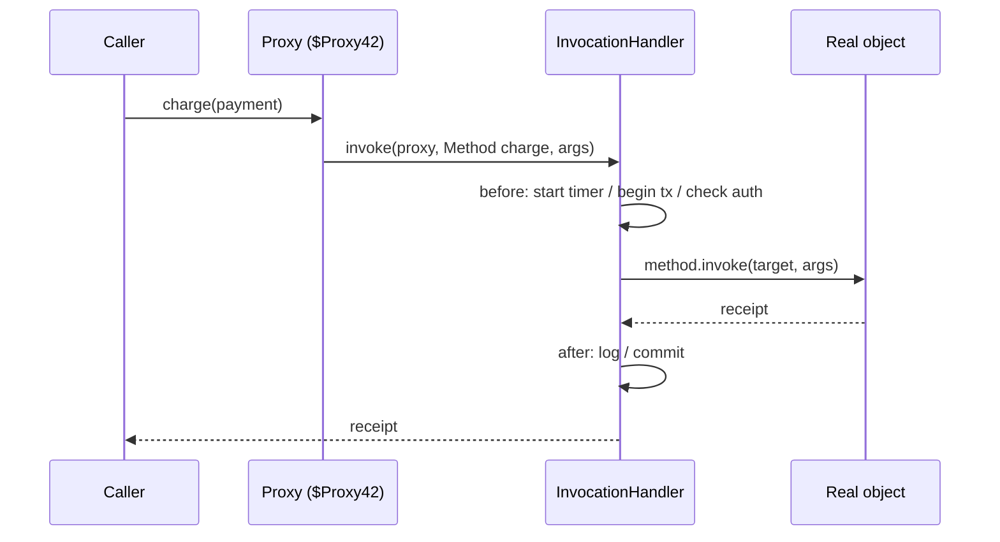

## Simple definition

- **Reflection** lets a program **inspect and use** classes, methods, fields, constructors and annotations **at runtime**, without knowing them at compile time.
- A **dynamic proxy** is an object created at runtime that **implements interfaces** (or subclasses a class) and routes every method call through your handler code.

Together they are the engine behind dependency injection, AOP, ORMs, serialisation and test mocks.

## The problem

Frameworks must work with **your** classes, which they have never seen. Spring must find `@Autowired` constructors, Hibernate must read `@Entity` fields, Jackson must call getters and constructors, and `@Transactional` must wrap your method calls. Reflection and proxies make that possible.

## Reflection basics

```java
Class<?> type = Class.forName("com.shop.Order");          // or Order.class, or obj.getClass()

for (Field f : type.getDeclaredFields()) {                 // includes private fields
    if (f.isAnnotationPresent(Column.class)) {
        System.out.println(f.getName() + " -> " + f.getAnnotation(Column.class).name());
    }
}

Constructor<?> ctor = type.getDeclaredConstructor(String.class, BigDecimal.class);
Object order = ctor.newInstance("ORD-1", new BigDecimal("12.50"));

Method total = type.getMethod("total");
Object value = total.invoke(order);                        // dynamic call

Field status = type.getDeclaredField("status");
status.setAccessible(true);                                // bypass private (subject to module rules)
status.set(order, "PAID");
```

| API | Gives you |
|---|---|
| `Class` | Name, modifiers, superclass, interfaces, record components (`getRecordComponents()`), sealed permitted subclasses |
| `Field` / `Method` / `Constructor` | Get and set, invoke, generic signatures (`getGenericType()`), annotations |
| `Annotation` | Runtime-retained annotations (`@Retention(RUNTIME)`) |
| `Parameter` | Parameter names (when compiled with `-parameters`, which Spring Boot builds use) |

### MethodHandles: the faster, modern alternative

`java.lang.invoke.MethodHandle` is a typed, directly executable reference to a method or field. The JIT can inline it, and access is checked once at lookup time. Since **JDK 18 (JEP 416)**, core reflection itself is reimplemented on top of method handles.

```java
MethodHandle total = MethodHandles.lookup()
        .findVirtual(Order.class, "total", MethodType.methodType(BigDecimal.class));
BigDecimal value = (BigDecimal) total.invoke(order);
```

## Dynamic proxies

### JDK dynamic proxy (interfaces only)

```java
interface PaymentClient { Receipt charge(Payment p); }

PaymentClient timed = (PaymentClient) Proxy.newProxyInstance(
        PaymentClient.class.getClassLoader(),
        new Class<?>[] { PaymentClient.class },
        (proxy, method, args) -> {                          // InvocationHandler
            long start = System.nanoTime();
            try {
                return method.invoke(realClient, args);     // delegate to the real object
            } finally {
                log.info("{} took {} µs", method.getName(), (System.nanoTime() - start) / 1_000);
            }
        });
```



### Class-based proxies: CGLIB and ByteBuddy

JDK proxies need an interface. To proxy a **class**, libraries generate a **subclass** at runtime that overrides the methods:

| | JDK dynamic proxy | Subclass proxy (CGLIB in Spring, ByteBuddy in Hibernate and Mockito) |
|---|---|---|
| Requires | An interface | A non-final class with non-final methods |
| Proxy type | Implements the interfaces | Extends the class |
| Can't intercept | Methods not on the interface | `final` or `private` methods, constructors |
| Spring Boot default | Only if configured | **Yes** (`proxyTargetClass=true` by default) |

**Who uses what:**

- **Spring AOP** (`@Transactional`, `@Cacheable`, `@Async`, method security): JDK or CGLIB proxies. See [AOP and proxies](/spring/core/aop-and-proxies).
- **Spring Data repositories**: JDK proxies of your repository interfaces.
- **Hibernate** lazy loading: ByteBuddy subclass proxies, or bytecode enhancement.
- **Mockito**: ByteBuddy subclasses, or the inline mock maker (the default since Mockito 5), which can mock final classes.
- **HTTP interface clients** (`@HttpExchange` in Spring 6+): JDK proxies that turn method calls into HTTP requests.

## Performance and limits

- Reflection is slower than direct calls, mainly because of lookup and access checks. Cache `Method` and `MethodHandle` objects; never look them up per call.
- **Strong encapsulation (JDK 16+, JEP 396/403):** `setAccessible(true)` on JDK internals fails unless the package is opened (`--add-opens`). Your own modules must `opens` packages to frameworks that reflect over them. See [JPMS](/java/advanced/java-module-system).
- **GraalVM native image** needs reflection known at build time. Spring Boot's AOT engine generates **reflection hints** (`RuntimeHints`) for this.
- **Integrity by default** (JEP draft) continues to restrict deep reflection, and JDK 26 started warning when `final` fields are mutated through reflection (JEP 500). Prefer constructors and public APIs.

## Common mistakes

> [!MISTAKE] Reflection in hot loops without caching
> Looking up `Method` objects on every call wastes CPU. Look them up once and cache them, or use `MethodHandle`.

> [!MISTAKE] Expecting proxies to intercept internal calls
> `this.otherMethod()` inside the target bypasses the proxy. That is why `@Transactional` on a self-invoked method does nothing.

> [!MISTAKE] `final` classes or methods with class-based proxies
> CGLIB cannot override them, so the advice is silently skipped.

## Quick check

**What can reflection do?**
Inspect classes, fields, methods, constructors and annotations at runtime; create instances; invoke methods; and read or write fields, including private ones if access is allowed.

**JDK dynamic proxy vs CGLIB?**
JDK proxies implement interfaces and route calls to an `InvocationHandler`. CGLIB (and ByteBuddy) generate subclasses, so they can proxy classes but not `final` methods.

**Why doesn't a proxy intercept self-invocation?**
The internal call goes through `this`, which is the target object itself, not the proxy wrapping it.

**What is a MethodHandle?**
A typed, directly invocable reference to a method or field, checked at lookup and optimisable by the JIT. Modern reflection is built on it.

**Why do native images need reflection hints?**
GraalVM analyses reachability ahead of time, so classes and members used reflectively must be declared at build time.

## Summary

- Reflection inspects and invokes code at runtime; frameworks depend on it.
- Proxies wrap objects to add behaviour: JDK proxies for interfaces, CGLIB and ByteBuddy for classes.
- Cache reflective lookups, respect module encapsulation, and remember self-invocation and `final` limits.

## References

- Oracle, [Trail: The Reflection API](https://docs.oracle.com/javase/tutorial/reflect/) and [`java.lang.reflect.Proxy`](https://docs.oracle.com/en/java/javase/21/docs/api/java.base/java/lang/reflect/Proxy.html).
- OpenJDK, [JEP 416: Reimplement Core Reflection with Method Handles](https://openjdk.org/jeps/416) and [JEP 500: Prepare to Make Final Mean Final](https://openjdk.org/jeps/500).
- Spring, [Proxying mechanisms](https://docs.spring.io/spring-framework/reference/core/aop/proxying.html).
- [ByteBuddy](https://bytebuddy.net/).
