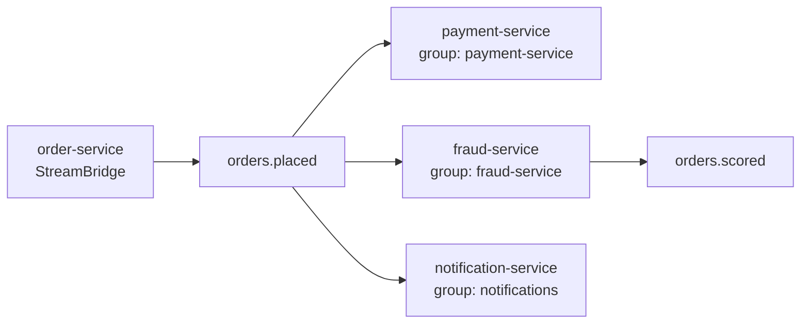

## Simple definition

In an **event-driven architecture**, services **publish events** (facts such as `OrderPlaced`) to a **message broker**, and other services **consume** them asynchronously. **Spring Cloud Stream** lets you write producers and consumers as plain Java **functions**, bound to **Kafka**, **RabbitMQ** or other brokers through **binders**.

## The problem

Synchronous call chains couple services in **time**: if the email or loyalty service is down or slow, checkout fails. Adding a new consumer means changing the producer. Events decouple services, absorb load spikes, and enable new consumers without touching the publisher. In exchange you must handle **eventual consistency**, duplicates and ordering.

## Kafka vs RabbitMQ

| | Apache Kafka | RabbitMQ |
|---|---|---|
| Model | **Distributed log**: partitions, retention, replay | **Message broker**: exchanges route to queues; messages are removed when acknowledged |
| Ordering | Per partition (by key) | Per queue (single consumer) |
| Replay | ✅ Re-read history | ❌ (except **streams**) |
| Throughput | Very high | High |
| Routing | Topics and keys | Rich: direct, topic, fanout and header exchanges |
| Queue semantics | Consumer groups; **share groups (queues) GA in Kafka 4.2** | Native work queues, priorities, TTL, DLX |
| Typical use | Event streaming, CDC, analytics, high-volume integration | Task queues, request routing, RPC-ish messaging, smaller estates |

For a deeper Kafka treatment, see the [Data, Distributed Systems & Cybersecurity hub](https://samirsahoo.github.io/data-security/streaming/kafka-architecture/).

## Spring Cloud Stream: the functional model

```java
@Configuration
class OrderEvents {

    @Bean                                              // consumer: payments.in-0
    Consumer<OrderPlaced> reservePayment(PaymentService payments) {
        return event -> payments.authorise(event.orderId(), event.total());
    }

    @Bean                                              // processor: in → out
    Function<OrderPlaced, OrderScored> scoreFraud(FraudModel model) {
        return event -> new OrderScored(event.orderId(), model.score(event));
    }
}

// Imperative publishing from a service
@Service
class Publisher {
    private final StreamBridge bridge;
    void publish(OrderPlaced e) { bridge.send("orders-out-0", e); }
}
```

```yaml
spring:
  cloud:
    function:
      definition: reservePayment;scoreFraud
    stream:
      bindings:
        reservePayment-in-0:
          destination: orders.placed           # Kafka topic / RabbitMQ exchange
          group: payment-service               # consumer group: one instance handles each message
        scoreFraud-in-0:
          destination: orders.placed
          group: fraud-service
        scoreFraud-out-0:
          destination: orders.scored
          producer:
            partition-key-expression: headers['orderId']   # keep per-order ordering
      kafka:
        binder:
          brokers: kafka:9092
```



- **Binding names** follow `<function>-in-<n>` / `-out-<n>`.
- **Consumer groups:** each group gets every message, and within a group each message goes to one instance (horizontal scaling).
- **Binders** are pluggable: Kafka, Kafka Streams, RabbitMQ, Pulsar, Solace, AWS Kinesis and others. Switching brokers is mostly configuration.

**When to use the native libraries instead:** **Spring for Apache Kafka** (`@KafkaListener`, `KafkaTemplate`, transactions, `DefaultErrorHandler`, retry topics) or **Spring AMQP** (`@RabbitListener`, `RabbitTemplate`) give full control of broker features. Spring Cloud Stream is the portable, higher-level abstraction.

## Reliability

| Concern | Solution |
|---|---|
| **DB change + event must both happen** | **Transactional outbox** (an outbox table in the same transaction, relayed by Debezium CDC or the Spring Modulith event publication registry with externalisation) |
| **Duplicates** (at-least-once delivery) | **Idempotent consumers**: store processed event IDs in the same DB transaction, or use upserts |
| **Transient failures** | Retries with backoff (binder `max-attempts`, back-off settings) |
| **Poison messages** | **Dead-letter queue/topic** (`enable-dlq: true` for Kafka; DLX for Rabbit), with alerts and replay tooling |
| **Ordering** | Partition by entity key (Kafka); one consumer per queue (Rabbit) |
| **Schema evolution** | Avro or Protobuf with a schema registry; backward-compatible changes |
| **Tracing** | Propagate `traceparent` headers (automatic with Micrometer instrumentation) |

```java
// Idempotent consumer
@Bean
Consumer<Message<OrderPlaced>> reservePayment(PaymentService payments, ProcessedEvents processed) {
    return msg -> {
        String eventId = msg.getHeaders().get("eventId", String.class);
        if (!processed.markIfNew("payment-service", eventId)) return;   // duplicate: skip
        payments.authorise(msg.getPayload().orderId(), msg.getPayload().total());
    };
}
```

See the [order management case study](/system-design/case-studies/order-management-system) for a saga with an outbox end to end.

## Event design

- Name events in the **past tense** (`OrderPlaced`), versioned, with an **event ID**, **timestamp**, **key** and **correlation/trace IDs** (CloudEvents is a good envelope).
- Carry the data consumers need (event-carried state transfer) to avoid call-backs, but **no secrets or unnecessary personal data**.
- Document events (AsyncAPI) and treat them as **contracts**.

## Testing

- **Unit:** functions are plain Java, so call them directly.
- **Binder test support:** the `TestChannelBinder` (`InputDestination` and `OutputDestination`) tests bindings without a broker.
- **Integration:** Testcontainers Kafka or RabbitMQ with `@ServiceConnection`, plus Awaitility for async assertions. See [integration testing](/spring/production/integration-testing).

## Common mistakes

> [!MISTAKE] Publishing directly inside a DB transaction
> The broker send is not part of the transaction. A rollback leaves a phantom event; a crash after commit loses one. Use the outbox.

> [!MISTAKE] Assuming exactly-once delivery
> Brokers redeliver after failures and rebalances. Make every consumer idempotent.

> [!MISTAKE] No dead-letter handling
> One bad message blocks a partition or loops forever. Configure DLQs, monitor them and build replay tooling.

## Quick check

**Kafka vs RabbitMQ in one line each?**
Kafka is a partitioned, replayable log for high-volume event streams. RabbitMQ is a flexible routing message broker with queues that delete messages once acknowledged.

**What is a binding in Spring Cloud Stream?**
The connection between a function's input or output (`fn-in-0`, `fn-out-0`) and a broker destination, with group and partition settings.

**What do consumer groups give you?**
Each group receives every message, while instances within a group share the load, each message handled by one instance.

**How do you publish an event reliably with a DB change?**
The transactional outbox: write the event to an outbox table in the same transaction, then relay it to the broker.

**Why must consumers be idempotent?**
Delivery is at-least-once, so duplicates occur after retries, rebalances and redeliveries.

## Summary

- Events decouple services in time and knowledge; brokers buffer load.
- Spring Cloud Stream binds Supplier, Function and Consumer beans to Kafka or RabbitMQ; use native Spring Kafka or AMQP for full control.
- Outbox + idempotent consumers + DLQs + schemas + tracing make event-driven systems reliable.

## References

- Spring Cloud Stream, [reference documentation](https://docs.spring.io/spring-cloud-stream/reference/).
- Spring for Apache Kafka, [reference](https://docs.spring.io/spring-kafka/reference/), and Spring AMQP, [reference](https://docs.spring.io/spring-amqp/reference/).
- Chris Richardson, [Transactional outbox](https://microservices.io/patterns/data/transactional-outbox.html).
- [CloudEvents](https://cloudevents.io/) and [AsyncAPI](https://www.asyncapi.com/).
