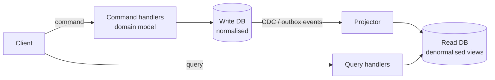
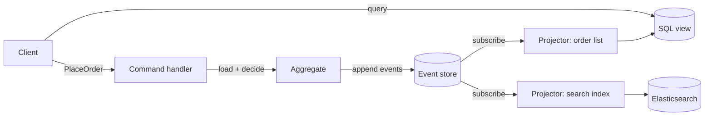

## Simple definition

- **CQRS (Command Query Responsibility Segregation)** uses **different models for writing and reading**. Commands change state through a write model that enforces business rules; queries read from one or more read models shaped for the screens and APIs that use them.
- **Event sourcing** stores an entity's state as the **sequence of events** that happened to it (`OrderPlaced`, `ItemAdded`, `OrderShipped`) instead of its current values. Current state is derived by replaying the events.

They are independent patterns that combine naturally: event sourcing produces a stream of events, and CQRS projections consume it to build read models.

## The problem

One domain model serving both writes and reads becomes a compromise:

- Writes need rich aggregates and invariants ("an order cannot ship before payment").
- Reads need denormalised data from many aggregates ("orders with customer name, last shipment status and total, filtered and sorted"), often at much higher volume.
- An ORM model tuned for one is awkward for the other: N+1 queries, huge joins, or aggregates bloated with display fields.

And a table of current values forgets history: *why* is the balance 40? Audit, analytics and debugging need the sequence of changes.

## CQRS



- Commands express **intent** (`PlaceOrder`, `CancelOrder`) and can be rejected; they return little or nothing.
- Queries never change state.
- Read models can use different technology: SQL views for lists, Elasticsearch for search, Redis for dashboards. Each is optimised for one access pattern and can be scaled independently.

CQRS can be as light as separate query classes reading the same database with tailored SQL, or as heavy as separate databases. Start light.

## Event sourcing

```java
sealed interface OrderEvent permits OrderPlaced, ItemAdded, OrderPaid, OrderShipped { }

final class Order {
    private OrderStatus status;
    private Money total = Money.ZERO;
    private final List<OrderEvent> uncommitted = new ArrayList<>();

    static Order rehydrate(List<OrderEvent> history) {
        Order o = new Order();
        history.forEach(o::apply);                       // replay facts, no rule checks
        return o;
    }

    void ship(TrackingNumber t) {                        // command method: check rules, then record
        if (status != OrderStatus.PAID) throw new IllegalStateException("not paid");
        record(new OrderShipped(t));
    }

    private void record(OrderEvent e) { apply(e); uncommitted.add(e); }

    private void apply(OrderEvent e) {
        switch (e) {
            case OrderPlaced p  -> status = OrderStatus.PLACED;
            case ItemAdded i    -> total = total.plus(i.price());
            case OrderPaid p    -> status = OrderStatus.PAID;
            case OrderShipped s -> status = OrderStatus.SHIPPED;
        }
    }
}
```

- **Command methods** validate against current state and **record** new events.
- **`apply`** mutates state from an event and never fails; it is used both for new events and for replay.
- The repository appends `uncommitted` events to the aggregate's stream with **optimistic concurrency**: `append(streamId, expectedVersion, events)` fails if someone else appended first, and the command is retried.

## Combined: event-sourced CQRS





Projectors subscribe to the event stream, update read models **idempotently** (tracking the last processed position), and can be **rebuilt from scratch** by replaying all events — which is how you add a new read model or fix a buggy one.

## Snapshots

Replaying 10,000 events to load an aggregate is slow. Periodically store a **snapshot** (state at version N) and replay only events after it. Snapshots are a cache: they can always be regenerated.

## Event design and evolution

- Events are **facts in the past tense** in the domain language; they are a long-lived contract.
- Never change the meaning of a stored event. Evolve with new optional fields, new event types, or **upcasting** (transform old event versions to the new shape when reading).
- Deleting personal data from an immutable log: store personal data separately and reference it, or encrypt it per subject and delete the key (**crypto-shredding**).

## Eventual consistency in the user interface

Read models lag behind commands by milliseconds to seconds. Strategies: return the new state (or version) from the command and render it directly; poll the read model until it reaches that version; or show optimistic UI updates. Avoid designs where users immediately query data they just changed through a lagging view without handling this.

## When to use (and not)

| Use | Avoid |
|---|---|
| Complex domains with rich behaviour and many different read needs | Simple CRUD |
| Audit trail is a requirement (finance, healthcare, logistics) | Teams new to DDD and event-driven design, on tight deadlines |
| Temporal queries ("state as of last Tuesday") | Data that is mostly deleted or overwritten |
| Several downstream consumers need the change stream | When a transactional outbox from a normal database is enough |

Apply them per [bounded context](/domain-driven-design/strategic/bounded-context), not across the whole system.

## Tooling

Axon Framework (Java), EventStoreDB/Kurrent, Marten (.NET), or a relational table `(stream_id, version, type, payload)` with a unique constraint on `(stream_id, version)`. Kafka is a good event **bus** but a poor event **store** for aggregates (no per-aggregate streams or optimistic append).

## Common mistakes

> [!MISTAKE] Event sourcing the whole system by default
> Event sourcing adds versioning, projections and eventual consistency everywhere. Use it where history and auditability are genuinely valuable.

- **CRUD-style events** (`OrderUpdated` with all fields) that carry no business meaning.
- **Business logic in projectors**; projectors only shape data.
- **Querying the event store for lists**; that is what read models are for.
- **Non-idempotent projections** that double-count on replay.

## Quick check

**What does CQRS separate?**
The model used to change state (commands) from the model(s) used to read it (queries).

**What does event sourcing store?**
The sequence of domain events for each aggregate; current state is derived by replaying them.

**Are CQRS and event sourcing the same thing?**
No. CQRS can use an ordinary database; event sourcing is often paired with CQRS because event streams are hard to query directly.

**How do you add a new read model to an event-sourced system?**
Write a new projector and replay all events from the beginning into the new view.

**How is concurrency controlled when appending events?**
With an expected version per stream; the append fails if the stream has advanced, and the command retries.

## Summary

- CQRS: separate write and read models; scale and shape them independently.
- Event sourcing: store facts, derive state, keep full history.
- Projections build read models and can be rebuilt by replay; snapshots speed up loading.
- Both add complexity: use them where the domain justifies it.

## Related topics

- [Transactional Outbox and Inbox](/microservices/data-consistency/transactional-outbox)
- [Saga Pattern](/microservices/data-consistency/saga-pattern)
- [Stream Processing: event sourcing and CDC](/data-systems/stream-processing)
- [Command Pattern](/design-patterns/behavioral/command)

## References

- Martin Fowler. "[CQRS](https://martinfowler.com/bliki/CQRS.html)" and "[Event Sourcing](https://martinfowler.com/eaaDev/EventSourcing.html)."
- Greg Young. "CQRS Documents." 2010.
- Chris Richardson. *Microservices Patterns*. Manning, 2018. Chapters 6–7.
- Martin Kleppmann. *Designing Data-Intensive Applications*. Chapter 11: event sourcing and state.
