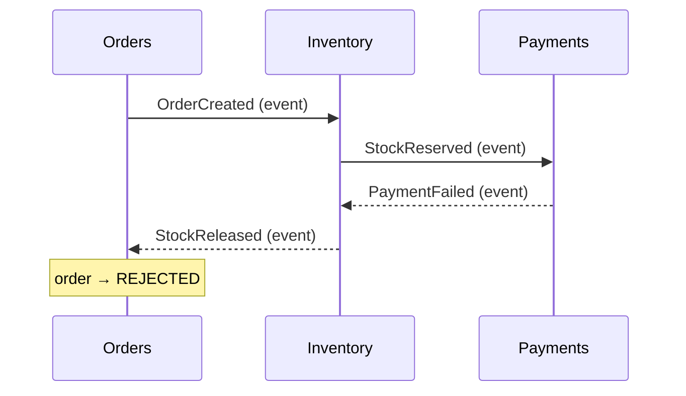
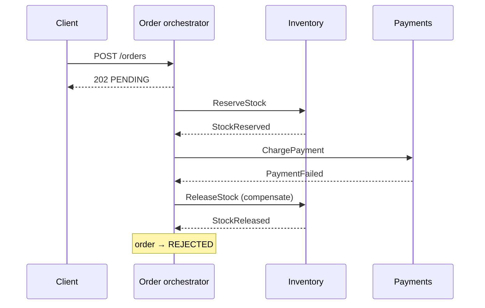

## Simple definition

A **saga** is a sequence of **local transactions**, one per service. Each step commits in its own database and triggers the next. If a step fails, the saga runs **compensating transactions** that semantically undo the steps already completed. Sagas give microservices business-level consistency without a distributed transaction.

## Why not a distributed transaction?

Placing an order touches Orders, Inventory and Payments, each with its own database. Two-phase commit across them would make every service's availability depend on all the others, hold locks across the network, and block if the coordinator fails (see [Consistency and Consensus: 2PC](/data-systems/consistency-and-consensus)). Many technologies (Kafka, most NoSQL stores, third-party APIs) do not support XA at all. Sagas accept **eventual consistency** in exchange for autonomy and availability.

## Anatomy of a saga

| Step | Local transaction | Compensation |
|---|---|---|
| 1 | Orders: create order `PENDING` | Mark order `REJECTED` |
| 2 | Inventory: reserve stock | Release reservation |
| 3 | Payments: charge card — **pivot** | (none: after this the saga must complete) |
| 4 | Orders: mark `CONFIRMED` | — (retriable) |
| 5 | Shipping: create shipment | — (retriable) |

- **Compensatable steps** come before the pivot and have compensations.
- The **pivot transaction** is the point of no return.
- **Retriable steps** after the pivot must eventually succeed (retry until they do).

Ordering steps so that risky, reversible ones come first and irreversible ones last simplifies the saga.

## Choreography

Each service listens for events and decides what to do next; there is no central coordinator.



## Orchestration

One component — the **orchestrator**, usually in the service that owns the process — sends commands and reacts to replies, holding the saga's state machine.





## Choosing

| | Choreography | Orchestration |
|---|---|---|
| Coordination logic | Spread across services | In one orchestrator |
| Coupling | Services depend on each other's events | Participants know only their commands |
| Visibility of the process | Implicit; hard to see the whole flow | Explicit state machine; easy to monitor |
| Risk | Cyclic event dependencies as steps grow | Orchestrator becomes too smart |
| Best for | 2–3 simple steps | 4+ steps, branching, timeouts, many compensations |

The same distinction appears in [Observer vs Mediator vs Event Bus](/comparisons/observer-mediator-event-bus): choreography is event-bus style, orchestration is mediator style.

## Implementing an orchestrator in Spring Boot

The orchestrator stores saga state in its database and sends commands through a [transactional outbox](/microservices/data-consistency/transactional-outbox), so state changes and messages commit together.

```java
@Service
class PlaceOrderSaga {
    private final SagaRepository sagas;
    private final OutboxPublisher outbox;

    @Transactional
    void start(Order order) {
        sagas.save(new SagaState(order.id(), Step.RESERVING_STOCK));
        outbox.publish("inventory.commands", order.id(), new ReserveStock(order.id(), order.lines()));
    }

    @Transactional
    void on(StockReserved reply) {
        SagaState s = sagas.findForUpdate(reply.orderId());
        if (s.step() != Step.RESERVING_STOCK) return;              // duplicate or stale reply
        s.moveTo(Step.CHARGING);
        outbox.publish("payment.commands", reply.orderId(), new ChargePayment(reply.orderId(), s.total()));
    }

    @Transactional
    void on(PaymentFailed reply) {
        SagaState s = sagas.findForUpdate(reply.orderId());
        if (s.step() != Step.CHARGING) return;
        s.moveTo(Step.COMPENSATING);
        outbox.publish("inventory.commands", reply.orderId(), new ReleaseStock(reply.orderId()));
    }
}
```

Every handler is **idempotent** (it checks the current step), because replies arrive at least once. Timeouts are handled by a scheduler that finds sagas stuck in a step. For complex or long-running processes, use a workflow engine: **Temporal**, **Camunda**, **AWS Step Functions** or Axon's saga support, which persist state and timers for you.

## Designing compensations

- Compensations are **semantic**, not database rollbacks: "refund" undoes "charge", "cancel shipment" undoes "create shipment". Some effects cannot be undone (an email was sent); send a correcting action instead.
- Compensations must be **idempotent** and **retriable**, and must work even if the forward step never actually happened (a reservation that timed out).
- Make each step's effect identifiable by saga ID, so its compensation can find it.

## Isolation anomalies and countermeasures

Sagas lack the I of ACID: other transactions see intermediate states. Problems include lost updates (a saga overwrites changes made by another) and dirty reads (another request sees stock reserved by a saga that will be rolled back). Countermeasures:

- **Semantic lock:** a `PENDING`/`*_PENDING` state flag tells others the record is in a saga.
- **Commutative updates:** design operations that can be applied in any order (credit/debit).
- **Pessimistic view:** order steps to minimise the business risk of dirty reads.
- **Reread value / version file:** verify that data has not changed before overwriting it.

## Common mistakes

> [!MISTAKE] Publishing events outside the local transaction
> Saving the order and then calling `kafkaTemplate.send(...)` can commit one without the other. Use an outbox so state and message commit atomically.

- **Non-idempotent participants**, which duplicate effects when messages are redelivered.
- **No timeouts**, leaving sagas stuck forever.
- **Choreography with many steps**, creating an untraceable web of events.
- **Treating compensation as rollback**, ignoring effects visible to the outside world.

## Quick check

**What is a saga?**
A sequence of local transactions across services, with compensating transactions to undo completed steps when a later step fails.

**What is a pivot transaction?**
The step after which the saga can no longer be compensated and must complete; steps after it must be retriable.

**When choose orchestration over choreography?**
When the process has many steps, branches, timeouts or compensations, and needs to be visible and testable in one place.

**Why must saga handlers be idempotent?**
Messages are delivered at least once; duplicates must not repeat effects or advance the saga twice.

## Summary

- Sagas replace distributed transactions with local transactions plus compensations.
- Choreography suits short flows; orchestration suits complex ones.
- Use an outbox, idempotent handlers and timeouts.
- Counter missing isolation with semantic locks and careful step ordering.

## Related topics

- [Transactional Outbox and Inbox](/microservices/data-consistency/transactional-outbox)
- [CQRS and Event Sourcing](/microservices/data-consistency/cqrs-and-event-sourcing)
- [Designing an Order Management System](/system-design/case-studies/order-management-system)
- [Observer vs Mediator vs Event Bus](/comparisons/observer-mediator-event-bus)

## References

- Hector Garcia-Molina, Kenneth Salem. "Sagas." SIGMOD 1987.
- Chris Richardson. *Microservices Patterns*. Manning, 2018. Chapter 4: Managing transactions with sagas.
- [microservices.io: Saga pattern](https://microservices.io/patterns/data/saga.html).
- Alex Xu. *ByteByteGo System Design Handbook*: how do microservices collaborate and interact with each other (orchestration vs choreography).
