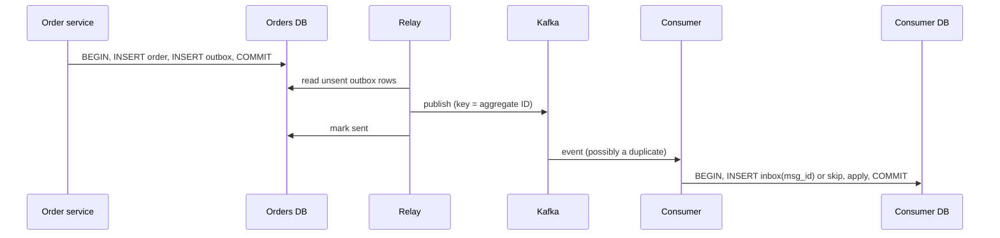

## Simple definition

The **transactional outbox** pattern publishes events reliably from a service that owns a database. Instead of writing to the database **and** sending to a broker (two systems that cannot share a transaction), the service writes the business change **and an outbox row** in **one local transaction**. A separate relay later reads the outbox and publishes to the broker. The matching **inbox** pattern lets consumers process each message once, even when it is delivered several times.

## The dual-write problem

```java
@Transactional
public Order place(OrderRequest r) {
    Order order = orders.save(Order.from(r));
    kafka.send("orders", order.id(), new OrderPlaced(order.id()));   // ✖ dual write
    return order;
}
```

| Failure | Result |
|---|---|
| Kafka send succeeds, then the DB transaction rolls back | Consumers act on an order that does not exist |
| DB commits, then the process crashes before sending | The order exists but nobody is told |
| Send after commit (`afterCommit` hook) and the broker is down | Event lost unless you build retry storage — which is an outbox |

## How the outbox works





```sql
CREATE TABLE outbox (
    id             UUID PRIMARY KEY,
    aggregate_type VARCHAR(64)  NOT NULL,     -- e.g. "Order" → topic
    aggregate_id   VARCHAR(64)  NOT NULL,     -- message key → partition, preserves order
    event_type     VARCHAR(128) NOT NULL,
    payload        JSONB        NOT NULL,
    created_at     TIMESTAMPTZ  NOT NULL DEFAULT now(),
    published_at   TIMESTAMPTZ
);
```

## Writing to the outbox in Spring

```java
@Transactional
public Order place(OrderRequest r) {
    Order order = orders.save(Order.from(r));
    outbox.save(OutboxEvent.of("Order", order.id(), "OrderPlaced", new OrderPlaced(order.id(), order.total())));
    return order;                                   // both rows commit or neither does
}
```

## Two ways to relay

| | Polling publisher | Transaction-log tailing (CDC) |
|---|---|---|
| How | A scheduled job selects unsent rows, publishes, marks them sent | Debezium reads the database's WAL/binlog and publishes inserted outbox rows |
| Latency | Polling interval (100 ms–seconds) | Near real time |
| Load on DB | Queries on every poll | Reads the log, no queries |
| Ordering | `ORDER BY created_at`, single active poller (lock / `SKIP LOCKED`) | Commit order from the log |
| Operations | Just application code | Kafka Connect + Debezium to run |
| Cleanup | Delete sent rows | Delete rows immediately after insert (the log already captured them) |

A polling relay in Spring:

```java
@Scheduled(fixedDelay = 200)
@Transactional
public void relay() {
    List<OutboxEvent> batch = outbox.lockNextBatch(100);   // SELECT ... FOR UPDATE SKIP LOCKED
    for (OutboxEvent e : batch) {
        kafka.send(e.topic(), e.aggregateId(), e.payload()).join();
        e.markPublished();
    }
}
```

Debezium's **outbox event router** turns rows of the outbox table into messages on per-aggregate topics, using `aggregate_id` as the key. See [Stream Processing: change data capture](/data-systems/stream-processing).

## Guarantees and their limits

- **At least once:** if the relay crashes after publishing but before marking a row sent, the event is published again. Consumers must deduplicate.
- **Ordering per aggregate:** use the aggregate ID as the message key so all events of one order go to one partition, in commit order. A single relay instance (or partitioned relays) avoids reordering.
- **Payload versioning:** outbox events are a public contract; evolve them compatibly ([Encoding and Schema Evolution](/data-systems/encoding-and-schema-evolution)).

## The idempotent inbox

Consumers record each processed message ID in the same transaction as the side effect:

```java
@Transactional
@KafkaListener(topics = "orders")
public void on(OrderPlaced e, @Header(KafkaHeaders.RECEIVED_KEY) String key,
               @Header("eventId") String eventId) {
    if (inbox.existsById(eventId)) return;          // duplicate: already applied
    inbox.save(new InboxEntry(eventId));            // unique constraint guards concurrent duplicates
    invoices.createFor(e.orderId(), e.total());
}
```

If the consumer crashes after committing but before committing the Kafka offset, the redelivered message finds its ID in the inbox and is skipped. Expire inbox entries after a period longer than any possible redelivery.

## Alternatives

- **Event sourcing:** the event store is the database, so there is nothing to dual-write ([CQRS and Event Sourcing](/microservices/data-consistency/cqrs-and-event-sourcing)).
- **Listen to yourself:** publish only to Kafka, and have the service update its own database by consuming the event; the database becomes eventually consistent with the log.
- **Kafka transactions:** exactly-once within Kafka (consume-transform-produce), but they do not cover an external database.

## Common mistakes

> [!MISTAKE] Publishing inside the transaction "to be safe"
> A Kafka send inside `@Transactional` is not part of the database transaction; it can succeed even if the transaction later rolls back. Use the outbox.

- **Several pollers without locking**, publishing the same rows twice and out of order.
- **Never cleaning the outbox**, letting it grow to millions of rows and slowing polls.
- **Consumers without deduplication.**
- **Using random keys**, losing per-aggregate ordering.

## Quick check

**What is the dual-write problem?**
Writing to two systems (database and broker) without a shared transaction, so one can succeed while the other fails.

**How does the outbox solve it?**
The event is written as a row in the same local transaction as the business data; a relay publishes it afterwards.

**What delivery guarantee does an outbox relay provide?**
At least once; consumers must be idempotent.

**Polling or CDC?**
Polling is simpler to run; CDC has lower latency and no query load but needs Debezium and Kafka Connect.

**What does the inbox store?**
Processed message IDs, written in the same transaction as the consumer's side effect.

## Summary

- Never dual-write to a database and a broker.
- Write events to an outbox table in the business transaction; relay them by polling or CDC.
- Key messages by aggregate ID for ordering; expect duplicates.
- Consumers use an inbox (or natural idempotence) to apply each message once.

## Related topics

- [Saga Pattern](/microservices/data-consistency/saga-pattern)
- [Message Queues and Delivery Semantics](/system-design/building-blocks/message-queues-and-delivery-semantics)
- [Event-Driven Microservices with Spring Cloud Stream](/microservices/communication/event-driven-spring-cloud-stream)
- [Stream Processing](/data-systems/stream-processing)

## References

- Chris Richardson. [microservices.io: Transactional outbox](https://microservices.io/patterns/data/transactional-outbox.html) and *Microservices Patterns*, Chapter 3.
- Debezium. [Outbox Event Router](https://debezium.io/documentation/reference/stable/transformations/outbox-event-router.html).
- Gunnar Morling. "Reliable Microservices Data Exchange With the Outbox Pattern." Debezium blog, 2019.
