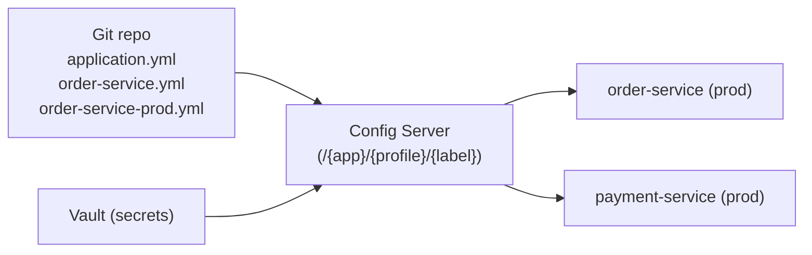

## Simple definition

**Centralized configuration** stores the configuration of many services in **one versioned, audited place** and serves it to them at startup (and optionally at runtime). **Spring Cloud Config** provides a **Config Server** (an HTTP API in front of Git, Vault or other backends) and a client that plugs into Spring Boot's [externalized configuration](/spring/boot/externalized-configuration).

## The problem

With 50 services × 4 environments, configuration copied into each repository or image drifts. Changing a shared timeout means 50 pull requests. Nobody can answer "what was the production configuration last Tuesday?". Secrets end up in many places.

## How Spring Cloud Config works



**Server:**

```java
@SpringBootApplication
@EnableConfigServer
class ConfigServerApp { }
```

```yaml
spring:
  cloud:
    config:
      server:
        git:
          uri: https://git.example.com/platform/config-repo
          default-label: main
          search-paths: '{application}'
```

**Repository layout** (merged from most to least specific):

```text
application.yml              # shared by all services
application-prod.yml         # shared, prod profile
order-service.yml            # one service
order-service-prod.yml       # one service, prod
```

**Client** (Spring Boot 2.4+ style):

```yaml
spring:
  application:
    name: order-service
  config:
    import: "optional:configserver:http://config-server:8888"
  cloud:
    config:
      fail-fast: true            # don't start with missing configuration (with retry)
      retry:
        max-attempts: 6
```

**Backends:** Git (the most common), Vault, JDBC, Redis, AWS S3, Parameter Store and Secrets Manager, CredHub, or a composite of several.

## Secrets

- Prefer a **secrets manager** (Vault, cloud secret managers) or Kubernetes Secrets over values in Git.
- If secrets must live in the config repo, Config Server supports **encrypted values** (`{cipher}…`) with a symmetric or asymmetric key and decrypts them when serving. Protect the `/encrypt` and `/decrypt` endpoints, and the server itself.
- **Secure the Config Server** (mTLS or OAuth2 between clients and server), because it serves the whole estate's configuration.

## Refreshing at runtime

| Mechanism | How | Caveats |
|---|---|---|
| Restart / rolling deploy | New pods read the new configuration | **Simplest and safest** |
| `@RefreshScope` + `POST /actuator/refresh` | Rebinds `@ConfigurationProperties`, recreates refresh-scoped beans | Per instance; mixed states during refresh |
| **Spring Cloud Bus** (Kafka or RabbitMQ) | `/actuator/busrefresh` broadcasts a refresh to all instances | More moving parts |
| Git webhook → `/monitor` | Config Server notifies the Bus on push | Keep it patched: recent releases fixed webhook validation issues |

Keep refreshable configuration to **operational knobs** (timeouts, limits). Use a **feature-flag platform** (OpenFeature with Unleash, flagd or LaunchDarkly) for toggles that change often.

## High availability

- Run several Config Server instances behind a load balancer. They are stateless; Git is the source of truth.
- Clients should use `fail-fast` with retry, or deliberately start with local defaults (`optional:`). Decide which.
- Cache configuration at startup, so a Config Server outage does not affect running services.

## Alternatives

| Option | When |
|---|---|
| **Kubernetes ConfigMaps and Secrets** (+ GitOps via Argo CD or Flux) | **Kubernetes-native platforms**: configuration lives in Git and is applied by GitOps, mounted as a config tree |
| Spring Cloud Kubernetes Config | Reload on ConfigMap changes, Spring-style |
| Consul KV | Consul-based estates |
| Cloud services (AWS AppConfig and Parameter Store, Azure App Configuration, GCP) | Managed, with built-in rollout and validation |
| Spring Cloud Config | Multi-platform estates, Spring-heavy, Git-centric |

## Common mistakes

> [!MISTAKE] Plain-text secrets in the config repo
> Git history keeps them forever. Use Vault or a secret manager, or at least `{cipher}` values.

> [!MISTAKE] Refreshing everything at runtime
> Half-refreshed connection pools and clients cause subtle bugs. Prefer restarts; refresh only simple knobs.

> [!MISTAKE] Config Server as a single point of failure
> Run it highly available, and make clients resilient (retry, caching, explicit fail-fast policy).

## Quick check

**What does Spring Cloud Config Server do?**
It serves configuration for applications and profiles from backends such as Git and Vault over HTTP, merged from shared to service-specific files.

**How does a client load configuration in modern Spring Boot?**
With `spring.config.import=configserver:http://…` plus `spring.application.name` and the active profiles.

**How can configuration change without a restart?**
`@RefreshScope` beans plus `/actuator/refresh`, or a broadcast through Spring Cloud Bus.

**What is the Kubernetes-native alternative?**
ConfigMaps and Secrets managed through GitOps, mounted as config trees (optionally with Spring Cloud Kubernetes).

**How are secrets handled?**
Ideally in Vault or a cloud secret manager. Otherwise as `{cipher}` encrypted values decrypted by Config Server.

## Summary

- Centralise configuration in Git (versioned, reviewed, audited) and serve it through Config Server.
- Layer it: shared → service → profile. Clients import via `configserver:`.
- Keep secrets in a secret manager; prefer restarts over runtime refresh.
- On Kubernetes, ConfigMaps + GitOps are often enough.

## References

- Spring Cloud Config, [reference documentation](https://docs.spring.io/spring-cloud-config/reference/).
- Spring Cloud Bus, [reference](https://docs.spring.io/spring-cloud-bus/reference/).
- [OpenFeature](https://openfeature.dev/).
