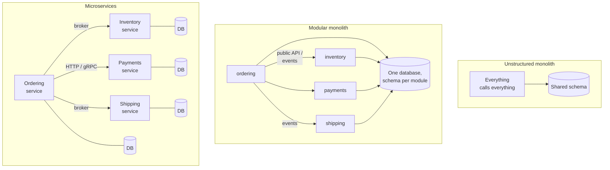

## Simple definition

| Style | Deployment units | Internal boundaries | Data |
|---|---|---|---|
| **Monolith** (unstructured) | One | Weak or none | One shared schema, accessed from anywhere |
| **Modular monolith** | One | Strong, enforced module boundaries aligned with business capabilities | One database, but each module owns its tables |
| **Microservices** | Many, independently deployable | Enforced by the network | Each service owns its database |

A **modular monolith** is a single deployable application divided internally into modules with explicit interfaces and private internals. **Microservices** take the same idea further: each module becomes a separately deployed process, owned by one team, with its own data store.

The key insight is that **modularity and distribution are separate decisions**. You can have good boundaries without a network between them.

## The problem

Teams usually reach this question because their monolith hurts:

- A change in one area breaks something unrelated.
- Builds and test runs take too long.
- Teams block each other on releases.
- One hot feature cannot be scaled without scaling everything.

Microservices are often proposed as the cure. But most of these symptoms come from **missing boundaries**, not from running in one process. Distributing a system without boundaries produces a **distributed monolith** — all the old coupling, plus network failures, eventual consistency and operational overhead.

## Why it matters

The choice is expensive to reverse. Moving from a monolith to microservices takes months or years; merging services back is rarer, but just as painful. The choice also determines team structure, the delivery pipeline, the operational platform and how data consistency is handled.

## Core concept



### What microservices buy

- **Independent deployment.** A team releases its service without coordinating with others.
- **Independent scaling.** The search service can run 40 instances while account management runs 2.
- **Fault isolation**, if designed for it: a failing recommendations service need not take checkout down.
- **Technology freedom** per service, which is often more of a cost than a benefit.
- **Team autonomy** at organisational scale — many teams can work in parallel with less coordination.

### What microservices cost

- **Distributed-systems failure modes**: partial failures, timeouts, retries, duplicate messages.
- **No local transactions across services.** Consistency needs sagas, the transactional outbox and idempotent consumers.
- **Operational overhead**: many pipelines, service discovery, centralised logging, distributed tracing, per-service on-call.
- **Harder testing**: contract tests, environment management, end-to-end flakiness.
- **Latency**: every network hop adds milliseconds and a failure point.
- **Harder refactoring across boundaries**: moving a responsibility between services means changing APIs, data ownership and deployments.

> [!KEY] Microservices are an organisational scaling tool
> Their main benefit — independent deployment by autonomous teams — matters when there are *many teams*. With one or two teams, the costs usually outweigh the benefits.

## How to decide

Score your situation honestly against these questions:

| Question | Points towards modular monolith | Points towards microservices |
|---|---|---|
| How many teams work on the system? | One to a few | Many, needing independent release cycles |
| How stable are domain boundaries? | Still being discovered | Well understood and stable |
| Do parts have very different scaling or availability needs? | Broadly similar | Significantly different, such as 100× load on one capability |
| Can you operate a distributed system? | No platform team; limited observability | Mature CI/CD, observability, on-call, container platform |
| Do you need strong consistency across capabilities? | Often | Rarely; eventual consistency is acceptable |
| Do parts need different technologies or isolation for compliance? | No | Yes (for example, PCI scope for payment data) |

> [!TRADEOFF] The "monolith first" argument
> Martin Fowler observed that most successful microservice systems started as monoliths that were split later, while many systems built as microservices from scratch ran into serious trouble. Early on, boundaries are uncertain, and moving a boundary inside a monolith is a refactoring rather than a migration.

## Practical example

The retailer from the [DDD articles](/domain-driven-design/fundamentals) has four bounded contexts — ordering, inventory, payments and shipping — and two teams of five.

**Decision:** a modular monolith with four modules. The payment provider is integrated through an outbound port and adapter. Recorded in an ADR with the triggers for revisiting:

- A third team is formed and takes over a context.
- One context's load or release cadence diverges sharply from the rest.
- Compliance requires isolating payment data.

### Keeping a monolith modular

Modules need enforced boundaries, or they decay:

```text
com.example.shop
├── ordering/              ← module
│   ├── OrderingApi.java   (public: the only type other modules may call)
│   ├── events/            (public: OrderPlaced, OrderPaid)
│   └── internal/          (private: domain, persistence, services)
├── inventory/
├── payments/
└── shipping/
```

Rules:

1. **Modules call each other only through public APIs or events** — never through another module's internal classes.
2. **Each module owns its tables.** No module reads or joins another module's tables; it asks through the API or keeps its own copy from events.
3. **Boundaries are checked by tests.** ArchUnit rules, or Spring Modulith's `ApplicationModules.of(Application.class).verify()`, fail the build on violations.
4. **Cross-module workflows use events** where eventual consistency is acceptable, which also prepares for later extraction.

> [!VERSION] Spring Modulith
> Spring Modulith is a Spring project for building modular monoliths with Spring Boot. It verifies module structure, publishes events between modules with a persistent event registry (a transactional-outbox-like mechanism), and generates module documentation. Check the [Spring Modulith reference](https://docs.spring.io/spring-modulith/reference/) for the release compatible with your Spring Boot version.

### Extracting a service later

When a trigger fires, extract one module using the **Strangler Fig** approach:

1. Ensure the module is already isolated: public API only, own tables, communication through events.
2. Deploy the module as a separate service behind the same API.
3. Route calls to the new service; keep the old in-process path as a fallback during migration.
4. Migrate its data to a separate database.
5. Remove the in-process module.

A well-modularised monolith makes step 1 — usually the hardest — already done.

## Real-world applications

- **Start-ups and new products**: a modular monolith keeps the team fast while the domain is discovered.
- **Large organisations with dozens of teams**: microservices let teams release independently.
- **Hybrid**: a modular monolith core plus a few extracted services for parts with special needs — a high-throughput search service, or a PCI-scoped payments service.

Several well-known companies have published accounts of consolidating services back into larger units when the distribution cost exceeded its value, and others of splitting monoliths when team scale demanded it. Both directions are legitimate responses to changing forces.

## Advantages and disadvantages

| | Modular monolith | Microservices |
|---|---|---|
| Deployment | One pipeline, one artefact | Many pipelines; independent releases |
| Consistency | Local ACID transactions available | Eventual consistency; sagas and outboxes |
| Performance | In-process calls | Network calls, serialisation |
| Scaling | Whole application scales together | Per-service scaling |
| Fault isolation | A memory leak affects everything | Failures can be contained (with effort) |
| Team autonomy | Shared release train | High, if boundaries are right |
| Operational cost | Low | High: observability, discovery, platform |
| Refactoring boundaries | Cheap: an IDE refactoring | Expensive: API and data migrations |

## Common mistakes

> [!MISTAKE] The distributed monolith
> Services that must be deployed together, share a database, or call each other synchronously in long chains have the costs of both styles and the benefits of neither. Common causes are boundaries along technical layers and a shared "common" entity library.

- **Splitting by technical layer** ("UI service", "database service") instead of by business capability.
- **Splitting too fine.** One service per entity produces chatty communication and distributed transactions for ordinary use cases.
- **Sharing databases between services.** This couples deployments and schemas, defeating independence.
- **Long synchronous call chains.** If service A calls B calls C calls D, availability multiplies: four services at 99.9% each give about 99.6% for the chain.
- **Ignoring the platform cost.** Microservices without centralised logging, tracing and automated deployment are very hard to operate.
- **A monolith without modules.** Choosing a monolith is not permission to skip boundaries.

## Interview questions and answers

**What is a modular monolith?**
A single deployable application divided into business-aligned modules with explicit public interfaces, private internals and module-owned data. It gives most of the design benefits of microservices without the costs of distribution.

**When would you choose microservices over a modular monolith?**
When many teams need to release independently, domain boundaries are stable, parts have very different scaling or isolation needs, and the organisation can operate a distributed system.

**What is a distributed monolith?**
A system deployed as multiple services that remain tightly coupled — through shared databases, synchronous call chains or lockstep deployments. It has the costs of distribution without the benefits of independence.

**How do you migrate from a monolith to microservices?**
Incrementally. First modularise inside the monolith, then extract one module at a time using the Strangler Fig pattern: route traffic to the new service, migrate its data, then remove the old code.

**How do you keep a monolith modular over time?**
Expose one public API per module, keep internals package-private, give each module its own tables, use events for cross-module workflows, and enforce the rules with architecture tests such as ArchUnit or Spring Modulith.

> [!INTERVIEW] Ask about the organisation
> A strong answer to "should we use microservices?" begins with questions: How many teams? How stable are the boundaries? What can the platform team operate? This shows that you treat architecture as a trade-off, not a fashion.

## Summary

- Modularity and distribution are separate decisions; get modularity first.
- A modular monolith offers strong boundaries, local transactions and simple operations.
- Microservices buy independent deployment and scaling at the price of distributed-systems complexity.
- Decide using team count, boundary stability, scaling differences and operational maturity.
- Enforce module boundaries so that extracting a service later is a small step.

## Related topics

- [What Is a Bounded Context?](/domain-driven-design/strategic/bounded-context)
- [Designing an Order Management System](/system-design/case-studies/order-management-system)
- [Introduction to Software Architecture](/software-architecture/introduction)
- [Layered versus Hexagonal Architecture](/hexagonal-architecture/layered-vs-hexagonal)

## References

- Martin Fowler. "[MonolithFirst](https://martinfowler.com/bliki/MonolithFirst.html)", 2015.
- Martin Fowler and James Lewis. "[Microservices](https://martinfowler.com/articles/microservices.html)", 2014.
- Sam Newman. *Building Microservices*, 2nd edition. O'Reilly, 2021; and *Monolith to Microservices*. O'Reilly, 2019.
- Martin Fowler. "[StranglerFigApplication](https://martinfowler.com/bliki/StranglerFigApplication.html)", 2004.
- [Spring Modulith reference documentation](https://docs.spring.io/spring-modulith/reference/).
