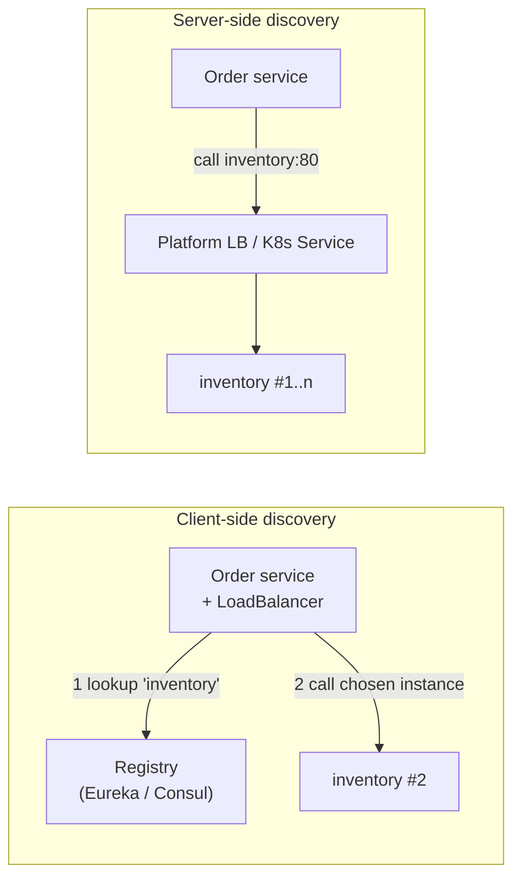

## Simple definition

**Service discovery** lets a service find the **current network locations** of the instances of another service, by **logical name** (`inventory-service`) instead of hard-coded hosts. A **service registry** keeps track of which instances are alive.

## The problem

In cloud and container environments, instances scale up and down, move, and change IP addresses all the time. Hard-coded URLs break. A static load-balancer configuration per service does not keep up.

## Patterns



| | Client-side | Server-side |
|---|---|---|
| Who picks the instance | The calling service's library | The platform (load balancer, Kubernetes `Service`, service mesh) |
| Examples | Eureka + Spring Cloud LoadBalancer, Consul | Kubernetes DNS and kube-proxy, AWS ALB, Istio and Linkerd |
| Pros | Smart, per-call balancing, no extra hop | Language-agnostic, no client library |
| Cons | A library in every service, per language | The platform must provide it |

**Registration:** instances register themselves (self-registration: Eureka client, Consul agent), or a third party registers them (the Kubernetes control plane through EndpointSlices). **Health:** heartbeats and health checks remove dead instances.

## Spring Cloud Netflix Eureka

```java
@SpringBootApplication
@EnableEurekaServer                       // the registry server
public class DiscoveryServer { ... }
```

```yaml
# Each client service (spring-cloud-starter-netflix-eureka-client)
spring:
  application:
    name: order-service                   # the logical name others use
eureka:
  client:
    service-url:
      defaultZone: http://eureka-1:8761/eureka/,http://eureka-2:8761/eureka/
  instance:
    prefer-ip-address: true
```

- Clients **register**, send **heartbeats** (every 30 s by default) and **cache** the registry locally, so calls keep working if Eureka is briefly down.
- **Self-preservation:** if many heartbeats are lost at once (likely a network problem), Eureka **stops evicting** instances rather than wiping the registry. That favours **availability** (AP) and means callers need retries and timeouts.
- Run **at least two** Eureka servers that replicate as peers.

## Calling by name

```java
@Bean
@LoadBalanced                               // Spring Cloud LoadBalancer resolves "inventory-service"
RestClient.Builder loadBalancedRestClientBuilder() { return RestClient.builder(); }

Stock stock = restClientBuilder.build()
        .get().uri("http://inventory-service/api/stock/{sku}", sku)
        .retrieve().body(Stock.class);
```

**Spring Cloud LoadBalancer** replaced Netflix Ribbon. It supports round-robin (the default), random, zone preference, health checks and caching, and works with any `DiscoveryClient` (Eureka, Consul, Kubernetes, simple static lists).

## Consul

**HashiCorp Consul** provides a registry with **active health checks**, a **key-value store** (also usable for configuration), multi-datacenter support and a service mesh (Consul Connect). Use it through `spring-cloud-starter-consul-discovery` and `-config`. It suits mixed estates (VMs + containers, several languages).

## Kubernetes: discovery is built in

On Kubernetes, a **`Service`** gives every set of pods a stable **DNS name** (`inventory.shop.svc.cluster.local`) and load-balances across ready pods. Readiness probes ([Actuator](/spring/boot/actuator-and-custom-endpoints)) remove unhealthy pods automatically.

```yaml
# Just call http://inventory:8080 — no registry needed
```

- **Spring Cloud Kubernetes** adds a `DiscoveryClient` that reads Kubernetes Endpoints, plus ConfigMap and Secret-based configuration, if you want Spring Cloud abstractions on Kubernetes.
- A **service mesh** (Istio, Linkerd) adds mTLS, retries, traffic splitting and telemetry at the platform level.

## Choosing in 2026

| Environment | Recommendation |
|---|---|
| **Kubernetes** | **Kubernetes Services + DNS** (plus a mesh if needed). Eureka adds little. |
| VMs or mixed, multi-language | Consul |
| Existing Spring Cloud estate on VMs | Eureka + Spring Cloud LoadBalancer (still supported in Spring Cloud 2025.1) |
| Managed cloud | Cloud-native discovery (AWS Cloud Map, ECS Service Connect, Azure Container Apps) |

## Common mistakes

> [!MISTAKE] Running Eureka on Kubernetes "because microservices"
> Two discovery systems disagree and add failure modes. Use Kubernetes Services unless you have a reason.

> [!MISTAKE] No timeouts or retries on discovered calls
> Registries are eventually consistent: instances may be gone. Use timeouts, retries and circuit breakers. See [resilience](/microservices/reliability/circuit-breakers-and-resilience4j).

> [!MISTAKE] A single registry instance
> The registry becomes a single point of failure. Run it highly available, and rely on client caching.

## Quick check

**Client-side vs server-side discovery?**
Client-side: the caller queries a registry and chooses an instance itself. Server-side: the caller hits a stable address, and the platform or load balancer routes to an instance.

**What is Eureka's self-preservation mode?**
When many heartbeats are missing at once, Eureka stops evicting instances, assuming a network issue, and favours availability over accuracy.

**What does `@LoadBalanced` do?**
It makes a RestClient, RestTemplate or WebClient builder resolve logical service names through Spring Cloud LoadBalancer and a DiscoveryClient.

**How does discovery work on Kubernetes?**
Services provide stable DNS names and load-balance to ready pods, with endpoints maintained by the control plane.

**What replaced Netflix Ribbon?**
Spring Cloud LoadBalancer.

## Summary

- Discovery maps logical names to live instances, through a client-side registry or platform routing.
- Eureka (AP, self-preservation, client caches) and Consul (health checks, KV, multi-DC) remain options.
- On Kubernetes, prefer built-in Services and DNS; always add timeouts, retries and circuit breakers.

## References

- Spring Cloud Netflix, [Eureka reference](https://docs.spring.io/spring-cloud-netflix/reference/).
- Spring Cloud Commons, [Spring Cloud LoadBalancer](https://docs.spring.io/spring-cloud-commons/reference/spring-cloud-commons/loadbalancer.html).
- Spring Cloud Consul and Spring Cloud Kubernetes reference documentation.
- Chris Richardson, [Service discovery patterns](https://microservices.io/patterns/client-side-discovery.html).
