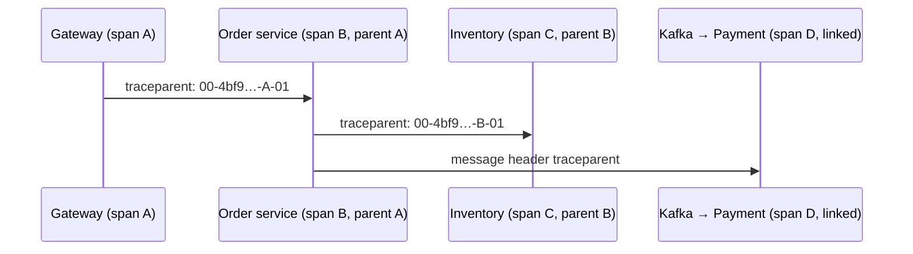

## Simple definition

**Observability** is the ability to understand what a system is doing from its outputs:

- **metrics**: numbers over time
- **traces**: the path of one request across services
- **logs**: discrete events with context.

In Spring Boot, **Micrometer** instruments the code once (the **Observation API**). **OpenTelemetry (OTel)** is the vendor-neutral standard for exporting telemetry over **OTLP** to any backend.

## The problem

A checkout takes 6 seconds. Which of the 9 services involved is slow, and why? Without correlated traces, metrics and logs, teams guess, grep logs on many machines and blame each other. With them, you open one trace and see the slow span, its logs and the error.

## The three signals

| Signal | Answers | Example | Backend examples |
|---|---|---|---|
| **Metrics** | *Is something wrong? How much?* | `http.server.requests` p99 latency, error rate, JVM memory, Kafka lag | Prometheus, Mimir, Datadog |
| **Traces** | *Where in the call path?* | Gateway → orders (120 ms) → inventory (4.8 s) → DB query | Tempo, Jaeger, Zipkin, X-Ray |
| **Logs** | *What exactly happened?* | `Payment declined code=51 traceId=4bf9…` | Loki, Elasticsearch, OpenSearch |

The **trace ID** ties them together: logs carry it, and metrics link to traces through **exemplars**.

## The pipeline



## Micrometer and the Observation API

```java
@Service
class CheckoutService {
    private final ObservationRegistry registry;
    private final MeterRegistry meters;

    OrderDto checkout(Cart cart) {
        return Observation.createNotStarted("shop.checkout", registry)      // → a timer metric AND a span
                .lowCardinalityKeyValue("channel", cart.channel())           // OK as a metric tag
                .highCardinalityKeyValue("cart.id", cart.id())               // span attribute only
                .observe(() -> doCheckout(cart));
    }

    void recordRefund(Money amount) {
        meters.counter("shop.refunds", "currency", amount.currency().getCurrencyCode()).increment();
    }
}

@Observed(name = "shop.pricing")      // annotation alternative (needs the aspect)
public Price price(String sku) { ... }
```

Spring auto-instruments **HTTP server and client** (`RestClient`, `WebClient`, `RestTemplate`), **JDBC** (with datasource-micrometer), **Kafka and RabbitMQ**, `@Scheduled`, caches, executors and the JVM.

## Distributed tracing concepts



- A **trace** is one end-to-end request (a trace ID). **Spans** are timed operations (span ID, parent, attributes, events, status).
- **Context propagation:** the **W3C Trace Context** `traceparent` header (and `baggage`) across HTTP and messaging. Micrometer and OTel handle this automatically for instrumented clients.
- **Sampling:** **head sampling** (decide at the start, for example 10%) is cheap. **Tail sampling** in the OTel Collector keeps all errors and slow traces. That is the best for cost versus value.

## Spring Boot setup

> [!VERSION] Spring Boot 4: an OpenTelemetry starter
> Spring Boot 4 adds **`spring-boot-starter-opentelemetry`**, which configures the OpenTelemetry SDK, the Micrometer tracing bridge and **OTLP export** for traces, metrics (and logs) in one dependency. Spring Boot 4.1 adds `management.opentelemetry.tracing.sampler` and more OTel options. The alternative is the **OpenTelemetry Java agent** (zero-code instrumentation) or the OTel Spring Boot starter from the OpenTelemetry project.

```yaml
management:
  tracing:
    sampling:
      probability: 0.1                     # head sampling; keep errors via tail sampling in the collector
  otlp:
    tracing:
      endpoint: http://otel-collector:4318/v1/traces
    metrics:
      export:
        url: http://otel-collector:4318/v1/metrics
  metrics:
    distribution:
      percentiles-histogram:
        http.server.requests: true         # enables accurate p95 and p99 in the backend
logging:
  pattern:
    correlation: "[${spring.application.name:},%X{traceId:-},%X{spanId:-}] "
  structured:
    format:
      console: ecs                         # structured JSON logs (Boot 3.4+): ecs, logstash or gelf
```

- **Log correlation:** trace and span IDs are put in the MDC and printed in every log line. Structured (JSON) logs make them searchable.
- **The OpenTelemetry Collector** receives OTLP, batches, filters PII, applies tail sampling, and routes to Prometheus, Tempo or Loki or to a vendor. Apps stay vendor-neutral.

## What to measure

- **RED** for services: **R**ate, **E**rrors, **D**uration, per endpoint and dependency.
- **USE** for resources: **U**tilisation, **S**aturation, **E**rrors (pools, CPU, queues, Kafka lag).
- **Business metrics:** orders per minute, payment approval rate.
- **SLOs and error budgets:** alert on **burn rate**, not on every spike.

## Cardinality: the silent cost

Every unique combination of metric tags is a separate time series. **Never tag metrics with user IDs, order IDs, URLs with IDs or exception messages.** Put those on spans or logs (high-cardinality key values). Spring uses URI **templates** (`/orders/{id}`) for HTTP metrics for this reason.

## Common mistakes

> [!MISTAKE] High-cardinality metric tags
> A tag per user creates millions of series and costs explode. Use low-cardinality tags for metrics, and put details in traces.

> [!MISTAKE] Broken propagation across async boundaries
> Custom executors and messaging without instrumentation lose the trace. Use instrumented clients and `ContextPropagatingTaskDecorator`, and propagate headers on messages.

> [!MISTAKE] Logs without trace IDs
> Logs cannot be joined to traces. Enable correlation patterns or structured logging.

## Quick check

**What are the three observability signals?**
Metrics (aggregated numbers), traces (the request path across services) and logs (detailed events), connected by trace IDs.

**What does the Micrometer Observation API give you?**
One instrumentation point that produces both a metric (timer) and a trace span, plus a context for log correlation.

**What is `traceparent`?**
The W3C Trace Context header that carries the trace ID, parent span ID and sampling flag between services.

**Head vs tail sampling?**
Head sampling decides at the start of a trace (cheap, but blind). Tail sampling decides after seeing the whole trace, so it can keep errors and slow traces. It is done in the collector.

**Why avoid user IDs as metric tags?**
They create unbounded cardinality: a time series per user, which overwhelms metric stores. Use span attributes or logs instead.

## Summary

- Instrument once with Micrometer Observations; export with OpenTelemetry (OTLP) through a collector.
- Traces, metrics and logs are correlated by trace ID; propagate context across HTTP and messaging.
- Measure RED, USE and business signals; alert on SLO burn; watch cardinality.

## References

- Spring Boot reference, [Observability](https://docs.spring.io/spring-boot/reference/actuator/observability.html) and [Tracing](https://docs.spring.io/spring-boot/reference/actuator/tracing.html).
- [Micrometer Observation documentation](https://docs.micrometer.io/micrometer/reference/observation.html).
- [OpenTelemetry documentation](https://opentelemetry.io/docs/) and [W3C Trace Context](https://www.w3.org/TR/trace-context/).
- Google SRE Workbook, [Alerting on SLOs](https://sre.google/workbook/alerting-on-slos/).
