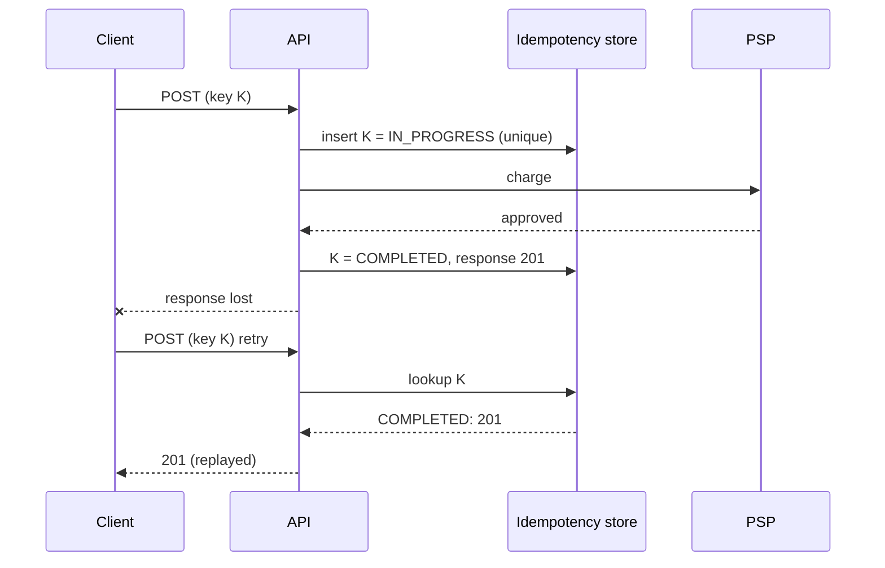

## Simple definition

An operation is **idempotent** if performing it several times has the same effect as performing it once. Idempotency is what makes **retries safe**: and in distributed systems retries are unavoidable, because a timeout never tells you whether the operation happened.

## Why it matters

A mobile app sends "pay 50 EUR". The server charges the card, but the response is lost on a flaky network. The app retries. Without idempotency, the customer pays twice. The same happens with message brokers (at-least-once delivery), load balancers retrying, users double-clicking, and saga steps being replayed.

## HTTP methods

| Method | Idempotent by spec | Notes |
|---|---|---|
| GET, HEAD, OPTIONS | Yes (and safe) | No side effects |
| PUT | Yes | "Set resource to this state" |
| DELETE | Yes | Deleting twice leaves it deleted (second call may return 404) |
| POST | **No** | Creates or triggers something each time |
| PATCH | Not necessarily | `{"op":"increment"}` is not idempotent; `{"status":"SHIPPED"}` is |

The spec describes the *intended* semantics; your implementation must actually honour them.

## Idempotency keys for POST

The client generates a unique key (usually a UUID) **per logical operation** and sends it with every attempt:

```http
POST /v1/payments
Idempotency-Key: 9f1c2a5e-0b7d-4c8e-9a37-3f1d0e6b2c11
Content-Type: application/json

{ "orderId": "o-981", "amount": "50.00", "currency": "EUR" }
```





Server rules:

1. **Insert the key first** with status `IN_PROGRESS`, protected by a **unique constraint**, so two concurrent attempts cannot both proceed. The loser gets `409 Conflict` (or waits).
2. Store a **fingerprint** of the request (hash of method, path and body). Same key with a different body → `422 Unprocessable Entity`: it is a client bug.
3. After processing, store the **response** (status and body) with the key; replay it for later attempts.
4. If processing fails with a retriable error, delete the key or mark it so a retry can run again; for non-retriable errors, store the error response.
5. **Expire** keys after a window (Stripe keeps them 24 hours).
6. Pass an idempotency key **downstream** (to the PSP), so the whole chain is idempotent.

## A Spring Boot sketch

```java
@Entity
@Table(name = "idempotency_keys")
class IdempotencyRecord {
    @Id String key;
    String requestHash;
    @Enumerated(EnumType.STRING) Status status;      // IN_PROGRESS, COMPLETED
    Integer responseStatus;
    @Column(columnDefinition = "text") String responseBody;
    Instant createdAt;
}

@Service
class IdempotentExecutor {
    private final IdempotencyRepository repo;
    private final TransactionTemplate tx;

    ResponseEntity<String> execute(String key, String requestHash, Supplier<ResponseEntity<String>> action) {
        try {
            tx.executeWithoutResult(s -> repo.saveAndFlush(IdempotencyRecord.inProgress(key, requestHash)));
        } catch (DataIntegrityViolationException duplicate) {           // key already exists
            IdempotencyRecord r = repo.findById(key).orElseThrow();
            if (!r.requestHash.equals(requestHash)) return ResponseEntity.unprocessableEntity().build();
            if (r.status == Status.IN_PROGRESS) return ResponseEntity.status(409).build();
            return ResponseEntity.status(r.responseStatus).body(r.responseBody);   // replay
        }
        ResponseEntity<String> response = action.get();
        tx.executeWithoutResult(s -> repo.findById(key).orElseThrow().complete(response));
        return response;
    }
}
```

When the business change and the response record live in the **same database**, write them in the same transaction for the strongest guarantee.

## Idempotent message consumers

Brokers deliver at least once. Options, simplest first:

| Technique | Example |
|---|---|
| **Natural idempotence** | `UPDATE orders SET status = 'SHIPPED' WHERE id = ?` — applying twice changes nothing |
| **Unique constraint** | `INSERT INTO invoices (order_id, ...)` with a unique `order_id`; the duplicate fails harmlessly |
| **Conditional write / version check** | `UPDATE account SET balance = ?, version = 8 WHERE id = ? AND version = 7` |
| **Inbox / processed-messages table** | Store the message ID in the same transaction as the effect; skip known IDs |

See [Transactional Outbox and Inbox](/microservices/data-consistency/transactional-outbox).

## Designing operations to be idempotent

- Prefer **absolute** over **relative** changes: "set quantity to 3" rather than "add 1".
- Use **client-generated IDs** for creation (`PUT /orders/{clientGeneratedId}`), making creation idempotent.
- Make state transitions conditional on the current state ([State pattern](/design-patterns/behavioral/state)): "ship if PAID".
- For side effects you cannot make idempotent (sending an email), record that they happened before or atomically with doing them.

## Retries and idempotency together

[Retry policies](/microservices/reliability/circuit-breakers-and-resilience4j) should apply only to idempotent operations, with backoff and jitter. Exactly-once processing = **at-least-once delivery (retries) + idempotency**; see [Message Queues and Delivery Semantics](/system-design/building-blocks/message-queues-and-delivery-semantics).

## Common mistakes

> [!MISTAKE] Check-then-act without a constraint
> `if (!repo.existsByKey(k)) { process(); repo.save(k); }` lets two concurrent retries both pass the check. Insert first and rely on a unique constraint.

- **Generating a new key on every retry** in the client, which defeats the purpose.
- **Keys scoped globally** instead of per client/account, allowing collisions between tenants.
- **Not storing the response**, so retries return a different result than the original.
- **Retrying non-idempotent calls** in HTTP clients and gateways by default.

## Quick check

**What does idempotent mean?**
Repeating the operation has the same effect as doing it once.

**Is POST idempotent?**
Not by definition; make it idempotent with an idempotency key.

**Why insert the key before processing?**
So a unique constraint stops concurrent duplicates; checking first and inserting later has a race.

**What should happen if the same key arrives with a different body?**
Reject it (422): the client reused a key for a different operation.

**How do message consumers achieve idempotency?**
Natural idempotence, unique constraints, conditional writes, or an inbox of processed message IDs.

## Summary

- Retries are unavoidable; idempotency makes them safe.
- POST + idempotency key: insert key first, fingerprint the request, store and replay the response, expire keys.
- Consumers: natural idempotence, constraints, versions or an inbox.
- Exactly-once effect = at-least-once delivery + idempotency.

## Related topics

- [Circuit Breakers and Resilience4j](/microservices/reliability/circuit-breakers-and-resilience4j)
- [Transactional Outbox and Inbox](/microservices/data-consistency/transactional-outbox)
- [Designing a Payment System](/system-design/case-studies/payment-system)

## References

- Stripe. [Idempotent requests](https://docs.stripe.com/api/idempotent_requests) and Brandur Leach, "Implementing Stripe-like Idempotency Keys in Postgres."
- IETF draft. [The Idempotency-Key HTTP Header Field](https://datatracker.ietf.org/doc/draft-ietf-httpapi-idempotency-key-header/).
- [RFC 9110 §9.2.2: Idempotent Methods](https://www.rfc-editor.org/rfc/rfc9110#section-9.2.2).
- Alex Xu. *ByteByteGo System Design Handbook*: avoid double charge.
