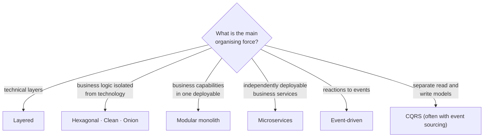

## Simple definition

**Software architecture** is the set of significant decisions about how a system is structured: its main parts, how they relate, how they communicate, and the principles that guide its evolution. "Significant" means *expensive to change later*.

Two well-known one-liners capture different sides of it:

- "Architecture is about the important stuff. Whatever that is." — Ralph Johnson, quoted by Martin Fowler.
- "Architecture represents the significant design decisions that shape a system, where significant is measured by cost of change." — Grady Booch.

## The problem architecture addresses

Every system meets forces that pull in different directions: deliver features quickly, stay fast under load, remain available when parts fail, stay secure, and remain cheap to run and change. A team that never decides how to balance these forces still ends up with an architecture — an accidental one, usually discovered when a change that should take a day takes a month.

Architecture work makes these trade-offs **explicit, deliberate and recorded**.

## Why it matters

- **Cost of change.** Choosing between a single deployable and twenty services, or between a relational database and an event log, shapes every later decision.
- **Quality attributes.** Performance, availability and security emerge from structure. They cannot be added at the end by writing more feature code.
- **Team structure.** Conway's Law observes that systems mirror the communication structure of the organisations that build them. Architecture and team boundaries must be designed together.
- **Communication.** A shared architectural vocabulary and diagrams let new developers, operations and the business reason about the system.

## Core concept

### Architecture versus detailed design

There is no sharp line. A useful test is *scope and reversibility*:

| | Architecture | Detailed design |
|---|---|---|
| Scope | Whole system or several components | One component, class or module |
| Examples | Monolith or services; synchronous or event-driven; which database; where transactions end | Which design pattern; class names; method signatures |
| Cost of reversal | High: affects many teams, data migrations, contracts | Low: a local refactoring |
| Driven by | Quality attributes and constraints | Functional behaviour and code clarity |

[Design patterns](/design-patterns/what-are-design-patterns) live mostly on the detailed-design side. Architecture styles such as [Hexagonal Architecture](/hexagonal-architecture/layered-vs-hexagonal) live on the architecture side.

### Functional requirements and quality attributes

- **Functional requirements** state what the system does: "a customer can place an order".
- **Nonfunctional requirements**, or **quality attributes**, state how well it does it: "95% of order placements complete within 300 ms at 200 requests per second".

Architecture is driven mainly by quality attributes, because almost any structure can deliver the functions.

| Quality attribute | Question it answers | Typical architectural tactics |
|---|---|---|
| Performance | How fast, at what load? | Caching, asynchronous processing, data locality |
| Scalability | How does it grow with load or data? | Statelessness, horizontal scaling, partitioning |
| Availability | How often is it usable? | Redundancy, failover, graceful degradation |
| Modifiability | How cheap is change? | Modularity, low coupling, stable interfaces |
| Testability | How easily can behaviour be verified? | Dependency inversion, ports and adapters |
| Security | Who can do what; how are attacks resisted? | Authentication at the edge, least privilege, encryption |
| Observability | Can we tell what it is doing? | Structured logs, metrics, distributed tracing |
| Deployability | How safely and often can we release? | Independent deployment units, automation, feature flags |

> [!KEY] Make quality attributes measurable
> "The system must be fast" cannot guide a decision. A **quality-attribute scenario** can: *source* (1,000 concurrent users) → *stimulus* (place an order) → *environment* (normal operation) → *response* (order confirmed) → *measure* (p95 latency under 300 ms). The format comes from the Software Engineering Institute's work on architecture evaluation.

### Coupling and cohesion

Two measures sit behind most structural decisions:

- **Cohesion**: how strongly the parts *inside* a module belong together. High cohesion means a change usually stays inside one module.
- **Coupling**: how much modules depend on each other. Low coupling means a change in one module rarely forces a change in another.

Good architectures group things that change together (high cohesion) and separate things that change for different reasons (low coupling). This is the [Single Responsibility Principle](/design-patterns/solid-principles#s--single-responsibility-principle) applied at a larger scale.

### Architecture styles

An **architecture style** is a named, reusable structure for a whole system, with known strengths and weaknesses. None is universally best.



| Style | Strengths | Limitations | Good fit |
|---|---|---|---|
| **Layered** | Simple, familiar, easy to start | Business logic tends to depend on persistence; layers can become pass-through | CRUD-heavy applications, small teams |
| **Hexagonal / Clean / Onion** | Business rules independent of frameworks; highly testable | More types and mapping code | Long-lived systems with real business rules |
| **Modular monolith** | Clear module boundaries, one deployment, local transactions | Requires discipline to keep modules separate; scales as one unit | Most new products; teams up to a few dozen developers |
| **Microservices** | Independent deployment and scaling, team autonomy | Distributed-systems complexity, eventual consistency, operational cost | Large organisations with many teams and clear domain boundaries |
| **Event-driven** | Loose temporal coupling, extensibility, natural audit trail | Harder to trace and debug, eventual consistency, ordering problems | Integration between contexts, asynchronous workflows |
| **CQRS / event sourcing** | Read models tuned per query; full history of changes | Significant complexity; event schema evolution | Collaborative or audit-critical domains with complex reads |

The dedicated sections go further: [Layered versus Hexagonal Architecture](/hexagonal-architecture/layered-vs-hexagonal), [Microservices versus Modular Monolith](/microservices/fundamentals/microservices-vs-modular-monolith) and [Domain-Driven Design](/domain-driven-design/fundamentals).

### Architecture Decision Records

An **Architecture Decision Record (ADR)** is a short document that captures one significant decision: its context, the options considered, the decision and its consequences. Michael Nygard popularised the format in 2011. ADRs are kept in the repository next to the code and are never edited after acceptance; a new ADR supersedes an old one.

```markdown
# ADR 0007: Use a modular monolith for the first release

Status: Accepted (2026-03-02)

## Context
Six developers, one product, domain boundaries still moving. Peak load
estimated at 50 requests/second. No requirement for independent scaling.

## Decision
Build one deployable Spring Boot application, split into modules
(ordering, inventory, payments) with enforced boundaries and no shared tables.

## Consequences
+ Local transactions, one pipeline, simple operations.
+ Modules can be extracted into services later if a boundary proves stable.
- All modules scale and deploy together.
- Boundary rules must be enforced by tests (for example, ArchUnit or Spring Modulith).
```

This repository records its own decisions as ADRs in `docs/adr/`.

## Practical example: deciding for an order system

A retailer wants online ordering. The stated requirements are a catalogue, a cart, checkout with card payment, and order tracking. The team has five developers.

1. **Clarify quality attributes.** Peak traffic during sales is about ten times normal. Payment must never be charged twice. Order history must be kept for seven years.
2. **Identify constraints.** The company already runs PostgreSQL and has no Kubernetes platform team.
3. **Shortlist styles.** A modular monolith or microservices.
4. **Evaluate against the drivers.** Idempotent payment handling and the ten-times peak can be met by a horizontally scaled monolith with a queue in front of payment confirmation. Microservices would add a platform the team cannot operate yet.
5. **Decide and record.** A modular monolith with Hexagonal modules, recorded in an ADR together with the conditions for revisiting the decision, such as "a second team takes ownership of payments".

The [order management case study](/system-design/case-studies/order-management-system) develops this example in full.

## Advantages and disadvantages of explicit architecture work

| Advantages | Disadvantages |
|---|---|
| Trade-offs are visible and discussed before they are expensive | Up-front work delays the first feature |
| Decisions are recorded, so their reasons survive staff turnover | Too much up-front design guesses at requirements that change |
| Quality attributes are designed in rather than patched on | Diagrams and documents drift from the code if not maintained |

The balance most teams settle on is *just enough* architecture up front — the decisions that are expensive to reverse — and evolutionary design for the rest.

## Common mistakes

> [!MISTAKE] Choosing the style before the drivers
> "We'll use microservices" as the first sentence of a design is a solution looking for a problem. Start from quality attributes and constraints, then choose.

- **Resume-driven architecture.** Selecting technology because it is fashionable or interesting.
- **Treating one style as universally best.** Every style trades one quality attribute against another.
- **Unmeasurable requirements.** "Highly available" means nothing until it has a number, such as 99.9% monthly.
- **Undocumented decisions.** Six months later nobody remembers why the system uses two databases. An ADR takes fifteen minutes to write.
- **Ignoring operations.** An architecture the team cannot deploy, monitor and debug is not finished.

## Interview questions and answers

**What is software architecture?**
The significant, hard-to-change decisions about a system's structure: its components, their relationships and communication, and the principles guiding its evolution. Architecture is driven mainly by quality attributes such as performance, availability and modifiability.

**How is architecture different from design?**
Architecture concerns system-wide, expensive-to-reverse decisions. Detailed design concerns the internals of one component. The boundary is fuzzy; cost of change is the best test.

**What are quality attributes? Give examples of trade-offs between them.**
Measurable properties such as performance, availability, security and modifiability. Caching improves performance but complicates consistency. Encryption improves security but costs CPU. Microservices improve deployability but reduce simplicity and make consistency harder.

**What is an ADR and why use one?**
An Architecture Decision Record captures one decision with its context, the options considered, the decision and its consequences. It preserves the *why* for future maintainers and makes revisiting a decision deliberate.

**Which architecture style is best?**
None in general. The right style depends on quality-attribute priorities, team size and skills, domain complexity and operational maturity.

> [!INTERVIEW] Lead with requirements
> In design interviews, spend the first minutes clarifying functional requirements, quality attributes and constraints. Then justify each structural choice by naming the attribute it serves and the one it costs.

## Summary

- Architecture is the set of significant, costly-to-change structural decisions.
- Quality attributes, not functions, drive most architectural choices; make them measurable.
- Low coupling and high cohesion underlie most good structures.
- Every architecture style is a trade-off; choose from drivers and constraints, not fashion.
- Record significant decisions in ADRs.

## Related topics

- [Layered versus Hexagonal Architecture](/hexagonal-architecture/layered-vs-hexagonal)
- [Microservices versus Modular Monolith](/microservices/fundamentals/microservices-vs-modular-monolith)
- [Domain-Driven Design Fundamentals](/domain-driven-design/fundamentals)
- [Introduction to System Design](/system-design/introduction)

## References

- Len Bass, Paul Clements, Rick Kazman. *Software Architecture in Practice*, 4th edition. Addison-Wesley, 2021.
- Mark Richards and Neal Ford. *Fundamentals of Software Architecture*, 2nd edition. O'Reilly, 2025.
- Martin Fowler. "[Who Needs an Architect?](https://martinfowler.com/ieeeSoftware/whoNeedsArchitect.pdf)", IEEE Software, 2003.
- Michael Nygard. "[Documenting Architecture Decisions](https://cognitect.com/blog/2011/11/15/documenting-architecture-decisions)", 2011.
- Melvin Conway. "How Do Committees Invent?", *Datamation*, 1968.
