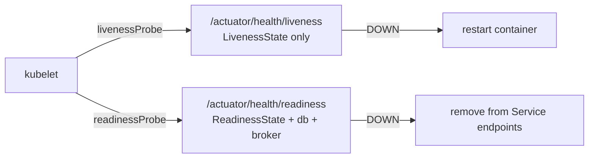

## Simple definition

**Spring Boot Actuator** adds **production-ready endpoints** that show whether an application is healthy, what it is doing, and how it is configured: health, metrics, info, loggers, environment, thread dumps and more. You can add your own health checks and endpoints.

## The problem

Operators and platforms need standard answers: *is it alive? Is it ready for traffic? How busy is it? Which version is deployed? Can I raise a log level without redeploying?* Writing these per service is wasteful and inconsistent.

## Key endpoints

| Endpoint | Shows / does | Expose in production? |
|---|---|---|
| `/actuator/health` | UP, DOWN or OUT_OF_SERVICE, plus components (db, disk, broker) | ✅ (details only to authorised users) |
| `/actuator/health/liveness`, `/readiness` | Kubernetes probe groups | ✅ |
| `/actuator/info` | Build, Git, Java and OS info | ✅ |
| `/actuator/metrics`, `/actuator/prometheus` | Micrometer metrics | ✅ (scrape on the internal port) |
| `/actuator/loggers` | View or change log levels at runtime | 🔒 Admin only |
| `/actuator/env`, `/configprops` | Configuration (values sanitised) | 🔒 Admin only |
| `/actuator/threaddump`, `/heapdump` | Diagnostics | 🔒 Admin only (a heap dump contains data) |
| `/actuator/conditions`, `/beans`, `/mappings` | Container introspection | 🔒 / dev |
| `/actuator/sbom` | Software bill of materials (CycloneDX) | 🔒 |
| `/actuator/shutdown` | Stops the app | ❌ Disabled by default |

## Configuration

```yaml
management:
  server:
    port: 8081                                   # separate port, not exposed via the ingress
  endpoints:
    web:
      exposure:
        include: health, info, prometheus, loggers
  endpoint:
    health:
      show-details: when-authorized
      probes:
        enabled: true                            # auto-enabled on Kubernetes
      group:
        readiness:
          include: readinessState, db, kafka     # ready only when dependencies are usable
  info:
    git.mode: simple
    env.enabled: true
info:
  app:
    team: payments
```

**Security:** use a separate management port that is not routed publicly, plus a `SecurityFilterChain` that permits `/actuator/health/**` and `/actuator/info` and requires an admin role for the rest. See [security filter chain](/spring/security/security-filter-chain).

## Health, liveness and readiness



> [!KEY] Liveness must not depend on external systems
> If the database is down, **restarting** the app will not fix it, and restarting every pod at once makes things worse. Put dependency checks in **readiness** (stop sending traffic), and keep **liveness** about the app's own state (deadlock, broken internal state).

Spring Boot publishes `AvailabilityChangeEvent`s. During graceful shutdown readiness goes to `REFUSING_TRAFFIC`, and you can change it yourself.

## Custom health indicator

```java
@Component("paymentProvider")
class PaymentProviderHealth implements HealthIndicator {
    private final PaymentClient client;
    PaymentProviderHealth(PaymentClient client) { this.client = client; }

    @Override
    public Health health() {
        try {
            Duration latency = client.ping();                  // keep it fast; use timeouts
            return Health.up().withDetail("latencyMs", latency.toMillis()).build();
        } catch (Exception e) {
            return Health.down(e).build();
        }
    }
}
```

Health checks run on every probe call, so keep them **cheap** and **time-bounded**. Cache expensive checks. Group them deliberately.

## Custom info

```java
@Component
class FeatureFlagsInfo implements InfoContributor {
    public void contribute(Info.Builder b) { b.withDetail("features", Map.of("newCheckout", true)); }
}
```

Also add the `spring-boot-maven-plugin` `build-info` goal and the `git-commit-id` plugin so `/info` shows the version and commit.

## Custom endpoints

```java
@Component
@Endpoint(id = "featureflags")                       // /actuator/featureflags (web and JMX)
class FeatureFlagsEndpoint {
    private final Map<String, Boolean> flags = new ConcurrentHashMap<>();

    @ReadOperation                                    // GET
    Map<String, Boolean> all() { return flags; }

    @ReadOperation                                    // GET /actuator/featureflags/{name}
    Boolean one(@Selector String name) { return flags.get(name); }

    @WriteOperation                                   // POST with a JSON body
    void set(@Selector String name, boolean enabled) { flags.put(name, enabled); }

    @DeleteOperation                                  // DELETE
    void remove(@Selector String name) { flags.remove(name); }
}
```

- `@Endpoint` is technology-neutral (HTTP and JMX). `@WebEndpoint` and `@JmxEndpoint` restrict it to one.
- Expose it explicitly (`management.endpoints.web.exposure.include=featureflags`) and secure it.
- Endpoint **access** control (`management.endpoint.<id>.access=read-only|unrestricted|none`) replaced the old `enabled` flags in Boot 3.4+.

## Metrics, tracing and logs

Actuator auto-configures **Micrometer**: JVM, HTTP server and client, datasource, cache, executor and Kafka metrics, plus the Observation API for tracing. See [observability with Micrometer and OpenTelemetry](/microservices/operations/observability-micrometer-opentelemetry).

## Common mistakes

> [!MISTAKE] Exposing all endpoints publicly
> `/env`, `/heapdump` and `/loggers` reveal secrets and data, or allow changes. Use a management port and authorisation.

> [!MISTAKE] Database checks in liveness
> A database outage restarts every pod in a loop. Database checks belong in readiness.

> [!MISTAKE] Slow health indicators
> Probes time out and pods flap. Keep checks fast, with timeouts and caching.

## Quick check

**Liveness vs readiness?**
Liveness answers "is the process OK, or should it be restarted?". Readiness answers "can it serve traffic now?". External dependencies belong in readiness.

**How do you add a custom health check?**
Implement `HealthIndicator` (or `ReactiveHealthIndicator`) as a bean. It appears as a component of `/actuator/health`.

**How do you create a custom actuator endpoint?**
Annotate a bean with `@Endpoint(id = …)` and add `@ReadOperation`, `@WriteOperation` or `@DeleteOperation` methods, then expose and secure it.

**Which endpoints must never be public?**
`env`, `configprops`, `heapdump`, `threaddump`, `loggers` (write), `shutdown` and other admin endpoints.

**Why use a separate management port?**
So actuator endpoints are not reachable through the public ingress, and can have different network and security rules.

## Summary

- Actuator standardises health, info, metrics and diagnostics.
- Liveness checks own state; readiness checks dependencies; probes are auto-enabled on Kubernetes.
- Expose little, on a separate port, behind authorisation.
- Extend with `HealthIndicator`, `InfoContributor` and `@Endpoint`.

## References

- Spring Boot reference, [Production-ready Features (Actuator)](https://docs.spring.io/spring-boot/reference/actuator/index.html).
- Spring Boot reference, [Kubernetes probes](https://docs.spring.io/spring-boot/reference/actuator/endpoints.html#actuator.endpoints.kubernetes-probes).
- Kubernetes, [Configure liveness, readiness and startup probes](https://kubernetes.io/docs/tasks/configure-pod-container/configure-liveness-readiness-startup-probes/).
