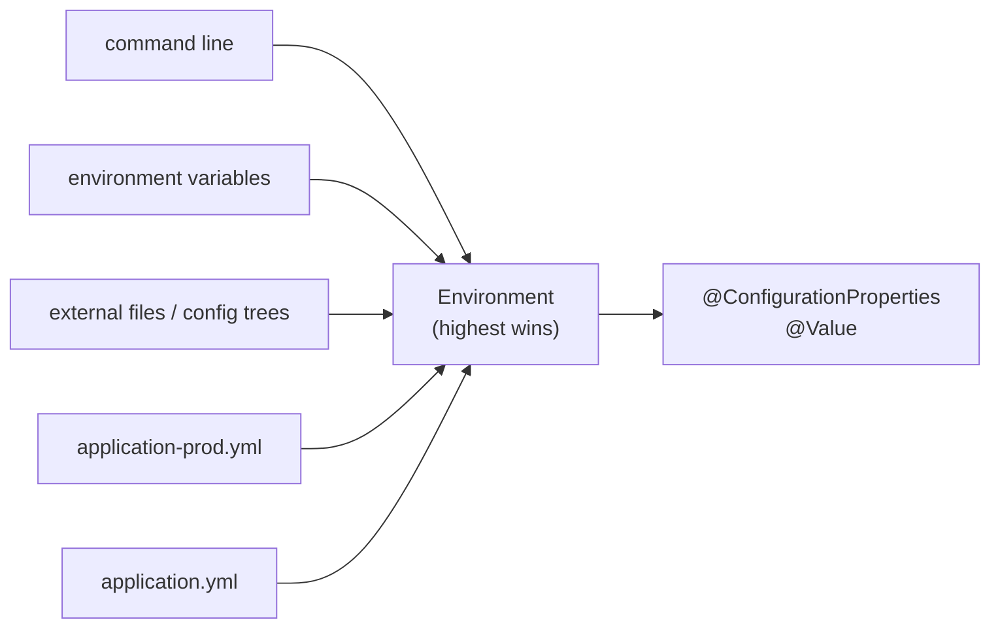

## Simple definition

**Externalized configuration** keeps environment-specific values (URLs, credentials, limits, feature flags) **outside the code**, so the **same artifact** runs in development, test and production. Spring Boot merges many **property sources** into one `Environment`, and binds values into type-safe objects with **`@ConfigurationProperties`**.

## The problem

Hard-coded URLs and passwords, a different build per environment, and `@Value` strings scattered across classes cause outages ("prod pointing at the test database"), leaked secrets and configuration nobody can audit. The Twelve-Factor App rule: *store config in the environment*.

## Property sources and precedence

Higher sources override lower ones (simplified, highest first):

| # | Source |
|---|---|
| 1 | Test properties (`@TestPropertySource`, `@DynamicPropertySource`) |
| 2 | Command-line arguments (`--server.port=9090`) |
| 3 | `SPRING_APPLICATION_JSON` |
| 4 | Java system properties (`-D`) |
| 5 | **OS environment variables** |
| 6 | Profile-specific files **outside** the JAR (`./config/application-prod.yml`) |
| 7 | Application files **outside** the JAR |
| 8 | Profile-specific files **inside** the JAR (`application-prod.yml`) |
| 9 | `application.yml` / `.properties` **inside** the JAR |
| 10 | `@PropertySource` and defaults |



**Profile-specific documents** in YAML:

```yaml
shop:
  payment:
    base-url: http://localhost:8089
---
spring.config.activate.on-profile: prod
shop:
  payment:
    base-url: https://payments.internal
```

## Relaxed binding and environment variables

`shop.payment.base-url`, `shop.payment.baseUrl` and the environment variable `SHOP_PAYMENT_BASEURL` all bind to the same property. For env vars: replace `.` with `_`, remove `-`, use upper case. List indexes become `SHOP_PARTNERS_0_NAME`.

## Importing more configuration

```yaml
spring:
  config:
    import:
      - optional:file:./config/extra.yml
      - optional:configtree:/etc/config/        # one file per property: Kubernetes ConfigMap and Secret volumes
      - optional:vault://                         # with Spring Cloud Vault
      - optional:configserver:http://config:8888  # with Spring Cloud Config
```

**Config trees** are the natural fit for Kubernetes: mount a Secret as files, and each file name becomes a property. See [centralized configuration](/microservices/fundamentals/centralized-configuration) for Config Server.

## Type-safe configuration with @ConfigurationProperties

```java
@ConfigurationProperties("shop.payment")
@Validated
public record PaymentProperties(
        @NotNull URI baseUrl,
        @DefaultValue("2s") Duration timeout,          // "2s", "500ms", "PT2S"
        @DefaultValue("3") @Min(0) int retries,
        @DefaultValue("10MB") DataSize maxPayload,
        Map<String, String> headers) {}

@SpringBootApplication
@ConfigurationPropertiesScan                            // or @EnableConfigurationProperties(PaymentProperties.class)
class ShopApplication { }
```

- **Records** (constructor binding) give immutable configuration.
- `Duration`, `DataSize`, `Period`, enums, lists, maps and nested records convert automatically.
- `@Validated` with Jakarta Validation **fails startup** on bad configuration: fail fast instead of failing at 3 a.m.
- Add `spring-boot-configuration-processor` to generate **metadata** for IDE auto-completion and documentation.

### @Value vs @ConfigurationProperties

| | `@Value("${…}")` | `@ConfigurationProperties` |
|---|---|---|
| Type safety and grouping | One value, a string expression | Structured, typed object |
| Validation | Manual | `@Validated` |
| Relaxed binding | Limited | Full |
| IDE metadata | ❌ | ✅ |
| SpEL | ✅ | ❌ |
| Use for | One-off values | **Everything else** |

## Secrets

- **Never** commit secrets to `application.yml` or Git.
- Inject them at runtime: Kubernetes Secrets (as a config tree), Vault (Spring Cloud Vault), or a cloud secret manager (Spring Cloud AWS, GCP or Azure).
- Prefer short-lived, dynamic credentials (Vault database secrets) and workload identity over static keys.
- Actuator's `/env` and `/configprops` **sanitise** values by default. Keep `management.endpoint.env.show-values=never` (the default) in production.

## Refreshing configuration at runtime

- Most configuration is read at startup. Restart (a rolling deployment) is the simplest and safest "refresh".
- **Spring Cloud** adds `@RefreshScope` and `/actuator/refresh` (or Spring Cloud Bus) to rebind properties and recreate beans without a restart. Use it carefully: half-refreshed systems are hard to reason about.
- **Feature flags** that change often belong in a feature-flag service (OpenFeature, Unleash, LaunchDarkly), not in properties.

## Common mistakes

> [!MISTAKE] Secrets in application.yml
> They end up in Git, images and logs. Use a secret store or Kubernetes Secrets.

> [!MISTAKE] One build per environment
> Profiles and external configuration let one artifact run everywhere. Rebuilding per environment means production runs untested bits.

> [!MISTAKE] Unvalidated configuration
> A missing URL found at the first request is an outage. Validate `@ConfigurationProperties` at startup.

## Quick check

**Which wins: an environment variable or `application.yml` in the JAR?**
The environment variable. OS environment variables rank above packaged application files.

**How does `SHOP_PAYMENT_BASEURL` map to a property?**
Relaxed binding maps it to `shop.payment.base-url` (underscores become dots; case and dashes are ignored).

**Why prefer `@ConfigurationProperties` over `@Value`?**
It is type-safe, grouped, validated, supports relaxed binding and generates IDE metadata.

**What is a config tree?**
A directory where each file name is a property and its content is the value. It fits Kubernetes ConfigMap and Secret volumes.

**How do you make bad configuration fail at startup?**
Annotate the properties class with `@Validated` and use constraints such as `@NotNull` and `@Min`.

## Summary

- One artifact everywhere: values come from ordered property sources.
- Bind with `@ConfigurationProperties` records, and validate at startup.
- Import config trees, Vault or Config Server; keep secrets out of Git.
- Prefer restarts for configuration changes; use flags for runtime toggles.

## References

- Spring Boot reference, [Externalized Configuration](https://docs.spring.io/spring-boot/reference/features/external-config.html).
- [The Twelve-Factor App: Config](https://12factor.net/config).
- Spring Cloud Vault, [reference](https://docs.spring.io/spring-cloud-vault/reference/).
