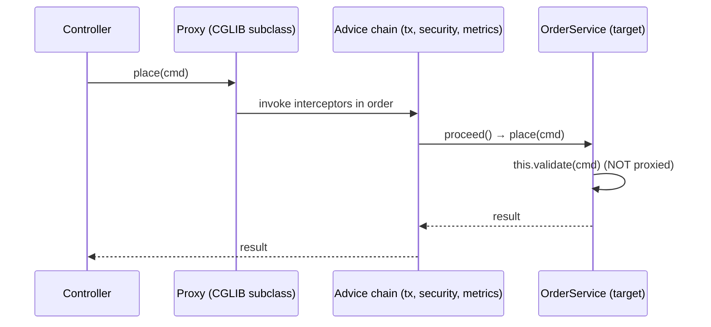

## Simple definition

**Aspect-oriented programming (AOP)** keeps **cross-cutting concerns** (logging, transactions, security, metrics, retries, caching) out of business code. You write the concern once as an **aspect** and declare **where** it applies. Spring AOP applies aspects by wrapping beans in **proxies**.

## The problem

Without AOP, every service method repeats the same boilerplate: start a timer, check a permission, begin a transaction, catch and translate exceptions, record metrics. That code is duplicated, easy to forget and mixed with business logic.

## Vocabulary

| Term | Meaning | Example |
|---|---|---|
| **Aspect** | A module of cross-cutting behaviour | `PerformanceAspect` |
| **Join point** | A point in execution where advice can run. In Spring AOP: **a method execution on a bean**. | `OrderService.place(..)` |
| **Pointcut** | A predicate selecting join points | `execution(* com.shop..*Service.*(..))` |
| **Advice** | The code to run at matched join points | "Log duration around the call" |
| **Target** | The real object being advised | The `OrderService` instance |
| **Proxy** | The wrapper that intercepts calls and runs the advice | A CGLIB subclass of `OrderService` |
| **Weaving** | Linking aspects to targets | Spring: at runtime via proxies; AspectJ: at compile or load time |

## The five advice types

```java
@Aspect
@Component
class ObservabilityAspect {

    @Pointcut("within(com.shop..service..*) && execution(public * *(..))")
    void serviceMethods() {}

    @Before("serviceMethods() && args(cmd,..)")
    void validate(JoinPoint jp, Object cmd) { /* runs before; cannot stop the call except by throwing */ }

    @AfterReturning(pointcut = "serviceMethods()", returning = "result")
    void audit(JoinPoint jp, Object result) { /* only on success */ }

    @AfterThrowing(pointcut = "serviceMethods()", throwing = "ex")
    void onError(JoinPoint jp, RuntimeException ex) { /* only on exception (does not swallow it) */ }

    @After("serviceMethods()")
    void always(JoinPoint jp) { /* like finally */ }

    @Around("@annotation(timed)")
    Object time(ProceedingJoinPoint pjp, Timed timed) throws Throwable {
        long start = System.nanoTime();
        try {
            return pjp.proceed();                      // call the target (or skip, retry, change args)
        } finally {
            metrics.record(timed.value(), System.nanoTime() - start);
        }
    }
}
```

| Advice | Runs | Can change the outcome? |
|---|---|---|
| `@Before` | Before the method | Only by throwing |
| `@AfterReturning` | After normal return | Can read (not replace) the result |
| `@AfterThrowing` | After an exception | Can translate (throw a different exception) |
| `@After` | Always (finally) | No |
| `@Around` | Wraps the call | **Yes**: proceed or not, change args or result, retry. The most powerful; use sparingly. |

**Pointcut designators:** `execution(...)`, `within(...)`, `@annotation(...)`, `@within(...)`, `args(...)`, `bean(name)`, combined with `&&`, `||` and `!`. **Annotation-based pointcuts** (`@annotation(Timed)`) are the clearest and least fragile.

## How proxies make it work



- A `BeanPostProcessor` (the auto-proxy creator) wraps each matching bean **after initialisation**.
- **JDK dynamic proxy** if the bean implements interfaces and `proxyTargetClass=false`; otherwise **CGLIB**. Spring Boot defaults to **CGLIB** (`spring.aop.proxy-target-class=true`).
- Proxies intercept only **public (and, with CGLIB, protected or package-visible) non-final methods called from outside the bean**.

### The self-invocation trap

```java
@Service
class OrderService {
    public void placeAll(List<Cmd> cmds) { cmds.forEach(this::place); }   // calls `this`, not the proxy
    @Transactional(propagation = REQUIRES_NEW)
    public void place(Cmd cmd) { ... }                                     // ❌ no new transaction here
}
```

**Fixes:**

1. Move the method to another bean (the best option).
2. Inject the bean's own proxy (`@Lazy` self-injection), which is a code smell.
3. Use the programmatic API (`TransactionTemplate`).
4. Use AspectJ weaving.

## Spring features built on AOP proxies

| Feature | Annotation |
|---|---|
| Transactions | `@Transactional` (see [transactions](/spring/data/transactions)) |
| Method security | `@PreAuthorize`, `@PostAuthorize`, `@Secured` |
| Caching | `@Cacheable`, `@CacheEvict` |
| Async execution | `@Async` |
| Retry and concurrency limits (Spring 7) | `@Retryable`, `@ConcurrencyLimit` |
| Metrics and tracing | `@Timed`, `@Observed`, `@Counted` |
| Validation | `@Validated` on classes |
| Spring Data repositories | Interface proxies |

## Ordering aspects

When several aspects match, use `@Order` (a lower value means **outer**, so its "before" part runs first). The order matters: retries should usually be **outside** the transaction, so each attempt gets a fresh transaction.

## Spring AOP vs AspectJ

| | Spring AOP | AspectJ (compile- or load-time weaving) |
|---|---|---|
| Join points | Method execution on Spring beans | Methods, constructors, field access, static and private methods |
| Self-invocation | ❌ Not intercepted | ✅ Intercepted |
| Setup | None (proxies) | Weaver plugin or agent |
| Use | **Default; enough for most needs** | Fine-grained or non-bean interception |

## Common mistakes

> [!MISTAKE] Expecting advice on private, final or self-invoked methods
> Proxies cannot intercept them. Public methods called from other beans only.

> [!MISTAKE] Business logic inside aspects
> Aspects hide behaviour. Keep them for genuinely cross-cutting technical concerns.

> [!MISTAKE] Broad pointcuts
> `execution(* *(..))` advises everything, including framework beans, which slows startup and causes surprises. Target annotations or packages.

## Quick check

**What is a pointcut vs advice?**
A pointcut selects where (which method executions); advice is what runs there and when.

**Which advice type can skip or retry the method call?**
`@Around`, through `ProceedingJoinPoint.proceed()`.

**Why doesn't `@Transactional` work on a self-invoked method?**
The call goes through `this`, the target object, not through the proxy that applies the transaction advice.

**JDK proxy vs CGLIB in Spring?**
JDK proxies implement the bean's interfaces; CGLIB subclasses the class. Spring Boot uses CGLIB by default.

**Name four Spring features built on AOP.**
`@Transactional`, method security, caching, `@Async`, `@Retryable` and observability annotations.

## Summary

- AOP isolates cross-cutting concerns as aspects: pointcut (where) plus advice (what and when).
- Spring AOP uses runtime proxies: method execution only, external calls only.
- Know the self-invocation trap and aspect ordering; use AspectJ only when proxies are not enough.

## References

- Spring Framework reference, [Aspect Oriented Programming with Spring](https://docs.spring.io/spring-framework/reference/core/aop.html) and [Proxying mechanisms](https://docs.spring.io/spring-framework/reference/core/aop/proxying.html).
- [AspectJ Programming Guide](https://eclipse.dev/aspectj/doc/latest/progguide/index.html).
