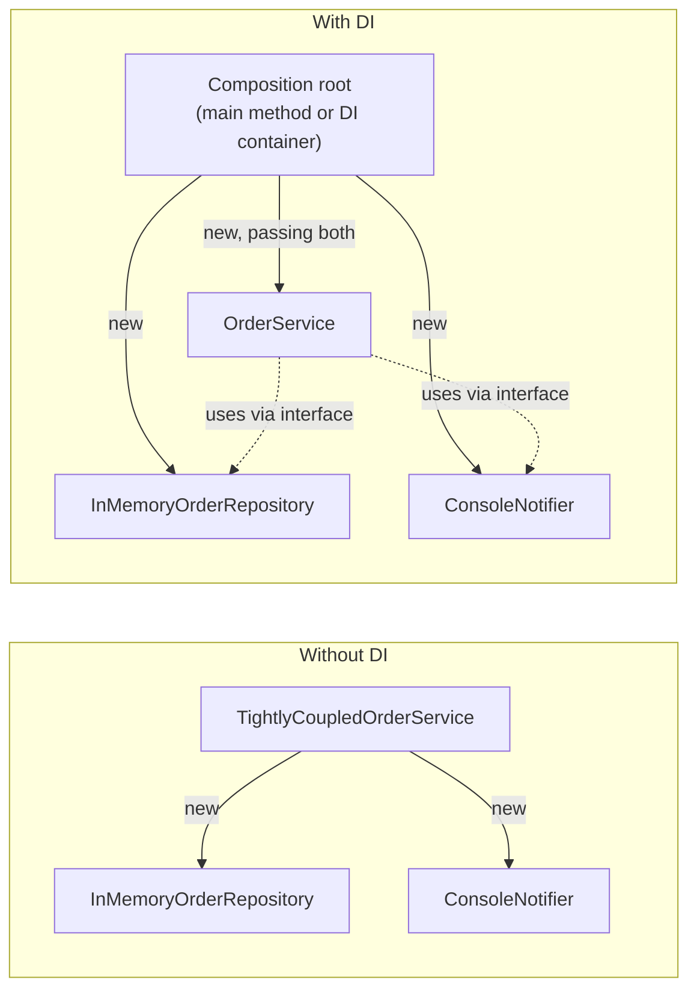

## Simple definition

**Dependency injection (DI)** means an object receives the objects it works with — its *dependencies* — from outside, instead of creating or looking them up itself.

```java
// Without DI: the service decides which notifier it uses.
private final Notifier notifier = new EmailNotifier();

// With DI: whoever creates the service decides.
public OrderService(Notifier notifier) { this.notifier = notifier; }
```

That is the entire idea. Frameworks such as Spring automate the wiring, but DI itself needs no framework.

## The problem

Here is an order service that creates its own collaborators:



It works, but:

- **It cannot be tested in isolation.** Every test sends a real notification and uses the real clock and random IDs, so assertions on time or IDs are impossible.
- **Changing an implementation means editing this class.** Moving from the in-memory repository to a database, or from console output to e-mail, requires modifying `TightlyCoupledOrderService` itself.
- **Its dependencies are hidden.** Nothing in its constructor tells you that it talks to a repository and sends notifications. You must read the implementation.

## Why it matters

DI is the practical mechanism behind the [Dependency Inversion Principle](/design-patterns/solid-principles#d--dependency-inversion-principle). It makes Strategy-style variation configurable ([Strategy pattern](/design-patterns/behavioral/strategy)), it is the foundation of the Spring Framework, and it is what lets [Hexagonal Architecture](/hexagonal-architecture/spring-boot-implementation) test business logic without a database.

## Core concept

### Inversion of Control

DI is one form of **Inversion of Control (IoC)**: control over *which* object is used moves from the class that uses it to the code that assembles the application. Other forms of IoC include template methods, callbacks and event listeners — "don't call us, we'll call you".



### Three ways to inject

| Style | How | Verdict |
|---|---|---|
| **Constructor injection** | Dependencies are constructor parameters | **Default choice.** Dependencies are explicit and can be `final`; the object is complete once constructed. |
| **Setter injection** | A setter is called after construction | For genuinely optional dependencies that have a sensible default. |
| **Field injection** | A framework writes directly into a private field (for example, `@Autowired` on a field) | Avoid in production code. Dependencies are hidden, fields cannot be `final`, and the class cannot be created without the framework. |

### The composition root

The **composition root** is the one place where the application's object graph is assembled — usually close to `main`. Everything else receives its dependencies and never creates them. In a Spring application, the container plus its `@Configuration` classes form the composition root.

## Practical example

The refactored service receives four dependencies: a repository, a notifier, a `java.time.Clock` and an ID generator.



The interfaces it depends on:





The composition root wires the service twice: once as production would, and once as a test would.



Expected output (`{{any}}` stands for the random UUID, which differs on every run):



## Implementation walkthrough

1. **Turn hidden dependencies into parameters.** Anything the class creates with `new`, looks up statically or reads from the environment — including the current time and random IDs — is a dependency.
2. **Depend on abstractions where variation is real.** `OrderRepository` and `Notifier` have several realistic implementations. Time and ID generation use the JDK's own abstractions, `Clock` and `Supplier<String>`, so no new interfaces are needed.
3. **Validate once, in the constructor.** `Objects.requireNonNull` makes a wiring mistake fail at startup, not on the first order.
4. **Make dependencies `final`.** The service is fully initialised after construction and safe to share between threads, provided its dependencies are thread-safe.
5. **Wire in one place.** `DiDemo.main` is the composition root. It is the only code that names concrete classes.
6. **Substitute freely in tests.** The test wiring uses a fixed clock, a sequential ID generator and a lambda that records notifications. No mocking library is needed, and the assertions are deterministic.

> [!KEY] Inject time and randomness
> `Instant.now()`, `UUID.randomUUID()` and `new Random()` are hidden dependencies. Injecting a `Clock` and an ID supplier is the cheapest way to make time- and ID-dependent logic testable.

## The same design with Spring

A DI container automates the composition root. With Spring Framework 7 (Spring Boot 4), the service class needs **no Spring annotations at all** if you register it in a configuration class:

```java
@Configuration(proxyBeanMethods = false)
class OrderConfiguration {

    @Bean
    Clock clock() {
        return Clock.systemUTC();
    }

    @Bean
    OrderService orderService(OrderRepository repository, Notifier notifier, Clock clock) {
        return new OrderService(repository, notifier, clock, () -> UUID.randomUUID().toString());
    }
}
```

Alternatively, you can annotate the class itself with `@Service`. If a class has a **single constructor**, Spring uses it for injection automatically; `@Autowired` is unnecessary (this has been true since Spring Framework 4.3).

```java
@Service
public class OrderService {
    private final OrderRepository repository;
    // ...
    public OrderService(OrderRepository repository, Notifier notifier, Clock clock, Supplier<String> ids) { ... }
}
```

The first style keeps framework annotations out of business classes entirely. The [Hexagonal Architecture example](/hexagonal-architecture/spring-boot-implementation) uses it for its application core, in `UseCaseConfiguration`:



> [!VERSION] Spring versions
> Constructor injection without `@Autowired` works for single-constructor classes since Spring Framework 4.3. Examples in this handbook use Spring Boot  (Spring Framework 7). See the [Spring reference on dependency injection](https://docs.spring.io/spring-framework/reference/core/beans/dependencies/factory-collaborators.html).

What the container adds beyond plain DI:

- **Automatic wiring** by type, with qualifiers when several candidates exist.
- **Lifecycle management**: singleton and other scopes, initialisation and destruction callbacks.
- **Proxies** that add transactions, security and caching around beans — see [Patterns in Spring](/spring/patterns-in-spring).
- **Configuration**: profiles and externalised properties to choose implementations per environment.

## Real-world applications

- Swapping an in-memory repository for a JPA repository between tests and production.
- Choosing a payment provider adapter per environment or per tenant.
- Injecting `Clock` to test expiry, scheduling and "orders older than 30 days" logic.
- Injecting HTTP clients configured with timeouts and retries, so business code does not build them.

## Advantages and disadvantages

| Advantages | Disadvantages |
|---|---|
| Classes are testable in isolation with simple fakes | Wiring moves elsewhere; you must look in the composition root or container to see the full graph |
| Dependencies are explicit in constructors | A container adds startup cost, reflection or code generation, and "magic" that must be learned |
| Implementations can change without editing clients | Overuse creates interfaces with one implementation and deep object graphs |
| Supports SOLID's DIP and OCP | Misconfiguration surfaces at startup, or at runtime with lazy beans, rather than at compile time |

## Alternatives and comparisons

| Approach | How a class obtains a dependency | Main drawback |
|---|---|---|
| **Direct instantiation** (`new`) | Creates it | Tight coupling, untestable |
| **Singleton / static access** | Calls `Foo.getInstance()` | Hidden global state shared between tests |
| **Service Locator** | Asks a registry: `locator.get(Foo.class)` | Dependencies are hidden inside method bodies; the class depends on the locator |
| **Dependency injection** | Receives it | Wiring lives elsewhere |

**DI versus DIP.** The Dependency Inversion Principle is a *design rule*: high-level policy should depend on abstractions. Dependency injection is a *technique* for supplying those abstractions. You can inject concrete classes (DI without DIP), and you could satisfy DIP using a service locator (DIP without DI). They work best together.

## Common mistakes

> [!MISTAKE] Field injection in production classes
> `@Autowired private OrderRepository repository;` hides the dependency and prevents `final`. The class cannot be instantiated in a plain unit test without reflection. Use constructor injection. Field injection is acceptable in test classes, where the framework creates the test instance.

- **Too many constructor parameters.** Seven dependencies is a design smell, not a DI problem. The class probably has more than one responsibility; split it.
- **An interface for every class.** Introduce an interface where there is real variation or a boundary (a port), not by reflex.
- **Injecting the container.** Passing `ApplicationContext` into a class and calling `getBean` turns DI back into a service locator.
- **Circular dependencies.** A needs B and B needs A. Spring Boot prohibits circular references by default since version 2.6. Fix the design — usually by extracting a third class or using an event.
- **Hidden statics.** `LocalDate.now()` deep inside a method is still a dependency. Inject a `Clock`.

## Interview questions and answers

**What is dependency injection?**
A technique in which an object receives its dependencies from outside, through its constructor, a setter or a field, instead of creating them. It decouples a class from the concrete implementations it uses.

**Why is constructor injection preferred?**
Dependencies are explicit and can be `final`. The object is complete and valid after construction, and it can be created in a plain unit test without a framework. Missing dependencies fail fast at startup.

**What is the difference between IoC and DI?**
Inversion of Control is the general principle that a framework or caller controls the flow or the choice of collaborators. DI is one specific form of IoC that concerns how dependencies are supplied.

**What is the difference between DI and the Dependency Inversion Principle?**
DIP is a design principle about the direction of source-code dependencies. DI is a technique for providing dependencies. DI is commonly used to wire a design that follows DIP.

**How do you handle two beans of the same type in Spring?**
Use `@Qualifier` at the injection point, mark one implementation `@Primary`, inject a `List` or `Map` of all implementations, or define the beans explicitly in a configuration class.

**Do you need Spring to do dependency injection?**
No. Constructors plus one composition root — usually `main` — are plain DI. A container automates wiring and adds lifecycle management, scopes and proxies.

> [!INTERVIEW] Demonstrate with a test
> The quickest way to show you understand DI is to describe how you would test a time-dependent method: inject a `Clock`, pass `Clock.fixed(...)` in the test, and assert exact timestamps.

## Summary

- DI means receiving dependencies instead of creating them.
- Constructor injection is the default: dependencies are explicit, `final` and validated once.
- One composition root assembles the object graph; in Spring, that is the container and its configuration.
- Treat time, randomness and environment access as dependencies too.
- DI is a technique; DIP is the principle it usually serves.

## Related topics

- [SOLID Principles: Dependency Inversion](/design-patterns/solid-principles#d--dependency-inversion-principle)
- [Strategy Pattern](/design-patterns/behavioral/strategy)
- [Hexagonal Architecture with Spring Boot](/hexagonal-architecture/spring-boot-implementation)
- [Patterns in Spring](/spring/patterns-in-spring)

## References

- Martin Fowler. "[Inversion of Control Containers and the Dependency Injection pattern](https://martinfowler.com/articles/injection.html)", 2004.
- Mark Seemann and Steven van Deursen. *Dependency Injection: Principles, Practices, and Patterns*. Manning, 2019.
- [Spring Framework reference: Dependency Injection](https://docs.spring.io/spring-framework/reference/core/beans/dependencies/factory-collaborators.html).
- [Spring Boot reference: Spring Beans and Dependency Injection](https://docs.spring.io/spring-boot/reference/using/spring-beans-and-dependency-injection.html).
