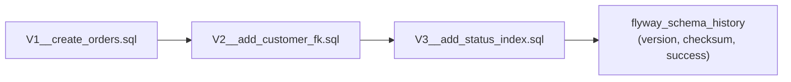

## Simple definition

- **Auditing** records **who changed what and when**: simple timestamps and users on each row, or a full history of every revision.
- **Database migrations** are **versioned, repeatable scripts** that evolve the schema alongside the code. **Flyway** and **Liquibase** apply them automatically at startup or in a pipeline.

## The problem

"Who changed this customer's limit?" cannot be answered without auditing. Regulators often require it. Schemas changed by hand drift between environments, and `spring.jpa.hibernate.ddl-auto=update` in production eventually corrupts or locks a table.

## Spring Data JPA auditing

```java
@Configuration
@EnableJpaAuditing
class AuditConfig {
    @Bean
    AuditorAware<String> auditor() {                         // who is making the change
        return () -> Optional.ofNullable(SecurityContextHolder.getContext().getAuthentication())
                .filter(Authentication::isAuthenticated)
                .map(Authentication::getName);
    }
}

@MappedSuperclass
@EntityListeners(AuditingEntityListener.class)
abstract class Auditable {
    @CreatedDate      Instant createdAt;
    @CreatedBy        String createdBy;
    @LastModifiedDate Instant updatedAt;
    @LastModifiedBy   String updatedBy;
    @Version          long version;                          // also gives optimistic locking
}
```

This gives the **latest** change only. For **history**:

| Approach | What you get | Trade-offs |
|---|---|---|
| **Hibernate Envers** (`@Audited`) | A revision table per entity (`orders_aud`) plus `revinfo`; query state "as of revision N" | Extra writes per transaction; schema per audited entity |
| Spring Data Envers | Repository support: `findRevisions(id)` | Built on Envers |
| Database triggers / temporal tables | Captures changes from any client, including SQL scripts | Database-specific; app context (user) must be passed in |
| **CDC** (Debezium) into an audit store | History outside the OLTP database, streamable | More infrastructure |
| Event sourcing | History **is** the data | Big design decision |

## Database migrations



### Flyway

```text
src/main/resources/db/migration/
  V1__create_orders.sql
  V2__add_status_column.sql
  R__refresh_reporting_views.sql      # repeatable: re-run when its checksum changes
```

```yaml
spring:
  flyway:
    enabled: true                     # auto-configured when flyway-core (+ flyway-database-postgresql) is present
    locations: classpath:db/migration
  jpa:
    hibernate:
      ddl-auto: validate              # Hibernate checks the mappings match; it never changes the schema
```

- **Versioned** (`V<n>__desc.sql`) migrations run once, in order. Their checksum is stored, and **editing an applied migration fails validation**, by design.
- **Repeatable** (`R__`) migrations suit views, functions and grants.
- Java-based migrations are possible for complex data moves.

### Liquibase

```yaml
# db/changelog/db.changelog-master.yaml
databaseChangeLog:
  - changeSet:
      id: 3-add-status-index
      author: payments-team
      changes:
        - createIndex:
            tableName: orders
            indexName: idx_orders_status
            columns: [{ column: { name: status } }]
      rollback:
        - dropIndex: { tableName: orders, indexName: idx_orders_status }
```

| | Flyway | Liquibase |
|---|---|---|
| Format | Plain SQL (and Java) | XML, YAML, JSON or SQL changesets |
| Database independence | You write the SQL | Abstract change types generate SQL per database |
| Rollback | Write forward-fix migrations (undo is a paid feature) | Rollback blocks per changeset |
| Preconditions, contexts and labels | Basic | Rich |
| Learning curve | Very low | Moderate |

Both integrate with Spring Boot automatically. Pick **one** per service.

## Zero-downtime schema changes: expand and contract

With rolling deployments, **old and new code run at the same time**. Never make a change that breaks the old version:

1. **Expand:** add the new column, table or index (nullable or with a default). Deploy code that writes **both** old and new.
2. **Migrate:** backfill data in batches (a separate job or migration).
3. **Switch:** deploy code that reads the new structure.
4. **Contract:** after all old versions are gone, drop the old column in a **later** release.

Also:

- create large indexes **concurrently** (`CREATE INDEX CONCURRENTLY` in PostgreSQL, outside a transaction)
- avoid long table locks
- add `NOT NULL` constraints in steps.

## Running migrations safely

- **Locally and in tests:** at application startup, against **Testcontainers** with the real database engine. See [integration testing](/spring/production/integration-testing).
- **Production:** options are startup migration (simple; Flyway takes a lock so only one instance migrates), **or** a separate **Kubernetes Job / init container** or pipeline step that runs before the rollout. The second is preferred for large changes and least-privilege credentials (the app user cannot run DDL).
- Review migrations like code; keep them small; never edit applied ones.

## Common mistakes

> [!MISTAKE] `ddl-auto=update` or `create` in production
> Hibernate guesses schema changes, cannot migrate data and can lock or drop things. Use migrations, with `ddl-auto=validate` or `none`.

> [!MISTAKE] Editing an already-applied migration
> The checksum mismatch breaks every environment. Add a new migration instead.

> [!MISTAKE] Renaming or dropping columns in one release
> Old instances still running break during the rollout. Use expand–contract.

## Quick check

**What do `@CreatedDate` and `@LastModifiedBy` need to work?**
`@EnableJpaAuditing`, the `AuditingEntityListener` on the entity, and an `AuditorAware` bean for the user fields.

**Spring Data auditing vs Envers?**
Auditing stores only who and when of the latest change on the row. Envers stores every revision of the entity's state in audit tables.

**Why not use `ddl-auto=update` in production?**
It is not a controlled, reviewable migration. It cannot handle data changes, renames or zero-downtime steps, and may lock or damage tables.

**What is expand–contract?**
Making backward-compatible schema changes first (add), migrating data and code, and removing old structures only in a later release.

**Flyway vs Liquibase in one line each?**
Flyway: plain versioned SQL scripts, very simple. Liquibase: abstract changesets with rollback, preconditions and contexts.

## Summary

- JPA auditing records the latest who and when; Envers, triggers or CDC record full history.
- Evolve schemas only with versioned migrations (Flyway or Liquibase), with `ddl-auto=validate`.
- Use expand–contract for zero downtime; test migrations against real databases; run large ones as separate jobs.

## References

- Spring Data JPA, [Auditing](https://docs.spring.io/spring-data/jpa/reference/auditing.html) and [Envers](https://docs.spring.io/spring-data/envers/reference/).
- Spring Boot, [Database initialization and migrations](https://docs.spring.io/spring-boot/how-to/data-initialization.html).
- [Flyway documentation](https://documentation.red-gate.com/flyway) and [Liquibase documentation](https://docs.liquibase.com/).
- Martin Fowler, [Evolutionary Database Design](https://martinfowler.com/articles/evodb.html).
