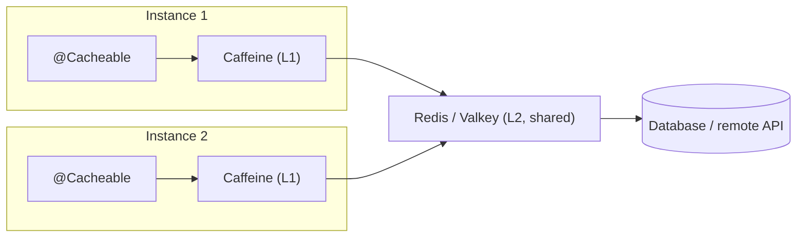

## Simple definition

The **Spring Cache abstraction** lets you cache method results declaratively with `@Cacheable` and friends. **Where** data is cached is pluggable: **Caffeine** in local memory, **Redis** (or Valkey) shared across instances, Hazelcast and others.

## The problem

Repeated expensive calls (database aggregations, remote price lookups, reference data) waste latency and load. Ad-hoc `Map` caches have no eviction or TTL, are not shared, and are scattered through the code.

## Caching patterns

| Pattern | How | Notes |
|---|---|---|
| **Cache-aside (lazy loading)** | Read the cache; on a miss, load from the source and store | **What `@Cacheable` does**; most common |
| Read-through | The cache loads on a miss itself | Cache library feature |
| Write-through | Write the cache and the database together | Consistent, but slower writes |
| Write-behind | Write the cache, flush to the DB asynchronously | Fast; risk of loss |
| Refresh-ahead | Refresh hot entries before expiry | Avoids misses on hot keys |

## Annotations

```java
@Service
@CacheConfig(cacheNames = "products")
class ProductService {

    @Cacheable(key = "#sku", unless = "#result == null")              // cache-aside
    public ProductDto find(String sku) { return mapper.toDto(repository.findBySku(sku)); }

    @CachePut(key = "#result.sku")                                    // always run, then update the cache
    public ProductDto update(UpdateProduct cmd) { ... }

    @CacheEvict(key = "#sku")                                         // remove on delete
    public void delete(String sku) { ... }

    @CacheEvict(allEntries = true)                                    // flush the whole cache (use sparingly)
    @Scheduled(cron = "0 0 3 * * *")
    public void nightlyReset() { }

    @Cacheable(cacheNames = "prices", key = "#sku + ':' + #currency", sync = true)   // sync: one loader per key per JVM
    public Price price(String sku, String currency) { ... }
}
```

- Enable caching with `@EnableCaching`. Spring Boot auto-configures a `CacheManager` from the classpath.
- Caching is **AOP**, so self-invocation and private methods are not cached. See [AOP and proxies](/spring/core/aop-and-proxies).
- Keys are SpEL. See [SpEL](/spring/core/spring-expression-language). Cached values should be **immutable DTOs**, not JPA entities.

## Providers



| | Caffeine (local) | Redis / Valkey (distributed) |
|---|---|---|
| Latency | Nanoseconds | About 0.2–1 ms network round trip |
| Shared between instances | ❌ (each pod has its own) | ✅ |
| Survives restarts | ❌ | ✅ (with persistence) |
| Eviction | W-TinyLFU, size and time based | TTL, maxmemory policies |
| Best for | Hot, small reference data; tolerating a little staleness | Shared state, sessions, rate limits, larger caches |

**Valkey** is the open-source fork of Redis (Linux Foundation), API-compatible. Spring Data Redis works with both.

### Redis configuration

```yaml
spring:
  cache:
    type: redis
  data:
    redis:
      host: redis
      port: 6379
```

```java
@Bean
RedisCacheManagerBuilderCustomizer cacheTtls() {
    var json = RedisSerializationContext.SerializationPair.fromSerializer(RedisSerializer.json());
    return b -> b
        .cacheDefaults(RedisCacheConfiguration.defaultCacheConfig()
                .entryTtl(Duration.ofMinutes(10))
                .disableCachingNullValues()
                .serializeValuesWith(json))
        .withCacheConfiguration("prices", RedisCacheConfiguration.defaultCacheConfig().entryTtl(Duration.ofSeconds(30)));
}
```

- **Always set TTLs.** Unbounded caches become stale and grow.
- Use **JSON** serialisation (not JDK serialisation) for safety and readability. Version cache key prefixes when DTOs change shape.

## Invalidation and consistency

> There are only two hard things in computer science: cache invalidation and naming things. (Phil Karlton)

- **TTL** bounds staleness. Pick it per data type.
- **Evict on write** (`@CacheEvict`) **after the transaction commits**. Evicting before commit lets another request re-cache the old value. Spring's `TransactionAwareCacheManagerProxy` or `@TransactionalEventListener(AFTER_COMMIT)` handles this.
- **Multiple instances with local caches:** broadcast invalidations (Redis pub/sub, Kafka) or keep local TTLs very short.
- Never cache **authorisation-sensitive** data under keys that ignore the user or tenant.

## Cache stampede

When a hot key expires, many requests miss at once and hammer the database. Mitigations:

- `@Cacheable(sync = true)` (one loader per JVM)
- **jittered TTLs**
- **refresh-ahead** (Caffeine `refreshAfterWrite`)
- distributed locks for very expensive loads
- serving stale data while revalidating.

## Hibernate second-level cache

JPA's **second-level (L2) cache** caches entities across sessions (with JCache providers such as Ehcache or Caffeine). It suits **read-mostly reference entities** (countries, product categories). It is risky for frequently updated or bulk-updated data. The Spring cache on service DTOs is usually clearer.

## Monitoring

Micrometer exposes cache metrics (`cache.gets{result=hit|miss}`, `cache.puts`, `cache.evictions`) for Caffeine and Redis. Track the **hit ratio** and load times; a cache with a 10% hit ratio is just overhead.

## Common mistakes

> [!MISTAKE] Caching JPA entities
> Detached entities with lazy proxies break on access, and mutable cached objects get changed by callers. Cache immutable DTOs.

> [!MISTAKE] No TTL
> Data never refreshes and memory grows. Set TTLs everywhere.

> [!MISTAKE] Evicting before commit
> A concurrent read can re-cache the old value. Evict after commit.

## Quick check

**What pattern does `@Cacheable` implement?**
Cache-aside: check the cache, call the method on a miss, and store the result.

**`@CachePut` vs `@CacheEvict`?**
`@CachePut` always executes the method and updates the cache with the result. `@CacheEvict` removes entries.

**Caffeine or Redis?**
Caffeine for very fast, per-instance caching of hot or reference data. Redis or Valkey when the cache must be shared across instances or survive restarts.

**What is a cache stampede, and one fix?**
Many concurrent misses for an expired hot key overload the source. Fixes: `sync = true`, jittered TTLs, refresh-ahead or locks.

**Why evict after commit?**
Evicting before commit lets another request reload and re-cache the old data before the new data is committed.

## Summary

- Spring Cache is declarative caching through AOP; the provider is pluggable.
- Caffeine locally, Redis or Valkey for shared caches; always set TTLs and use JSON serialisation.
- Invalidate after commit, guard hot keys against stampedes, and monitor the hit ratio.

## References

- Spring Framework reference, [Cache Abstraction](https://docs.spring.io/spring-framework/reference/integration/cache.html).
- Spring Boot reference, [Caching](https://docs.spring.io/spring-boot/reference/io/caching.html).
- Spring Data Redis, [reference](https://docs.spring.io/spring-data/redis/reference/).
- [Caffeine](https://github.com/ben-manes/caffeine) and [Valkey](https://valkey.io/).
