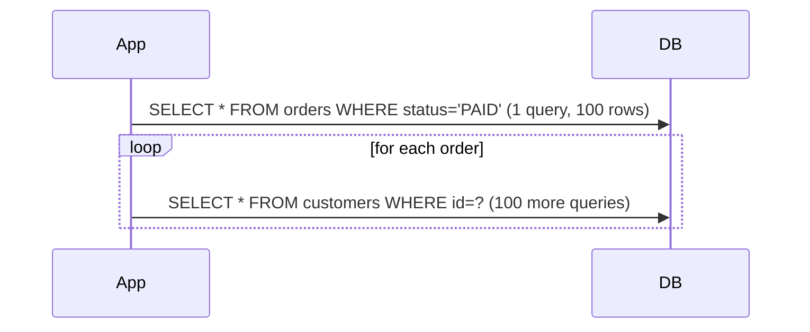

## Simple definition

**Entity mappings** tell JPA how classes and their associations map to tables and foreign keys. **Fetch strategies** decide **when** associated data is loaded: **eagerly** (with the parent) or **lazily** (on first access, through a proxy).

## The problem

Most JPA performance disasters come from mappings and fetching:

- the **N+1 query problem**: loading 100 orders, then one extra query per order for its customer
- `EAGER` associations dragging half the database into memory
- `LazyInitializationException` after the transaction ends
- wrong cascades deleting data.

## Associations

```java
@Entity
class Order {
    @Id @GeneratedValue(strategy = GenerationType.SEQUENCE) Long id;

    @ManyToOne(fetch = FetchType.LAZY, optional = false)          // owning side: holds the FK customer_id
    Customer customer;

    @OneToMany(mappedBy = "order", cascade = CascadeType.ALL, orphanRemoval = true)
    List<OrderLine> lines = new ArrayList<>();                    // inverse side

    @Embedded Money total;                                        // value object in the same table

    void addLine(OrderLine line) { lines.add(line); line.order = this; }      // keep both sides in sync
    void removeLine(OrderLine line) { lines.remove(line); line.order = null; }
}

@Entity
class OrderLine {
    @Id @GeneratedValue Long id;
    @ManyToOne(fetch = FetchType.LAZY) Order order;               // owning side (FK order_id)
    String sku; int quantity;
}
```

| Concept | Rule |
|---|---|
| **Owning side** | The side with the foreign key (`@ManyToOne`, or the `@JoinColumn` side). **Only the owning side's changes are written.** |
| `mappedBy` | Marks the inverse side and names the owning field |
| Bidirectional | Keep both sides consistent with helper methods |
| `cascade` | Propagates `persist`, `merge`, `remove`… from parent to children. Use it for **aggregate parts** (lines), never towards shared entities (customer). |
| `orphanRemoval` | Deletes children removed from the collection |
| `@ManyToMany` | Prefer an explicit join **entity** when the link has data (role, date) |
| `@Embeddable` | Value objects (Money, Address) stored in the parent's table |

### Default fetch types

| Association | JPA default | Recommendation |
|---|---|---|
| `@ManyToOne`, `@OneToOne` | **EAGER** | **Set LAZY explicitly** |
| `@OneToMany`, `@ManyToMany` | LAZY | Keep LAZY |

> [!KEY] Make everything LAZY; fetch per use case
> Mapping-level `EAGER` cannot be turned off per query and causes extra joins or queries everywhere. Map lazily, then load exactly what each use case needs with a fetch join, an entity graph or a projection.

## The N+1 problem



It hides behind innocent code such as `orders.forEach(o -> o.getCustomer().getName())`, or Jackson serialising entities.

**Fixes:**

| Fix | How | Notes |
|---|---|---|
| **Fetch join** | `select o from Order o join fetch o.customer where …` | One query. Avoid fetching two collections at once (cartesian product). |
| **Entity graph** | `@EntityGraph(attributePaths = {"customer", "lines"})` on a repository method | Declarative, per method |
| **Batch fetching** | `hibernate.default_batch_fetch_size=50` or `@BatchSize` | Loads lazy associations in `IN (…)` batches: N+1 becomes 1 + N/50 |
| **DTO projection** | `select new OrderSummary(o.id, c.name) from Order o join o.customer c` | Best for read endpoints |
| `@Fetch(SUBSELECT)` | A Hibernate collection strategy | Loads all collections with a subquery |

**Detect it** with Hibernate statistics, SQL logging in tests, datasource-proxy assertions on query counts, or tools such as Digma or the Hypersistence Optimizer.

### Pagination with collection fetch joins

`join fetch o.lines` plus `Pageable` makes Hibernate paginate **in memory** (warning HHH90003004). Instead, page the **IDs** first, then fetch the entities with their collections for those IDs, or use projections.

## LazyInitializationException

Accessing a lazy association **after** the persistence context closed (for example in a controller, with open-in-view disabled) throws it. Fix it by fetching what you need **inside** the transactional service method (fetch join or entity graph) and returning **DTOs**. Do not re-enable open-in-view or switch to EAGER.

## Inheritance strategies

| Strategy | Tables | Trade-off |
|---|---|---|
| `SINGLE_TABLE` (default) | One table with a discriminator | Fastest; nullable columns |
| `JOINED` | A table per class, joined | Normalised; joins on every query |
| `TABLE_PER_CLASS` | A table per concrete class | Polymorphic queries use UNION |
| `@MappedSuperclass` | Shared fields only, not an entity | No polymorphic queries |

Often **composition** (or sealed types in the domain mapped to one entity) is simpler than entity inheritance.

## equals and hashCode for entities

- Do not use Lombok `@Data` or all-field `equals` on entities (lazy collections, changing state).
- Use a **business key** (natural, immutable) if you have one.
- Otherwise use **ID-based equality** that is stable across states: `equals` compares non-null IDs, and `hashCode` returns a constant per class (`getClass().hashCode()`).

## Aggregates and DDD

Map **one aggregate** (Order + OrderLines) with cascades inside it. Reference **other aggregates by ID** or with lazy `@ManyToOne` without cascade. That keeps transactions and loading boundaries clear. See [DDD fundamentals](/domain-driven-design/fundamentals).

## Common mistakes

> [!MISTAKE] Leaving `@ManyToOne` EAGER
> Every query on the child joins or loads the parent, often transitively. Set `fetch = LAZY`.

> [!MISTAKE] Updating only the inverse side
> Adding to `order.lines` without setting `line.order` writes nothing. Use helper methods.

> [!MISTAKE] `CascadeType.REMOVE` on shared associations
> Deleting an order must not delete its customer. Cascade only within an aggregate.

## Quick check

**What is the owning side of a relationship?**
The side holding the foreign key. Only changes made on it are persisted. The inverse side uses `mappedBy`.

**Default fetch type of `@ManyToOne`, and what should you do?**
EAGER by JPA default. Set it to LAZY and fetch per use case.

**What is the N+1 problem?**
One query loads N parents, then N additional queries load an association for each parent.

**Three ways to fix N+1?**
Fetch joins, entity graphs, batch fetching (`default_batch_fetch_size`) and DTO projections.

**How should you fix LazyInitializationException?**
Load the needed associations inside the transaction (fetch join or entity graph) and return DTOs, rather than enabling open-in-view or EAGER.

## Summary

- Map the owning side correctly, keep bidirectional links in sync, and cascade only within aggregates.
- Map everything LAZY; fetch per use case with joins, graphs, batches or projections.
- Watch for N+1 and in-memory pagination; return DTOs from services.

## References

- Hibernate ORM User Guide, [Associations](https://docs.jboss.org/hibernate/orm/7.0/userguide/html_single/Hibernate_User_Guide.html#associations) and [Fetching](https://docs.jboss.org/hibernate/orm/7.0/userguide/html_single/Hibernate_User_Guide.html#fetching).
- Spring Data JPA, [Entity graphs](https://docs.spring.io/spring-data/jpa/reference/jpa/query-methods.html#jpa.entity-graph).
- Vlad Mihalcea, [The best way to map a @OneToMany relationship](https://vladmihalcea.com/the-best-way-to-map-a-onetomany-association-with-jpa-and-hibernate/).
