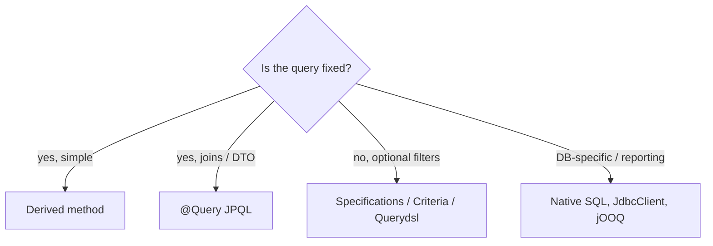

## Simple definition

- **JPQL (Jakarta Persistence Query Language)** is SQL-like, but queries **entities and their fields**, not tables and columns.
- The **Criteria API** builds the same queries **programmatically and type-safely**. It is ideal when filters are dynamic.
- Spring Data adds **derived queries**, **`@Query`**, **Specifications** and **Query by Example** on top.

## The problem

Simple lookups fit method names. Real screens need optional filters (status, date range, customer, amount), sorting and pagination. Concatenating JPQL strings for that is ugly and **dangerous** (injection). Native SQL everywhere loses portability and mapping.

## JPQL essentials

```java
// Joins and filtering on entity fields
@Query("""
    select o from Order o
    join o.customer c
    where c.country = :country and o.total.amount >= :min
    order by o.createdAt desc
    """)
List<Order> bigOrdersFrom(String country, BigDecimal min);

// Fetch join to avoid N+1
@Query("select distinct o from Order o join fetch o.lines where o.status = :status")
List<Order> withLines(Status status);

// Constructor expression → DTO (only the selected columns)
@Query("select new com.shop.OrderSummary(o.id, c.name, o.total.amount) from Order o join o.customer c")
List<OrderSummary> summaries();

// Aggregates and grouping
@Query("select c.country, count(o), sum(o.total.amount) from Order o join o.customer c group by c.country")
List<Object[]> revenueByCountry();
```

- Supports joins (inner, left, fetch), `where`, `group by`, `having`, subqueries, `case`, functions, `exists`, `in`, and (JPA 3.2) set operations such as `union`, plus more functions.
- **Always bind parameters** (`:name`). Never concatenate user input into the query string.

### Native queries

```java
@Query(value = "select * from orders where created_at > now() - interval '1 day'", nativeQuery = true)
List<Order> lastDay();
```

Use them for database-specific features (window functions, JSON operators, CTEs, `FOR UPDATE SKIP LOCKED`). Prefer projections into DTOs for reports. For heavy SQL, **`JdbcClient`** or **jOOQ** is often cleaner.

## The Criteria API

```java
CriteriaBuilder cb = em.getCriteriaBuilder();
CriteriaQuery<Order> q = cb.createQuery(Order.class);
Root<Order> o = q.from(Order.class);
Join<Order, Customer> c = o.join(Order_.customer);              // Order_ = generated static metamodel

List<Predicate> where = new ArrayList<>();
if (filter.status() != null)  where.add(cb.equal(o.get(Order_.status), filter.status()));
if (filter.from() != null)    where.add(cb.greaterThanOrEqualTo(o.get(Order_.createdAt), filter.from()));
if (filter.country() != null) where.add(cb.equal(c.get(Customer_.country), filter.country()));

q.select(o).where(where.toArray(Predicate[]::new)).orderBy(cb.desc(o.get(Order_.createdAt)));
List<Order> result = em.createQuery(q).setMaxResults(50).getResultList();
```

- The **static metamodel** (`Order_`, generated by `hibernate-jpamodelgen`) gives compile-time checked attribute names.
- Verbose, but safe and dynamic.

## Spring Data Specifications

```java
static Specification<Order> hasStatus(Status s) { return (root, q, cb) -> s == null ? null : cb.equal(root.get(Order_.status), s); }
static Specification<Order> createdAfter(Instant t) { return (root, q, cb) -> t == null ? null : cb.greaterThan(root.get(Order_.createdAt), t); }

Page<Order> page = orderRepository.findAll(
        Specification.allOf(hasStatus(f.status()), createdAfter(f.from())),
        PageRequest.of(0, 20, Sort.by("createdAt").descending()));
```

Specifications wrap Criteria predicates into small **composable** functions. A `null` predicate is ignored, which makes optional filters trivial.

## Other options

| Tool | Best for |
|---|---|
| Derived query methods | Simple, fixed lookups |
| `@Query` JPQL | Fixed queries with joins, fetches and DTOs |
| **Specifications** | Dynamic filters in Spring Data style |
| **Query by Example** (`Example.of(probe)`) | Simple equality filters from a sample object |
| **Querydsl** | Fluent, type-safe dynamic queries (`QOrder.order.status.eq(...)`) |
| Native SQL / `JdbcClient` / jOOQ | Database features, reporting, performance-critical SQL |



## Pagination that scales

- **Offset pagination** (`Pageable`) is simple, but deep pages are slow and the count query is costly. Return `Slice` to skip the count.
- **Keyset (seek) pagination:** Spring Data's **`ScrollPosition`** / `Window` API (`findFirst10ByStatus(Status s, ScrollPosition pos)`) continues from the last seen key. It stays fast at any depth.

## Common mistakes

> [!MISTAKE] String-concatenated JPQL
> That is an injection risk and breaks caching. Bind parameters, or use Criteria and Specifications.

> [!MISTAKE] Fetching entities for read-only lists
> Use DTO projections: fewer columns, no dirty checking, no lazy surprises.

> [!MISTAKE] Paginating fetch joins of collections
> Hibernate falls back to in-memory pagination. Page the IDs first.

## Quick check

**How does JPQL differ from SQL?**
It queries entities and their attributes and relationships, not tables and columns. The provider translates it to SQL.

**When use the Criteria API or Specifications?**
When filters are optional or dynamic and must stay type-safe and injection-free.

**What is a constructor expression?**
`select new com.x.Dto(...)` in JPQL, which instantiates DTOs directly from selected values.

**What is the JPA static metamodel?**
Generated classes (`Order_`) whose attributes give compile-time checked property references for Criteria queries.

**Why prefer keyset pagination for deep paging?**
It filters by the last seen key instead of skipping N rows, so performance stays constant, and it is stable when data changes.

## Summary

- JPQL for fixed entity queries, with fetch joins and DTO constructor expressions.
- Criteria and Specifications (or Querydsl) for dynamic filters; always bind parameters.
- Native SQL, JdbcClient or jOOQ for database-specific and reporting queries.
- Keyset pagination (`ScrollPosition`) for large data sets.

## References

- [Jakarta Persistence 3.2 specification: Query Language](https://jakarta.ee/specifications/persistence/3.2/).
- Spring Data JPA, [Specifications](https://docs.spring.io/spring-data/jpa/reference/jpa/specifications.html) and [Scrolling](https://docs.spring.io/spring-data/jpa/reference/repositories/scrolling.html).
- Hibernate, [Query Language guide](https://docs.jboss.org/hibernate/orm/7.0/querylanguage/html_single/Hibernate_Query_Language.html).
- [Querydsl](https://querydsl.com/) and [jOOQ](https://www.jooq.org/).
