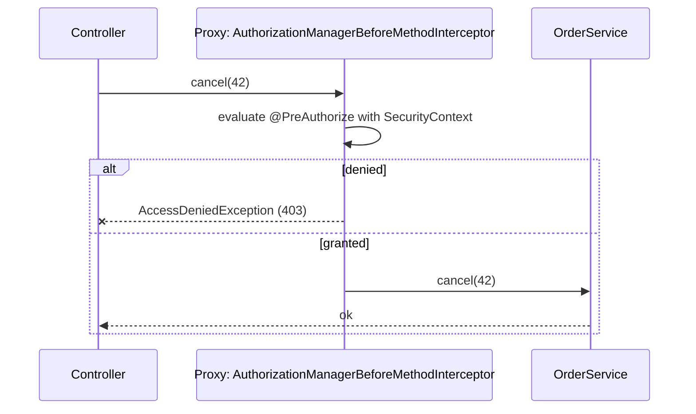

## Simple definition

**Method-level security** checks authorization **on service methods** instead of (or in addition to) URL rules:

- `@PreAuthorize` decides **before** the call
- `@PostAuthorize` decides **after**, using the returned object
- `@PreFilter` and `@PostFilter` filter collections.

It is enabled with `@EnableMethodSecurity` and implemented with **AOP proxies**.

## The problem

URL rules (`/api/orders/** → authenticated`) cannot express **"only the owner of order 42 may see it"**. Missing **object-level** checks cause **BOLA (Broken Object Level Authorization)**, the top API security risk in the OWASP API Top 10. Business rules about who can do what belong **next to the business operation**.

## Enabling

```java
@Configuration
@EnableMethodSecurity            // prePostEnabled = true by default; securedEnabled and jsr250Enabled optional
class MethodSecurityConfig { }
```

## The annotations

```java
@Service
class OrderService {

    @PreAuthorize("hasRole('ADMIN') or #customerId == authentication.name")
    public List<OrderDto> ordersFor(String customerId) { ... }

    @PostAuthorize("returnObject.customerId == authentication.name or hasRole('SUPPORT')")
    public OrderDto get(long orderId) { ... }

    @PreAuthorize("@orderAuthz.canCancel(#orderId, authentication)")    // delegate to a bean: testable
    public void cancel(long orderId) { ... }

    @PostFilter("filterObject.region == authentication.principal.claims['region']")
    public List<OrderDto> search(OrderQuery q) { ... }                // removes elements the user may not see

    @PreAuthorize("hasAuthority('SCOPE_orders:write')")
    public OrderDto create(CreateOrder cmd) { ... }
}

@Component("orderAuthz")
class OrderAuthorization {
    boolean canCancel(long orderId, Authentication auth) {
        Order o = repository.findById(orderId).orElseThrow();
        return o.ownedBy(auth.getName()) && o.isCancellable();
    }
}
```

| Annotation | When | Typical use |
|---|---|---|
| `@PreAuthorize` | Before the method | Roles, scopes, argument-based ownership |
| `@PostAuthorize` | After the method (it runs, then may be denied) | Check the returned object's owner. **Must not have side effects.** |
| `@PreFilter` / `@PostFilter` | Filter collection arguments or results | Small collections only. Filter in the **query** for large data. |
| `@Secured("ROLE_ADMIN")`, `@RolesAllowed` (JSR-250) | Before | Simple role checks (no SpEL) |

**Useful expressions:** `hasRole('X')` (checks `ROLE_X`), `hasAuthority('SCOPE_x')`, `hasAnyRole(...)`, `isAuthenticated()`, `authentication.name`, `principal`, `#param`, `returnObject`, `filterObject`, and `@bean.method(...)`.

## How it works



The usual AOP rules apply: **public methods, called through the proxy**. Self-invocation skips the check. See [AOP and proxies](/spring/core/aop-and-proxies).

## Cleaner rules: meta-annotations and templates

```java
@Target(METHOD) @Retention(RUNTIME)
@PreAuthorize("hasRole('{role}') or #customerId == authentication.name")   // template parameter
@interface OwnerOr { String role(); }

@OwnerOr(role = "SUPPORT")
public List<OrderDto> ordersFor(String customerId) { ... }
```

Register `PrePostTemplateDefaults` to enable `{placeholders}`. Meta-annotations give names to rules and keep SpEL out of business code.

## Recent features

- **`@AuthorizeReturnObject`** (Spring Security 6.3+): wraps returned objects in proxies, so annotations on **their** methods (for example `@PreAuthorize` on a getter for a sensitive field) are enforced.
- **`@HandleAuthorizationDenied`**: return a masked value instead of throwing on denial (for example `"***"` for a field the user may not see).
- **Custom `AuthorizationManager<MethodInvocation>`** beans for complex, reusable policies, or to delegate to a policy engine (OPA, Cedar, OpenFGA).
- In Spring Security 7, **multi-factor requirements** can also be expressed as authorities (for example require an OTT or WebAuthn factor for `transfer`).

## URL rules vs method rules

| | URL rules (filter chain) | Method security |
|---|---|---|
| Granularity | Path and HTTP method | Business operation and objects |
| Knows domain objects | No | Yes (arguments and return values) |
| Use for | Coarse access: authenticated, admin areas, public endpoints | Ownership, tenant isolation, fine-grained permissions |

Use **both**: coarse at the edge, fine-grained in the service layer.

## Testing

```java
@SpringBootTest
class OrderServiceSecurityTest {
    @Autowired OrderService service;

    @Test @WithMockUser(username = "alice")
    void ownerCanReadOwnOrders() { assertThatNoException().isThrownBy(() -> service.ordersFor("alice")); }

    @Test @WithMockUser(username = "bob")
    void otherUserIsDenied() {
        assertThatThrownBy(() -> service.ordersFor("alice")).isInstanceOf(AccessDeniedException.class);
    }
}
```

For JWT-based controllers, use `jwt()` request post-processors in MockMvc tests (`.with(jwt().authorities(...))`).

## Common mistakes

> [!MISTAKE] Only role checks, no ownership checks
> Any authenticated customer can read any order by changing the ID (BOLA). Check ownership or tenant on every object access.

> [!MISTAKE] Side effects before `@PostAuthorize` denies
> The method already ran, and its changes may persist. Use `@PreAuthorize` for anything that writes.

> [!MISTAKE] `@PostFilter` on large result sets
> It loads everything, then discards rows. Filter in the database query by user or tenant.

## Quick check

**What does `@PreAuthorize` do?**
It evaluates a SpEL authorization expression before the method runs, and throws AccessDeniedException if it is false.

**When would you use `@PostAuthorize`?**
When the decision depends on the returned object, such as its owner, and the method has no side effects.

**What is BOLA, and how does method security help?**
Broken object-level authorization: missing per-object access checks. Method security can check ownership using arguments or return values.

**How do you keep complex rules out of SpEL strings?**
Delegate to a bean (`@authz.canX(#id, authentication)`), or use meta-annotations with templates or custom AuthorizationManagers.

**Why might a method-security annotation be ignored?**
The method is private or final, or it is called from within the same bean (self-invocation), so the proxy is bypassed.

## Summary

- `@EnableMethodSecurity`, then `@PreAuthorize` and `@PostAuthorize`, plus filters for collections.
- Enforce ownership and tenancy on business methods to prevent BOLA.
- Delegate logic to beans, use meta-annotations, and test with `@WithMockUser` or `jwt()`.

## References

- Spring Security reference, [Method Security](https://docs.spring.io/spring-security/reference/servlet/authorization/method-security.html).
- OWASP, [API Security Top 10: API1 Broken Object Level Authorization](https://owasp.org/API-Security/editions/2023/en/0xa1-broken-object-level-authorization/).
