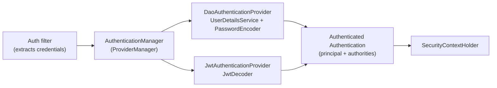

## Simple definition

**Spring Security** protects applications with a chain of **servlet filters** that runs **before** your controllers. The filters **authenticate** the caller (who are you?), store the result in a **`SecurityContext`**, and **authorize** the request (are you allowed?). It is configured with one or more **`SecurityFilterChain`** beans.

## The problem

Security checks scattered across controllers are inconsistent and easy to forget. Attacks such as CSRF, session fixation and clickjacking need defaults most developers would not think to add. Spring Security centralises these controls, secure by default, in front of the application.

## Architecture

```mermaid {title="From the servlet container to your SecurityFilterChain"}
flowchart LR
    REQ["HTTP request"] --> DFP["DelegatingFilterProxy<br/>(servlet filter)"] --> FCP["FilterChainProxy<br/>(springSecurityFilterChain bean)"]
    FCP -->|"first matching chain"| C1["SecurityFilterChain /api/**<br/>stateless JWT"]
    FCP --> C2["SecurityFilterChain /**<br/>form or OIDC login"]
    C1 --> APP["DispatcherServlet → controller"]
```

- **`DelegatingFilterProxy`** bridges the servlet container and Spring beans.
- **`FilterChainProxy`** picks the **first `SecurityFilterChain` whose request matcher matches**, then runs its filters.
- You can have several chains: an API chain with JWT and a web chain with login, each with its own rules.



## Key filters, in order (simplified)

| Filter | Job |
|---|---|
| `SecurityContextHolderFilter` | Loads the `SecurityContext` (from the session, or empty for stateless) |
| `HeaderWriterFilter` | Security headers: HSTS, X-Content-Type-Options, frame options, CSP if configured |
| `CorsFilter` | CORS preflight and headers |
| `CsrfFilter` | CSRF token check for state-changing requests (browser sessions) |
| `LogoutFilter` | Logout handling |
| Authentication filters: `UsernamePasswordAuthenticationFilter`, `BearerTokenAuthenticationFilter`, `OAuth2LoginAuthenticationFilter`, `BasicAuthenticationFilter`… | Extract credentials and authenticate |
| `RequestCacheAwareFilter`, `SecurityContextHolderAwareRequestFilter` | Saved requests, servlet API integration |
| `AnonymousAuthenticationFilter` | An anonymous principal when nobody is authenticated |
| `ExceptionTranslationFilter` | Turns `AuthenticationException` into **401** (or a login redirect) and `AccessDeniedException` into **403** |
| `AuthorizationFilter` | Applies the `authorizeHttpRequests` rules using an `AuthorizationManager` |

Turn on `logging.level.org.springframework.security=TRACE` to see the exact chain and the decisions for each request.

## Authentication internals



- **`Authentication`** holds the principal, credentials and **`GrantedAuthority`s** (roles and scopes).
- **`SecurityContextHolder`** stores it per request (a ThreadLocal by default). Read it with `@AuthenticationPrincipal` in controllers.
- **Passwords:** never store them in plain text. Use `PasswordEncoderFactories.createDelegatingPasswordEncoder()`, which defaults to bcrypt and supports Argon2 and PBKDF2 with `{id}` prefixes for upgrades.

## A modern configuration

```java
@Configuration
@EnableWebSecurity
@EnableMethodSecurity
class SecurityConfig {

    @Bean
    @Order(1)
    SecurityFilterChain api(HttpSecurity http) throws Exception {
        return http
            .securityMatcher("/api/**")
            .authorizeHttpRequests(auth -> auth
                .requestMatchers(HttpMethod.GET, "/api/products/**").permitAll()
                .requestMatchers("/api/admin/**").hasRole("ADMIN")
                .requestMatchers(HttpMethod.POST, "/api/orders/**").hasAuthority("SCOPE_orders:write")
                .anyRequest().authenticated())                           // deny by default
            .oauth2ResourceServer(o -> o.jwt(Customizer.withDefaults()))  // see the OAuth2 article
            .sessionManagement(s -> s.sessionCreationPolicy(SessionCreationPolicy.STATELESS))
            .csrf(csrf -> csrf.disable())                                 // stateless API with bearer tokens only
            .build();
    }

    @Bean
    @Order(2)
    SecurityFilterChain web(HttpSecurity http) throws Exception {
        return http
            .authorizeHttpRequests(a -> a.requestMatchers("/", "/css/**").permitAll().anyRequest().authenticated())
            .oauth2Login(Customizer.withDefaults())                       // OIDC login; CSRF stays ON
            .build();
    }
}
```

> [!VERSION] Spring Security 7 (Spring Boot 4)
> - The **lambda DSL is the only DSL**; the `and()` chaining style was removed.
> - `AuthorizationManager#authorize` replaces `check`.
> - **Built-in multi-factor authentication**: factors are modelled as authorities (`FactorGrantedAuthority`), and `@EnableMultiFactorAuthentication` requires several factors.
> - Spring Authorization Server became part of Spring Security.
> - Path matching uses `PathPatternRequestMatcher`.

## CSRF and CORS

- **CSRF** protects **cookie-based** browser sessions. Keep it **enabled** for apps with session cookies (including BFFs). Disable it only for stateless APIs that accept **only** `Authorization` header tokens.
- **CORS** controls which browser origins may call your API. Configure a `CorsConfigurationSource` bean, never `*` with credentials.

## Common mistakes

> [!MISTAKE] Ordering rules from broad to narrow
> Rules are evaluated in order, so `anyRequest().permitAll()` before specific rules opens everything. Specific first, `anyRequest()` last, and deny by default.

> [!MISTAKE] Disabling CSRF for session-based apps
> Browsers send cookies automatically, so cross-site requests can act as the user. Keep CSRF on when using sessions.

> [!MISTAKE] Security only in the UI or gateway
> APIs called directly bypass it. Enforce authorisation in each service (and in methods, for object-level checks).

## Quick check

**What does FilterChainProxy do?**
It selects the first SecurityFilterChain whose matcher fits the request and runs that chain's security filters.

**Where is the authenticated user stored during a request?**
In the `SecurityContext`, held by `SecurityContextHolder` (thread-bound by default).

**What does ExceptionTranslationFilter do?**
It converts authentication failures into 401 (or a login redirect) and access-denied failures into 403.

**When is it safe to disable CSRF?**
For stateless APIs that authenticate only with bearer tokens in headers, never with cookies.

**What did Spring Security 7 add for MFA?**
Built-in multi-factor authentication: factors are recorded as authorities, and `@EnableMultiFactorAuthentication` requires them.

## Summary

- Spring Security is a filter chain in front of MVC: authenticate → SecurityContext → authorize.
- Use separate SecurityFilterChains per area (API vs web), with deny-by-default rules.
- Use delegating password encoders, keep CSRF for cookie sessions, and configure CORS explicitly.
- Spring Security 7: lambda DSL only, built-in MFA, Authorization Server included.

## References

- Spring Security reference, [Architecture](https://docs.spring.io/spring-security/reference/servlet/architecture.html) and [What's New in 7.0](https://docs.spring.io/spring-security/reference/whats-new.html).
- Spring Security reference, [Password storage](https://docs.spring.io/spring-security/reference/features/authentication/password-storage.html).
- OWASP, [Cross-Site Request Forgery Prevention Cheat Sheet](https://cheatsheetseries.owasp.org/cheatsheets/Cross-Site_Request_Forgery_Prevention_Cheat_Sheet.html).
