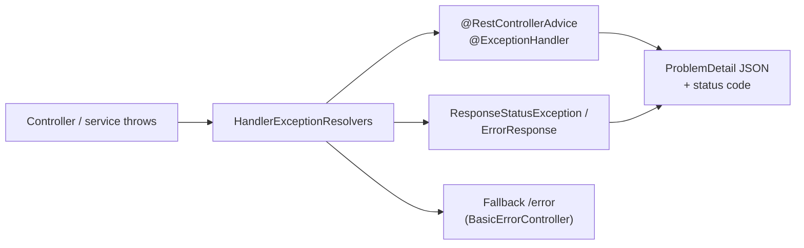

## Simple definition

A **RESTful API** exposes **resources** (orders, customers) at stable URIs and uses **HTTP methods and status codes** with their standard meanings. **Global exception handling** turns every error into a **consistent, machine-readable response**, in Spring using `@RestControllerAdvice` and **RFC 9457 Problem Details**.

## The problem

Inconsistent APIs (`/getOrder`, `/order/delete?id=1`), `200 OK` with `{"error": …}` bodies, stack traces in responses, and different error shapes per endpoint make clients fragile and leak internals.

## Resource design

| Action | Method + URI | Success status |
|---|---|---|
| List or search | `GET /orders?status=PAID&page=0&size=20` | 200 |
| Read one | `GET /orders/{id}` | 200 (404 if missing) |
| Create | `POST /orders` | **201 Created** + `Location` header |
| Replace | `PUT /orders/{id}` | 200 or 204 |
| Partial update | `PATCH /orders/{id}` (JSON Merge Patch) | 200 or 204 |
| Delete | `DELETE /orders/{id}` | 204 |
| Action that is not CRUD | `POST /orders/{id}/cancellation` | 202 or 200 |

- Use **nouns, plural, lower-case, hyphenated** names; nest only for true ownership (`/orders/{id}/lines`).
- **Safe** methods (GET, HEAD) do not change state. **Idempotent** methods (GET, PUT, DELETE) can be retried safely. **POST is not idempotent**, so support an **`Idempotency-Key`** header for payments and orders.

### Status codes that matter

| Code | Use |
|---|---|
| 400 | Malformed request or validation failure |
| 401 / 403 | Not authenticated / not allowed |
| 404 | Resource not found (or hidden) |
| 409 | Conflict: a business rule or version conflict |
| 412 | `If-Match` precondition failed (optimistic locking via ETag) |
| 422 | Semantically invalid (some teams use it for validation errors) |
| 429 | Rate limited (send `Retry-After`) |
| 500 / 503 | Server error / temporarily unavailable |

## Validation and DTOs

```java
public record CreateOrder(
        @NotBlank String customerId,
        @NotEmpty List<@Valid Line> lines,
        @Size(max = 500) String note) {
    public record Line(@NotBlank String sku, @Positive int quantity) {}
}
```

- Validate at the edge with `@Valid` and Jakarta Validation. Spring 6.1+ also validates `@PathVariable` and `@RequestParam` constraints through **built-in method validation**.
- Keep **DTOs separate from entities and domain objects**, and map explicitly. Records are ideal DTOs.

## Pagination, filtering and sorting

- Use `Pageable` with `page`, `size` and `sort`. Return page metadata. Spring Data's `PagedModel` gives a stable JSON shape (`spring.data.web.pageable.serialization-mode=via-dto`).
- For very large or real-time feeds, use **cursor/keyset pagination** (`?after=…`), which stays fast and stable while data changes.

## Versioning (Spring Framework 7)

Spring 7 adds **first-class API versioning**:

```java
@Configuration
class ApiConfig implements WebMvcConfigurer {
    public void configureApiVersioning(ApiVersionConfigurer c) {
        c.useRequestHeader("API-Version").addSupportedVersions("1.0", "2.0").setDefaultVersion("1.0");
    }
}

@GetMapping(path = "/orders/{id}", version = "1.0")   OrderV1 getV1(@PathVariable long id) { ... }
@GetMapping(path = "/orders/{id}", version = "2.0+")  OrderV2 getV2(@PathVariable long id) { ... }
```

Strategies: a header, a path segment (`/v2/…`), a query parameter or a media type. Clients (`RestClient`, `WebClient`, HTTP interfaces) can send versions too. Prefer **additive, backward-compatible changes**, and version only for breaking ones.

## Global error handling with Problem Details

**RFC 9457** (which replaced RFC 7807) defines a standard JSON error body:

```json
{
  "type": "https://api.shop.example/problems/insufficient-stock",
  "title": "Insufficient stock",
  "status": 409,
  "detail": "SKU ABC-1 has 2 units, 5 requested",
  "instance": "/api/orders",
  "sku": "ABC-1",
  "traceId": "4bf92f3577b34da6a3ce929d0e0e4736"
}
```

```java
@RestControllerAdvice
class ApiExceptionHandler extends ResponseEntityExceptionHandler {   // handles Spring MVC's own exceptions as ProblemDetail

    @ExceptionHandler(OrderNotFoundException.class)
    ProblemDetail notFound(OrderNotFoundException ex) {
        ProblemDetail pd = ProblemDetail.forStatusAndDetail(HttpStatus.NOT_FOUND, ex.getMessage());
        pd.setType(URI.create("https://api.shop.example/problems/order-not-found"));
        pd.setProperty("orderId", ex.orderId().value());
        return pd;
    }

    @ExceptionHandler(InsufficientStockException.class)
    ProblemDetail conflict(InsufficientStockException ex) {
        ProblemDetail pd = ProblemDetail.forStatusAndDetail(HttpStatus.CONFLICT, ex.getMessage());
        pd.setTitle("Insufficient stock");
        pd.setProperty("sku", ex.sku());
        return pd;
    }

    @ExceptionHandler(Exception.class)                      // last resort: no internals leaked
    ProblemDetail unexpected(Exception ex) {
        log.error("Unhandled error", ex);
        return ProblemDetail.forStatusAndDetail(HttpStatus.INTERNAL_SERVER_ERROR, "Unexpected error");
    }
}
```

```properties
spring.mvc.problemdetails.enabled=true   # Problem Details for built-in errors (400s from validation, 405, 415…)
```



**Rules:** one place for mapping; **never return stack traces**; include a **trace or correlation ID**; and map validation errors to a list of field errors.

## Calling other APIs: RestClient and HTTP interfaces

```java
@HttpExchange("/api/inventory")
interface InventoryClient {
    @GetExchange("/{sku}") Stock stock(@PathVariable String sku);
}
// Spring 7 / Boot 4: @ImportHttpServices(group = "inventory", types = InventoryClient.class)
// with base URL and timeouts configured via spring.http.serviceclient.inventory.*
```

`RestClient` (synchronous, fluent) replaces `RestTemplate` for new code. **HTTP interfaces** generate clients from annotated interfaces, like OpenFeign but built in.

## Documentation

Generate OpenAPI 3.1 documentation with **springdoc-openapi**, or design-first with an OpenAPI spec and code generation. Publish it, and lint it in CI (Spectral).

## Common mistakes

> [!MISTAKE] 200 OK with an error body
> Clients, caches and monitoring rely on status codes. Use proper 4xx and 5xx codes with Problem Details.

> [!MISTAKE] Leaking exceptions
> Stack traces and SQL in responses expose internals. Map everything centrally, with a safe fallback.

> [!MISTAKE] Non-idempotent retries
> Retrying `POST /payments` can charge twice. Support `Idempotency-Key` and store the results.

## Quick check

**Which HTTP methods are idempotent?**
GET, HEAD, PUT, DELETE and OPTIONS. POST is not, and PATCH is not guaranteed.

**What should `POST /orders` return on success?**
201 Created with a `Location` header pointing to the new resource, and usually the created representation.

**What is RFC 9457?**
The Problem Details standard for machine-readable HTTP error bodies (`type`, `title`, `status`, `detail`, `instance`, plus extensions). It obsoletes RFC 7807.

**How do you centralise error handling in Spring MVC?**
A `@RestControllerAdvice` with `@ExceptionHandler` methods returning `ProblemDetail`, often extending `ResponseEntityExceptionHandler`.

**What API versioning support did Spring Framework 7 add?**
Built-in versioning strategies (header, path, query, media type) configured centrally, with `version` attributes on request mappings.

## Summary

- Resources plus correct methods, status codes and idempotency make a predictable API.
- Validate at the edge, use DTOs, paginate, and version only for breaking changes.
- Map all errors centrally to RFC 9457 Problem Details, without leaking internals.
- Use RestClient and HTTP interfaces to consume APIs.

## References

- [RFC 9457: Problem Details for HTTP APIs](https://www.rfc-editor.org/rfc/rfc9457) and [RFC 9110: HTTP Semantics](https://www.rfc-editor.org/rfc/rfc9110).
- Spring Framework reference, [Error responses](https://docs.spring.io/spring-framework/reference/web/webmvc/mvc-ann-rest-exceptions.html) and [API versioning](https://docs.spring.io/spring-framework/reference/web/webmvc-versioning.html).
- Spring Framework reference, [HTTP Interface clients](https://docs.spring.io/spring-framework/reference/integration/rest-clients.html#rest-http-interface).
- [springdoc-openapi](https://springdoc.org/).
