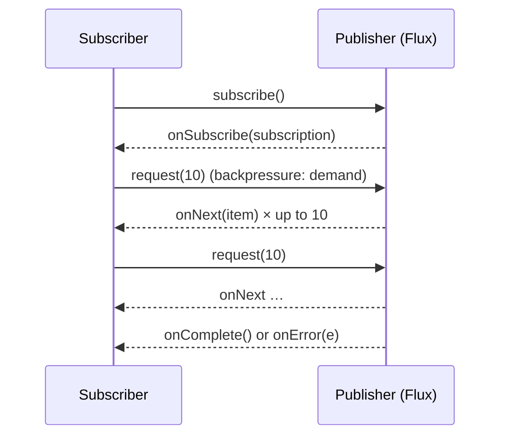

## Simple definition

**Reactive programming** composes **asynchronous, non-blocking streams of data** with **backpressure**, so a consumer controls how fast data arrives. **Project Reactor** implements it with two types: **`Mono<T>`** (0 or 1 item) and **`Flux<T>`** (0 to N items). **Spring WebFlux** is the reactive web framework built on Reactor, usually running on **Netty** with a small number of event-loop threads.

## The problem

Thread-per-request servers waste threads waiting on I/O. Streaming, server-sent events and high-fan-out gateways need to handle many slow connections with few resources, **and** to slow down producers that are faster than consumers. Reactive Streams solves both. Since Java 21, virtual threads also solve the first part (see the comparison below).

## Reactive Streams in one picture



The JDK includes these interfaces as `java.util.concurrent.Flow` (Java 9).

## Mono, Flux and laziness

```java
Flux<Order> orders = orderRepository.findByStatus(PAID)        // nothing happens yet (assembly)
        .filter(o -> o.total().compareTo(LIMIT) > 0)
        .flatMap(o -> fraudClient.score(o)                       // async call per order, concurrent
                        .map(score -> o.withRisk(score)), 8)     // concurrency limit 8
        .timeout(Duration.ofSeconds(2))
        .onErrorResume(TimeoutException.class, e -> Flux.empty());

orders.subscribe(System.out::println);                          // subscription triggers execution
```

> [!KEY] Nothing happens until you subscribe
> Building a pipeline (**assembly**) does no work. **Subscription** starts the data flow. In WebFlux, the framework subscribes to the `Mono` or `Flux` your controller returns.

### Essential operators

| Need | Operator |
|---|---|
| Transform synchronously | `map` |
| Call something async per item | `flatMap` (concurrent, unordered), `concatMap` (sequential, ordered), `flatMapSequential` (concurrent, ordered) |
| Combine | `zip` (pairwise), `Mono.zip(a, b)`, `merge`, `concat` |
| Filter and limit | `filter`, `take`, `skip`, `distinct` |
| Errors | `onErrorResume`, `onErrorReturn`, `onErrorMap`, `retryWhen(Retry.backoff(3, ofMillis(100)))` |
| Time | `timeout`, `delayElements`, `interval` |
| Side effects | `doOnNext`, `doOnError`, `doFinally` (logging, metrics) |
| Batch | `buffer`, `window` |
| Default | `defaultIfEmpty`, `switchIfEmpty` |

## Never block the event loop

WebFlux on Netty uses about **one event-loop thread per core**. A single blocking call (JDBC, `Thread.sleep`, a blocking HTTP client) **stalls every request** sharing that thread.

- Use reactive drivers: **WebClient**, **R2DBC**, reactive MongoDB, Redis and Kafka (reactor-kafka).
- If you **must** call blocking code: `Mono.fromCallable(() -> legacy.call()).subscribeOn(Schedulers.boundedElastic())`.
- Detect accidental blocking in tests with **BlockHound**.

| Scheduler | For |
|---|---|
| `Schedulers.parallel()` | CPU-bound work (threads ≈ cores) |
| `Schedulers.boundedElastic()` | Wrapping blocking calls (bounded) |
| `publishOn` / `subscribeOn` | Switch where downstream or upstream work runs |

## WebFlux endpoints

```java
@RestController
@RequestMapping("/api/prices")
class PriceController {
    @GetMapping("/{sku}")
    Mono<Price> price(@PathVariable String sku) { return pricing.quote(sku); }

    @GetMapping(value = "/stream", produces = MediaType.TEXT_EVENT_STREAM_VALUE)
    Flux<Price> stream() { return pricing.liveUpdates(); }                    // server-sent events
}

// Functional style
@Bean
RouterFunction<ServerResponse> routes(PriceHandler h) {
    return route(GET("/api/prices/{sku}"), h::price);
}
```

**WebClient** is the reactive HTTP client:

```java
Mono<Stock> stock = webClient.get().uri("/inventory/{sku}", sku)
        .retrieve().bodyToMono(Stock.class)
        .timeout(Duration.ofMillis(500))
        .retryWhen(Retry.backoff(2, Duration.ofMillis(100)));
```

**Context propagation:** use Reactor's `Context` (not ThreadLocal). Micrometer's context-propagation library carries trace IDs and security context automatically when enabled (`Hooks.enableAutomaticContextPropagation()`).

## Testing

```java
StepVerifier.create(pricing.quote("ABC"))
        .expectNextMatches(p -> p.amount().signum() > 0)
        .verifyComplete();
```

Use `WebTestClient` for endpoint tests, and virtual time (`StepVerifier.withVirtualTime`) for delays.

## WebFlux vs MVC with virtual threads

| Choose | When |
|---|---|
| **Spring MVC + virtual threads** | Typical CRUD and request/response services with blocking libraries (JPA, JDBC). Simpler code and debugging. **The default for most teams in 2026.** |
| **WebFlux** | Streaming (SSE, WebSockets), gateways (Spring Cloud Gateway), very high concurrency with backpressure, an end-to-end reactive stack (R2DBC, reactive Kafka), or an existing reactive codebase |

Mixing them is fine at the edges: MVC apps can use `WebClient`, or `RestClient` with HTTP interfaces.

## Common mistakes

> [!MISTAKE] Blocking calls in reactive pipelines
> A JDBC call or `block()` on an event-loop thread freezes throughput. Use reactive drivers or `boundedElastic`.

> [!MISTAKE] Forgetting to subscribe
> A `Mono` that is created but never returned or subscribed does nothing. Side effects silently never happen.

> [!MISTAKE] flatMap when order matters
> `flatMap` interleaves results. Use `concatMap` or `flatMapSequential` to preserve order.

## Quick check

**Mono vs Flux?**
Mono emits 0 or 1 item; Flux emits 0 to N items. Both then complete or error.

**What is backpressure?**
The subscriber signals demand (`request(n)`), so the publisher never sends more than the consumer can handle.

**Why must you not block in WebFlux?**
A few event-loop threads serve all requests. Blocking one stalls every connection assigned to it.

**`flatMap` vs `concatMap`?**
`flatMap` subscribes to inner publishers concurrently, so results can arrive out of order. `concatMap` processes them one at a time, in order.

**When pick WebFlux over MVC with virtual threads?**
For streaming, gateways, backpressure-heavy pipelines or fully reactive stacks. For ordinary request/response services, MVC with virtual threads is usually simpler.

## Summary

- Reactor gives Mono and Flux with lazy, non-blocking, backpressured pipelines.
- WebFlux on Netty must never block; use reactive drivers and WebClient.
- Test with StepVerifier and WebTestClient.
- Since Java 21, choose WebFlux for streaming and reactive stacks, and MVC + virtual threads for typical services.

## References

- Spring Framework reference, [Spring WebFlux](https://docs.spring.io/spring-framework/reference/web/webflux.html).
- [Project Reactor reference guide](https://projectreactor.io/docs/core/release/reference/).
- [Reactive Streams specification](https://www.reactive-streams.org/).
- [BlockHound](https://github.com/reactor/BlockHound).
