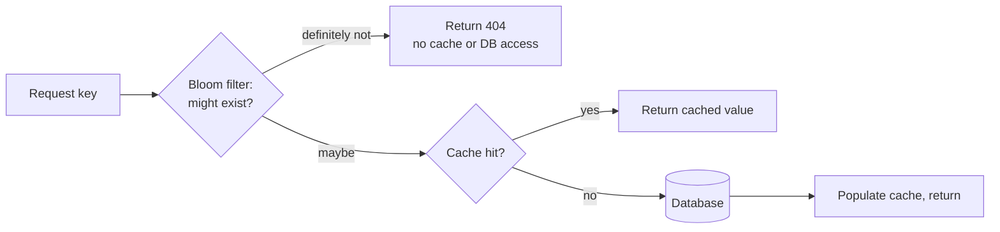

## Simple definition

A **cache** is a small, fast store holding copies of data that is expensive to fetch or compute. It works because of **locality of reference**: recently requested data is likely to be requested again. Caches exist at almost every layer — hardware, operating system, browser, CDN, application, database — and they are the cheapest way to cut latency and load.

The hard parts are not putting data *into* a cache; they are keeping it **correct** (invalidation) and **safe** when it misses or fails.

## Where to cache

| Layer | Caches | Example |
|---|---|---|
| Client / browser | HTTP responses, assets | `Cache-Control`, `ETag` |
| **CDN** | Static and some dynamic content near users | CloudFront, Cloudflare, Akamai |
| Reverse proxy / gateway | Whole responses | NGINX, Varnish |
| **Application (local)** | Hot objects in process memory | Caffeine, `@Cacheable` with a local provider |
| **Distributed cache** | Shared across instances | Redis, Memcached, Hazelcast |
| Database | Buffer pool, query cache | InnoDB buffer pool, PostgreSQL shared buffers |

**Local cache per node** is fastest but each node has its own copy, so misses multiply as nodes are added and copies disagree. A **global (distributed) cache** is shared: either every node queries it directly, or it fetches from the origin itself on a miss. Distributed caches partition keys across nodes with [consistent hashing](/system-design/building-blocks/consistent-hashing), so adding a cache node only moves a fraction of keys.

A **CDN** is a cache for large static media. If the system is not big enough for a CDN, serve static media from a separate subdomain with a lightweight server (NGINX) and move to a CDN later by changing DNS.

## Read strategies

| Strategy | Who loads on a miss | Notes |
|---|---|---|
| **Cache-aside** (lazy loading) | The **application**: read cache; on miss, read DB and populate cache | Most common; only requested data is cached; first request is slow |
| **Read-through** | The **cache** itself loads from the DB via a loader | Simpler application code; cache library must know the data source |

```java
// Cache-aside
Product p = cache.get(id);
if (p == null) {
    p = repository.findById(id).orElseThrow();
    cache.set(id, p, Duration.ofMinutes(10));
}
```

In Spring, `@Cacheable` implements cache-aside declaratively; see [Spring Cache and Redis](/spring/data/caching).

## Write strategies

| Strategy | On write | Pros | Cons |
|---|---|---|---|
| **Write-through** | Write to cache and DB synchronously | Cache always fresh; no data loss | Higher write latency; caches data that may never be read |
| **Write-around** | Write to DB only; cache populated on later reads | Avoids flooding cache with write-once data | Recent writes miss the cache |
| **Write-back** (write-behind) | Write to cache only; flush to DB later, in batches | Lowest write latency, high throughput | **Data loss** if the cache fails before flushing |

Strategies combine: cache-aside reads with write-around writes (plus invalidation) is the most common pairing for web applications.

## Invalidation

> "There are only two hard things in computer science: cache invalidation and naming things." — Phil Karlton

Cached data must stay **coherent** with the source. Options:

- **TTL (time to live):** entries expire after a fixed time. Simple; data can be stale for up to the TTL.
- **Explicit invalidation:** delete (or update) the cache entry when the data changes. Prefer **delete** over update: concurrent updates can write stale values into the cache in the wrong order.
- **Event-driven invalidation:** consume the database's change stream ([CDC](/data-systems/stream-processing)) and invalidate affected keys, which works even for writes from other services.
- **Versioned keys:** include a version in the key (`product:42:v7`); old versions simply expire.

> [!WARNING] The delete-then-write race
> With cache-aside, a reader can miss, read the old value from the database, and write it into the cache *after* a writer has updated the database and deleted the key. The stale value then lives until the TTL. Mitigations: always set a TTL, delete again shortly after writing ("delayed double delete"), or use CDC-based invalidation.

## Eviction policies

When the cache is full, something must go:

| Policy | Evicts | Note |
|---|---|---|
| **LRU** (least recently used) | Entry unused for longest | Most common default |
| **LFU** (least frequently used) | Entry used least often | Better for stable popularity; Redis `allkeys-lfu` |
| FIFO | Oldest inserted | Simple, often worse |
| Random | Random entry | Cheap; surprisingly reasonable |
| TTL-based | Soonest to expire | Redis `volatile-ttl` |

Caffeine uses **W-TinyLFU**, which combines recency and frequency with very high hit rates.

## Failure modes and their fixes

| Problem | What happens | Fixes |
|---|---|---|
| **Cache penetration** (cache miss attack) | Requests for keys that exist in neither cache nor DB always hit the DB; attackers can exploit this | Cache **null results** with a short TTL; put a **Bloom filter** of existing keys in front so missing keys are rejected without touching cache or DB |
| **Cache stampede** (thundering herd, dog-piling) | A hot key expires and thousands of requests rebuild it at once | A per-key lock or single-flight so one request rebuilds; serve stale while revalidating; refresh before expiry |
| **Cache avalanche** | Many keys expire at the same moment, or the cache cluster fails | **Jitter** TTLs; replicate the cache; circuit breakers and rate limits protecting the DB; warm the cache before switching traffic |
| **Hot key** | One key gets a huge share of traffic and overloads one cache node | Local in-process copy of the hot key; replicate it under several keys |
| **Big key** | A huge value (multi-megabyte list) blocks Redis' single thread | Split it; store large blobs in object storage |



A Bloom filter never gives false negatives, only occasional false positives, which simply fall through to the normal path.

## Redis versus Memcached

| | Redis | Memcached |
|---|---|---|
| Data types | Strings, hashes, lists, sets, sorted sets, streams, bitmaps, HyperLogLog, geospatial | Strings only |
| Persistence | Snapshots (RDB) and append-only file (AOF) | None |
| Replication and clustering | Built-in replication, Sentinel failover, Redis Cluster sharding | Client-side sharding |
| Threading | Single-threaded command execution (I/O threads optional) | Multithreaded |
| Extras | Pub/sub, Lua scripts, transactions, TTL per key, streams | Simple, very fast for plain key-value |

Choose Memcached for a simple, multithreaded, volatile string cache; choose Redis for anything richer (leaderboards with sorted sets, rate limiting counters, distributed locks, queues).

### Why is Redis so fast?

- **In memory:** RAM access is orders of magnitude faster than disk.
- **I/O multiplexing and a single-threaded execution loop:** no lock contention or context switching between commands; epoll handles thousands of connections.
- **Efficient data structures:** compact encodings (listpacks, intsets) and structures with good complexity (skip lists for sorted sets).

The single thread is also why one slow command (`KEYS *`, a huge `SMEMBERS`) blocks everyone.

## Common mistakes

> [!MISTAKE] Caching without a TTL
> Entries without expiry live forever when an invalidation is missed. Always set a TTL as a safety net, even with explicit invalidation.

- **Treating the cache as the source of truth** (write-back without accepting the data-loss risk).
- **Caching per-user or rarely reused data** that only evicts useful entries.
- **Identical TTLs** for a large batch of keys, inviting an avalanche.
- **Serialisation mismatches** after deployments (old cached objects unreadable by new code); version cache keys or formats.

## Quick check

**What is the difference between cache-aside and read-through?**
In cache-aside, the application loads data into the cache on a miss; in read-through, the cache does it via a configured loader.

**When would you use write-back?**
When write latency and throughput matter more than the risk of losing recent writes if the cache fails, for example counters and metrics.

**What is cache penetration and how do you prevent it?**
Repeated requests for keys that do not exist bypass the cache and hit the database. Cache null results with a short TTL or use a Bloom filter of existing keys.

**How do you prevent a cache stampede?**
Let only one request rebuild an expired hot key (lock or single-flight), serve stale data while refreshing, or refresh proactively.

**Why is Redis fast despite being single-threaded?**
Data is in memory, an event loop multiplexes I/O without locking or context switches, and its data structures are efficient.

## Related topics

- [Spring Cache and Redis](/spring/data/caching)
- [Consistent Hashing](/system-design/building-blocks/consistent-hashing)
- [Stream Processing: change data capture](/data-systems/stream-processing)
- [Diagram Building Blocks: cache-aside](/system-design/diagram-patterns#cache-cache-aside)

## References

- Alex Xu. *ByteByteGo System Design Handbook*: top cache strategies; cache miss attack; Redis vs Memcached; why is Redis so fast.
- System Design Notes (handwritten, LinkedIn): caching, CDNs, cache invalidation, eviction policies.
- [Caffeine: design of W-TinyLFU](https://github.com/ben-manes/caffeine/wiki/Efficiency).
