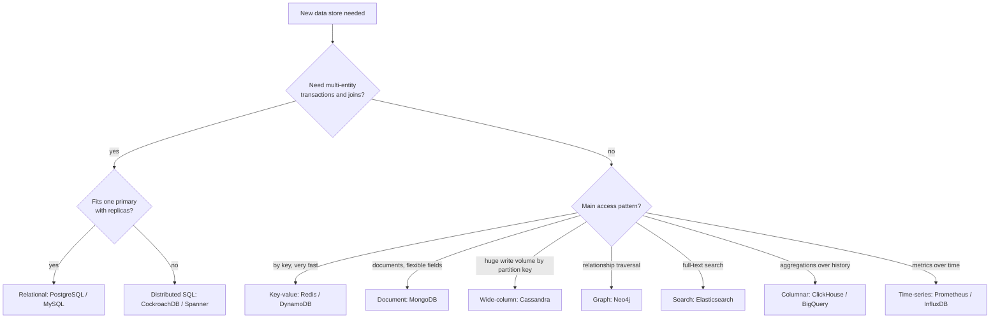

## Simple definition

There is no best database, only the best fit for a **workload**: the shape of the data, how it is queried, how much there is, how fast it changes, and which guarantees it needs. Choosing well means asking those questions first and naming the technology last.

## SQL versus NoSQL

| | SQL (relational) | NoSQL (non-relational) |
|---|---|---|
| Data | Structured rows and columns; one row is one entity, one column one attribute | Unstructured or semi-structured; documents, key-values, wide rows, graphs |
| Schema | Predefined (schema-on-write) | Dynamic (schema-on-read) |
| Queries | SQL, joins, ad-hoc queries | Mostly by key or a predefined access pattern; limited joins |
| Transactions | ACID, multi-row | Often single-item atomicity; some offer transactions |
| Scaling | Primarily vertical, plus read replicas; sharding is manual or via distributed SQL | Designed for horizontal scaling across commodity servers |
| Examples | PostgreSQL, MySQL, MariaDB, Oracle, SQL Server | MongoDB, Cassandra, DynamoDB, Redis, Neo4j, HBase |

### Reasons to choose SQL

- You need **ACID** guarantees and integrity constraints — e-commerce orders, financial records — to reduce anomalies and protect data.
- Your data is **structured and stable**, and the business is not facing sudden, massive growth in volume or variety.
- You need flexible, ad-hoc queries and joins across entities.

### Reasons to choose NoSQL

- You must store **large volumes** of data with little or no structure, or with varying attributes.
- You want to make full use of **cloud and commodity hardware**, spreading data across many servers cheaply.
- You need **rapid development** with evolving data shapes, or very high write throughput with predictable key-based access.

> [!TIP] Default to a relational database
> PostgreSQL handles JSON documents, full-text search, geospatial queries (PostGIS) and terabytes of data on one primary. Start there unless a specific requirement — massive write throughput, global multi-region writes, graph traversals — points elsewhere.

## The NoSQL families and other specialised stores

| Family | Model | Strengths | Examples | Typical uses |
|---|---|---|---|---|
| **Key-value** | Opaque value by key | Extreme speed and scale, simple API | Redis, DynamoDB, Riak, etcd | Caches, sessions, shopping carts, feature flags, rate-limit counters |
| **Document** | JSON-like documents, indexed fields | Flexible schema, locality for trees | MongoDB, Couchbase, Firestore | Catalogues, user profiles, content |
| **Wide-column** | Rows with dynamic columns grouped in families, partitioned and sorted | Massive write throughput, time-ordered data per key | Cassandra, ScyllaDB, HBase, Bigtable | Messaging, IoT, activity logs, time-series at scale |
| **Graph** | Vertices and edges | Relationship traversals | Neo4j, Neptune | Social networks, fraud detection, recommendations |
| **Time-series** | Timestamped measurements | Compression, downsampling, retention | InfluxDB, TimescaleDB, Prometheus | Metrics, monitoring, sensors |
| **Search** | Inverted index | Full-text relevance, faceting | Elasticsearch, OpenSearch, Solr | Product search, log search |
| **Columnar (OLAP)** | Column-oriented storage | Aggregations over billions of rows | ClickHouse, BigQuery, Redshift, Snowflake | Analytics, reporting |
| **NewSQL / distributed SQL** | Relational + horizontal scaling + consensus | SQL and transactions at scale | CockroachDB, Spanner, YugabyteDB, TiDB | Global transactional systems |

See [Data Models](/data-systems/data-models-and-query-languages) and [Storage Engines](/data-systems/storage-engines) for how these work internally.

## A decision process

Questions to ask in an interview:

1. What are the entities and relationships? (one-to-many trees vs many-to-many)
2. What are the top queries, and their read/write ratio?
3. What volume and growth? (estimate it)
4. Which consistency is required for each operation? (see [CAP and PACELC](/system-design/building-blocks/cap-theorem-and-pacelc))
5. What latency, availability and geographic distribution are required?
6. What does the team already know how to operate?

## Polyglot persistence

Large systems use several stores, each for what it does best: PostgreSQL as the system of record, Redis for caching and rate limiting, Elasticsearch for search, a warehouse for analytics, object storage for files. Keep **one system of record** per piece of data and derive the others from it, ideally with [change data capture](/data-systems/stream-processing), to avoid inconsistent dual writes. Each additional technology adds operational cost.

## Indexes

An index is a data structure that makes retrieval faster at the cost of **extra storage** and **slower writes** (every insert, update and delete must update every index). Indexes are well known from relational databases, but the same idea applies to any data set: a table of contents for large data spread across machines.

- Index the columns used in `WHERE`, `JOIN` and `ORDER BY` of frequent queries; verify with `EXPLAIN`.
- For write-heavy tables, keep indexes to a minimum.
- Composite indexes follow the leftmost-prefix rule.

See [Storage Engines: other indexing structures](/data-systems/storage-engines).

## Block, file and object storage

Not all data belongs in a database. Large binary content (images, videos, backups, logs) belongs in storage designed for it.

| | Block storage | File storage | Object storage |
|---|---|---|---|
| Unit | Fixed-size blocks, raw volume | Files in a hierarchical directory tree | Objects (data + metadata) in a flat namespace with keys |
| Access | Attached to one server, formatted with a filesystem or used by a database | Network protocols (NFS, SMB), shared by many clients | HTTP API (`PUT`/`GET` by key) |
| Performance | Highest, lowest latency | Medium | Higher latency, very high throughput |
| Scalability | Limited per volume | Medium | Virtually unlimited, cheapest per GB |
| Mutability | In-place updates | In-place updates | Objects are typically immutable (replace whole object) |
| Examples | AWS EBS, SAN, local SSD | AWS EFS, NFS shares | Amazon S3, Google Cloud Storage, Azure Blob, MinIO |
| Use for | Databases, VM disks | Shared home directories, legacy apps | Media, backups, data lakes, static assets |

Object stores achieve durability with replication or **erasure coding** (splitting data into fragments plus parity, so it can be rebuilt from a subset at lower storage overhead than full copies). Large uploads use **multipart upload**: split the file into parts, upload them in parallel and independently (retrying only failed parts), then ask the store to assemble them.

## Common mistakes

> [!MISTAKE] Choosing NoSQL "for scale" without a scale problem
> Giving up joins, transactions and ad-hoc queries for scale you will not reach makes every feature harder. Estimate first.

- **Storing large files as database BLOBs** instead of object storage plus a metadata row.
- **Modelling NoSQL tables like relational ones**; wide-column and key-value stores are designed around the queries, one table per access pattern.
- **Adding a technology per feature**, multiplying operational burden.

## Quick check

**Give two reasons to choose a relational database.**
ACID transactions and integrity for critical data, and structured, stable data with ad-hoc queries and joins.

**Give two reasons to choose NoSQL.**
Large volumes of unstructured or varied data, and cheap horizontal scaling across commodity or cloud servers.

**What is polyglot persistence and its main risk?**
Using several specialised data stores in one system; the risk is inconsistency and operational cost, mitigated by one system of record and change data capture.

**What do indexes cost?**
Storage space and write performance, because every write must update each index.

**When would you use object storage instead of block storage?**
For large, immutable binary objects accessed over HTTP at scale (media, backups, data lakes); block storage is for databases and VM disks needing low-latency in-place updates.

## Related topics

- [Data Models and Query Languages](/data-systems/data-models-and-query-languages)
- [Storage Engines](/data-systems/storage-engines)
- [CAP Theorem and PACELC](/system-design/building-blocks/cap-theorem-and-pacelc)
- [Spring Data JPA and the Hibernate Lifecycle](/spring/data/spring-data-jpa-and-hibernate)

## References

- Alex Xu. *ByteByteGo System Design Handbook*: a visual guide on how to choose the right database; block storage, file storage and object storage; erasure coding; upload large files.
- System Design Notes (handwritten, LinkedIn): SQL vs NoSQL, reasons to use SQL and NoSQL databases, indexes.
- Martin Kleppmann. *Designing Data-Intensive Applications*. O'Reilly, 2017. Chapters 2 and 3.
