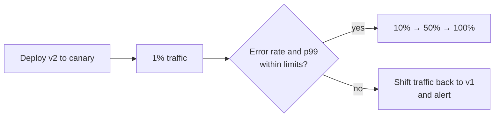

## Simple definition

Deploying or upgrading services is risky: most outages are caused by changes. A **deployment strategy** decides how a new version replaces the old one, aiming for **no downtime**, **limited blast radius** if the new version is bad, and **fast rollback**.

## The strategies

| Strategy | How | Rollback | Extra cost | Risk |
|---|---|---|---|---|
| **Multi-service (big bang)** | Upgrade all services at the same time | Hard | None | High: dependencies hard to test; all users hit at once |
| **Recreate** | Stop old, start new | Redeploy old | None | Downtime |
| **Rolling** | Replace instances a few at a time | Roll back gradually | Little | Medium: two versions run together |
| **Blue-green** | Two identical environments; switch all traffic at once | **Instant**: switch back | **Double** infrastructure | Low for rollback; all users switch together |
| **Canary** | Send a small share of traffic to the new version, increase gradually | Fast: shift traffic back | Small | **Lowest**: problems affect few users |
| **A/B test** | Different versions for user segments to compare business metrics | Turn off experiment | Small | Low; is an experiment, not a release method |
| **Shadow (dark launch)** | Copy live traffic to the new version; discard its responses | Nothing to roll back | Extra capacity | Zero user impact; careful with side effects |

## Rolling updates

Instances are replaced in batches: take some out of the load balancer, deploy, wait for readiness checks, put them back, continue. This is Kubernetes' default (`maxSurge`, `maxUnavailable`).

Requirements: **readiness probes** so traffic only reaches warmed-up instances (see [Actuator](/spring/boot/actuator-and-custom-endpoints)), **graceful shutdown** so in-flight requests finish, and **compatibility** between versions running side by side.

## Blue-green

```mermaid {title="Blue-green: switch the router, keep the old environment for rollback"}
flowchart LR
    U((Users)) --> R[Router / load balancer]
    R -- "100% (live)" --> G["Green: v1"]
    R -. "0% → 100% after tests" .-> B["Blue: v2"]
    G --> DB[(Shared database)]
    B --> DB
```

The new version is deployed to the idle environment and tested there with production configuration. Switching the router moves all traffic at once; switching back is the rollback. Costs: two production-grade environments, and the **shared database** must work with both versions.

## Canary releases

A canary deployment upgrades gradually: 1% of traffic, then 5%, 25%, 100%, watching error rates, latency and business metrics at each step. Users are selected randomly or by segment (internal staff first, one region). It is cheaper than blue-green and limits the blast radius, but requires good **monitoring** and, ideally, **automated analysis** that stops and rolls back when metrics degrade (Argo Rollouts, Flagger, Spinnaker's Kayenta).



ByteByteGo describes how Amazon builds and operates software with this mindset: small changes deployed through automated pipelines, gradually, with automatic rollback triggered by alarms.

## Feature flags

**Feature flags** separate *deploying* code from *releasing* a feature: code ships turned off, and a flag turns it on for chosen users, percentages or tenants without a deployment. Benefits: trunk-based development, instant kill switches, gradual exposure and experiments. Costs: conditional code paths to test, and **flag debt** if old flags are never removed. Tools: Unleash, LaunchDarkly, OpenFeature, or a simple configuration service.

## Database changes during deployment

During rolling, blue-green and canary deployments, **old and new code run at the same time against the same database**. Schema changes must therefore be backward and forward compatible. Use the **expand–contract** (parallel change) pattern:

1. **Expand:** add the new column or table (nullable, no constraints that old code would violate).
2. Deploy code that **writes both** old and new structures, and reads the old.
3. **Backfill** existing rows.
4. Deploy code that **reads the new** structure.
5. **Contract:** stop writing the old structure, then drop it in a later release.

The same compatibility rules apply to API payloads and messages; see [Encoding and Schema Evolution](/data-systems/encoding-and-schema-evolution) and [Auditing and Migrations](/spring/data/auditing-and-migrations).

## Choosing

- **Most services:** rolling updates with readiness checks, plus feature flags for risky features.
- **High-risk changes or critical services:** canary with automated analysis.
- **Need instant, whole-system rollback** and can afford it: blue-green.
- **Validating performance of a rewrite:** shadow traffic first.

## Common mistakes

> [!MISTAKE] A destructive migration in the same release as the code change
> Renaming or dropping a column while old instances are still running breaks them mid-rollout, and makes rollback impossible. Expand first, contract later.

- **Canaries without metrics or alerts**: the bad version reaches 100% before anyone notices.
- **No graceful shutdown**, dropping requests on every deployment.
- **Testing blue against a different configuration** than green.
- **Deploying many services at once**, making failures hard to attribute.

## Quick check

**What is the main advantage of blue-green deployment?**
Instant rollback by switching traffic back to the previous environment.

**Why is canary deployment considered lowest risk?**
Only a small share of users sees the new version at first, and traffic is increased only while metrics stay healthy.

**What is the difference between a canary and an A/B test?**
A canary validates a release's health before full rollout; an A/B test compares versions on business metrics over time.

**Why must database migrations be backward compatible during rolling deployments?**
Old and new versions of the code run simultaneously against the same schema.

**What do feature flags decouple?**
Deploying code from releasing features to users.

## Related topics

- [Encoding and Schema Evolution](/data-systems/encoding-and-schema-evolution)
- [Actuator and Custom Endpoints](/spring/boot/actuator-and-custom-endpoints)
- [Observability with Micrometer and OpenTelemetry](/microservices/operations/observability-micrometer-opentelemetry)

## References

- Alex Xu. *ByteByteGo System Design Handbook*: deployment strategies; how does Amazon build and operate the software; handling a large-scale outage.
- Danilo Sato. "[Canary Release](https://martinfowler.com/bliki/CanaryRelease.html)" and Martin Fowler, "[BlueGreenDeployment](https://martinfowler.com/bliki/BlueGreenDeployment.html)."
- Pete Hodgson. "[Feature Toggles](https://martinfowler.com/articles/feature-toggles.html)."
