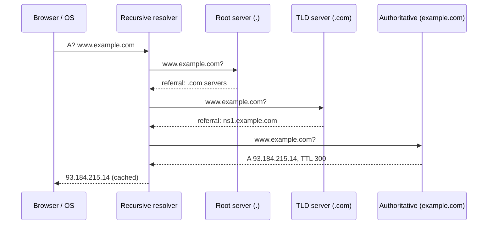

## Simple definition

When you type `https://www.example.com/products` and press Enter, the browser must: find the server's IP address (**DNS**), open a connection (**TCP**), secure it (**TLS**), send an **HTTP** request, receive the response, and **render** the page. Each step adds latency and each is a lever in system design. ByteByteGo covers this as "what happens when you type a URL into your browser?" and "how does DNS work".

## Step 1: parse the URL

`https://www.example.com:443/products?page=2#reviews` → scheme `https`, host `www.example.com`, port `443` (default for HTTPS), path `/products`, query `page=2`, fragment `reviews` (never sent to the server). If the domain is on the browser's HSTS list, `http://` is upgraded to `https://` before any request.

## Step 2: DNS resolution

DNS translates names to IP addresses. Lookups are cached at several levels — browser, operating system, home router, and the **recursive resolver** (your ISP's, or public ones such as 1.1.1.1 and 8.8.8.8) — each for the record's **TTL**. ByteByteGo notes lookups take roughly 20–120 ms when not cached.

On a full cache miss, the recursive resolver walks the hierarchy:





There are three levels of DNS servers: **root** (13 named clusters, anycast worldwide), **top-level domain** (`.com`, `.org`, `.uk`), and **authoritative** servers for each domain. The client asks once (recursive query); the resolver does the iterative work.

### Common record types

| Record | Purpose |
|---|---|
| A / AAAA | Name → IPv4 / IPv6 address |
| CNAME | Alias to another name (e.g. `www` → `example.cdn-provider.net`) |
| MX | Mail servers |
| NS | Authoritative name servers for a zone |
| TXT | Verification, SPF/DKIM policies |
| SRV | Service host and port (used by some service discovery) |

### DNS in system design

- **TTL trade-off:** long TTLs mean fewer lookups but slow failover; short TTLs (30–60 s) allow quick traffic shifts at the cost of more queries.
- **DNS load balancing:** return several A records (round robin) — coarse, because clients cache and DNS has no health awareness by default.
- **GeoDNS / latency-based routing:** return the IP of the nearest data centre (Route 53, Cloudflare), the basis of multi-region designs (see [Scaling to millions](/system-design/building-blocks/scaling-from-zero-to-millions)).
- **Anycast:** the same IP announced from many locations; routing delivers packets to the nearest one (used by CDNs and public resolvers).
- **Failover:** health-checked DNS records switch traffic away from failed regions.
- **Security:** DNSSEC signs records; DNS over HTTPS/TLS encrypts queries.

## Step 3: TCP connection

The browser opens a TCP connection: SYN, SYN-ACK, ACK — one round trip. Browsers keep connections alive and reuse them.

## Step 4: TLS handshake

For HTTPS, TLS 1.3 adds one round trip: key exchange, certificate verification against trusted CAs, and session keys. See [HTTPS, Password Storage and API Signing](/system-design/building-blocks/security-fundamentals). SNI tells the server which certificate to present when one IP hosts many domains.

## Step 5: HTTP request and response

```http
GET /products?page=2 HTTP/2
Host: www.example.com
Accept: text/html
Cookie: session=...
```

| | HTTP/1.1 | HTTP/2 | HTTP/3 |
|---|---|---|---|
| Transport | TCP | TCP | **QUIC over UDP** |
| Requests per connection | One at a time (pipelining rarely used) | **Multiplexed streams** | Multiplexed streams |
| Head-of-line blocking | Per connection | At TCP level (one lost packet stalls all streams) | **Removed** (streams independent) |
| Headers | Text | Binary, compressed (HPACK) | Compressed (QPACK) |
| Handshake | TCP + TLS | TCP + TLS | Combined; 0-RTT resumption |

The request usually hits a **CDN** edge first (cached static assets), then a [load balancer](/system-design/building-blocks/load-balancing), then application servers, caches and databases.

## Step 6: rendering

The browser parses HTML into the DOM, CSS into the CSSOM, combines them into a render tree, computes layout, paints and composites. JavaScript can block parsing (use `defer`/`async`). Further resources (CSS, JS, images, fonts) trigger more requests, ideally over the same HTTP/2 or HTTP/3 connection and from the CDN.

## Where the time goes, and how to cut it

| Cost | Mitigation |
|---|---|
| DNS lookup | Caching, `dns-prefetch`, fewer distinct domains |
| TCP + TLS round trips | Keep-alive, TLS 1.3, HTTP/3, `preconnect`, edge termination near users |
| Distance to server | CDN, multi-region deployment, anycast |
| Server processing | Caching, efficient back ends |
| Payload size | Compression (Brotli), image formats, code splitting |
| Render blocking | Critical CSS, deferred JS |

## Common mistakes

> [!MISTAKE] Relying on DNS for fast failover with long TTLs
> If records have a 24-hour TTL, clients keep using a dead IP for up to a day. Use short TTLs on records you may need to change, and combine DNS failover with load balancers.

- **Forgetting DNS is a dependency**: an outage of your DNS provider takes everything down; use two providers for critical domains.
- **Too many third-party domains** on a page, each costing DNS, TCP and TLS setup.

## Quick check

**What are the three levels of DNS servers?**
Root, top-level domain (TLD) and authoritative servers.

**Who performs the iterative lookups?**
The recursive resolver; the client sends it one recursive query.

**Why do DNS TTLs matter for failover?**
Clients and resolvers cache records for the TTL; long TTLs delay traffic moving away from a failed endpoint.

**What problem does HTTP/3 solve that HTTP/2 does not?**
TCP-level head-of-line blocking: QUIC streams are independent, so one lost packet does not stall others.

**Name three ways to reduce page-load latency.**
CDNs near users, HTTP/2 or HTTP/3 with TLS 1.3 and connection reuse, and caching plus compression.

## Summary

- DNS resolves names through caches and the root → TLD → authoritative hierarchy.
- TTLs, GeoDNS and anycast make DNS a traffic-routing tool.
- TCP, TLS and HTTP add round trips; HTTP/2 multiplexes, HTTP/3 removes head-of-line blocking.
- CDNs and caching cut most of the distance; the browser then renders the page.

## Related topics

- [HTTPS, Password Storage and API Request Signing](/system-design/building-blocks/security-fundamentals)
- [Load Balancing and Proxies](/system-design/building-blocks/load-balancing)
- [Caching Strategies: CDNs](/system-design/building-blocks/caching-strategies)

## References

- Alex Xu. *ByteByteGo System Design Handbook*: what happens when you type a URL into your browser; how does DNS work; what problem does each generation of HTTP solve; how do modern browsers work.
- [RFC 1034: Domain names — concepts and facilities](https://www.rfc-editor.org/rfc/rfc1034); [RFC 9114: HTTP/3](https://www.rfc-editor.org/rfc/rfc9114).
