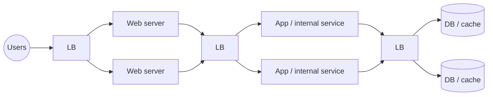

## Simple definition

A **load balancer (LB)** spreads incoming requests across a group of servers so that no single server is overloaded, and stops sending traffic to servers that are unhealthy. It improves **scalability** (add servers behind it), **availability** (route around failures) and **responsiveness**.

It is also a **proxy**: clients talk to the balancer, not to the servers.

## Where load balancers sit

To get full scalability and redundancy, balance load at each tier:

1. Between users and web servers.
2. Between web servers and internal application or platform services (and caches).
3. Between the application tier and databases (for read replicas).

## Layer 4 versus layer 7

| | Layer 4 (transport) | Layer 7 (application) |
|---|---|---|
| Decides using | IP addresses and ports (TCP/UDP) | HTTP method, path, headers, cookies, host |
| Sees content | No (can pass TLS through) | Yes (terminates TLS) |
| Can do | Fast connection-level forwarding | Path-based routing, header rewriting, caching, compression, auth, rate limiting |
| Cost | Cheaper, faster | More CPU per request |
| Examples | AWS NLB, IPVS, HAProxy TCP mode | AWS ALB, NGINX, Envoy, HAProxy HTTP mode, Spring Cloud Gateway |

## Algorithms

| Algorithm | How | Good for | Weakness |
|---|---|---|---|
| **Round robin** | Each server in turn | Identical servers, similar requests | Ignores current load |
| **Weighted round robin** | Proportional to configured weights (CPU, memory) | Mixed server sizes | Static weights |
| **Random** | Random server (optionally weighted) | Simple, stateless balancers | Uneven in small samples |
| **Least connections** | Server with fewest active connections | Long-lived or variable-length requests | Connections ≠ load |
| **Least response time** | Fastest recent responses and fewest connections | Heterogeneous latency | Needs measurement |
| **Power of two choices** | Pick two at random, choose the less loaded | Large fleets; avoids herding | — |
| **IP hash / consistent hashing** | Hash of client IP or a key picks the server | Session affinity, cache locality | Uneven if keys are skewed |

**Sticky sessions** (affinity by cookie or IP hash) send a user to the same server. They are a workaround for stateful servers and reduce the balancer's freedom; prefer a [stateless web tier](/system-design/building-blocks/scaling-from-zero-to-millions#7-a-stateless-web-tier).

## Health checks

A balancer periodically probes each server (TCP connect, or `GET /health`). Servers failing several checks are removed from the pool, and added back when they recover. Distinguish **liveness** (process up) from **readiness** (able to serve: warmed up, dependencies reachable); route only to ready instances. Spring Boot exposes both through [Actuator](/spring/boot/actuator-and-custom-endpoints).

## Kinds of load balancer

| Kind | How | Pros | Cons |
|---|---|---|---|
| **Smart client** | The client library holds the server list, detects unresponsive hosts, picks one | No extra hop; attractive for small systems and internal calls | Logic in every client and language |
| **Hardware** | Dedicated appliances (e.g. Citrix NetScaler, F5) | Very high performance | Expensive, not trivial to configure |
| **Software** | HAProxy, NGINX, Envoy on commodity machines or as a managed cloud service | Cheap, flexible, programmable | You operate it (unless managed) |

A **hybrid** is common: large companies use hardware or cloud balancers at the edge as the first point of contact, and smart clients or software balancers internally. HAProxy can run **on each client machine** (the app talks to `localhost:9000`, HAProxy forwards to the pool) or **on intermediate servers** shared by many clients; either way it handles health checks and adds or removes machines.

In Java microservices, Spring Cloud LoadBalancer with a [service registry](/microservices/fundamentals/service-discovery) is a smart-client balancer, and a service mesh (Envoy sidecars) moves the logic out of the application.

## Avoiding a single point of failure

A single load balancer is itself a single point of failure. Run a pair:

- **Active–passive:** the passive node monitors the active one (heartbeat) and takes over its virtual IP if it fails (VRRP, keepalived).
- **Active–active:** both serve traffic, with DNS or anycast spreading load between them.

Managed cloud balancers are already redundant across zones.

## Forward and reverse proxies

| | Forward proxy | Reverse proxy |
|---|---|---|
| Acts on behalf of | **Clients** | **Servers** |
| Hides | Client identity from servers | Server topology from clients |
| Uses | Corporate egress filtering, anonymity, client-side caching | Load balancing, TLS termination, caching, compression, WAF, rate limiting |
| Examples | Squid, corporate proxies | NGINX, HAProxy, Envoy, CDNs, [API gateways](/microservices/fundamentals/api-gateway) |

The handwritten notes add a useful use of proxies: **collapsed forwarding**. A proxy that receives many identical requests (the same object) at once can forward one request and share the response, or combine requests for nearby data into one, reducing load on the origin — especially useful when caching is limited.

## Common mistakes

> [!MISTAKE] Health checks that check too much
> A `/health` endpoint that fails when a downstream dependency is slow can make *every* instance unhealthy at once, removing all capacity. Readiness should reflect the instance's ability to serve; let circuit breakers handle dependencies.

- **One balancer, no redundancy.**
- **Round robin with very different request costs**, overloading some servers.
- **Relying on sticky sessions** instead of externalising state.
- **No connection draining** during deployments, dropping in-flight requests.

## Quick check

**What is the difference between layer 4 and layer 7 load balancing?**
Layer 4 routes by IP and port without reading content; layer 7 reads HTTP and can route by path, header or cookie.

**When is least connections better than round robin?**
When requests vary in duration or connections are long-lived, so the number of active connections reflects load better than a fixed rotation.

**What is a smart client?**
A client library that load-balances itself: it holds the server list, detects unhealthy hosts and picks a server.

**How do you make the load balancer highly available?**
Run a redundant pair (active-passive with a floating IP, or active-active), or use a managed multi-zone balancer.

**Forward versus reverse proxy?**
A forward proxy represents clients to servers; a reverse proxy represents servers to clients.

## Related topics

- [API Gateway with Spring Cloud Gateway](/microservices/fundamentals/api-gateway)
- [Service Discovery](/microservices/fundamentals/service-discovery)
- [Consistent Hashing](/system-design/building-blocks/consistent-hashing)
- [Diagram Building Blocks: load balancer](/system-design/diagram-patterns#load-balancer)

## References

- System Design Notes (handwritten, LinkedIn): load balancing, smart clients, hardware and software load balancers, proxies.
- Alex Xu. *ByteByteGo System Design Handbook*: how to scale a website.
- [HAProxy documentation](https://docs.haproxy.org/).
