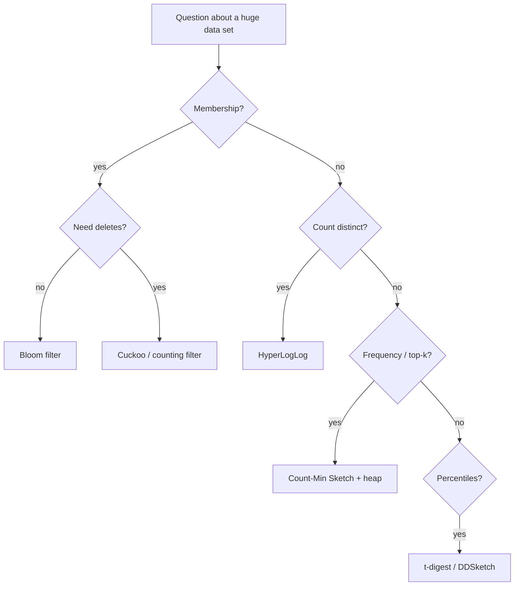

## Simple definition

**Probabilistic data structures** answer questions about very large data sets using a small, fixed amount of memory, in exchange for a small, **quantifiable error**. Exact answers would need memory proportional to the data; these need kilobytes or megabytes regardless of size.

| Question | Exact approach | Probabilistic structure | Error type |
|---|---|---|---|
| "Have I seen this item?" | Hash set of all items | **Bloom filter** | False positives (never false negatives) |
| "How many distinct items?" | Hash set, count it | **HyperLogLog** | ± ~1% relative error |
| "How often did this item occur?" | Hash map of counts | **Count-Min Sketch** | Overestimates only |

## Bloom filter

A bit array of *m* bits, all zero, and *k* independent hash functions.

- **Add(x):** set the bits at positions `h1(x) … hk(x)` to 1.
- **MightContain(x):** if any of those *k* bits is 0, x is **definitely not** in the set; if all are 1, x is **probably** in the set.

False positives happen when other items happened to set all of x's bits. With *n* items, the false-positive rate is approximately:

> p ≈ (1 − e^(−kn/m))^k, minimised with k = (m/n) · ln 2

Rule of thumb: **~9.6 bits per item for 1% false positives**, ~14.4 bits for 0.1%. One billion URLs at 1% ≈ 1.2 GB, versus tens of GB for a set of hashes.

```java
final class BloomFilter {
    private final BitSet bits;
    private final int m, k;

    BloomFilter(long expectedItems, double falsePositiveRate) {
        this.m = (int) Math.ceil(-expectedItems * Math.log(falsePositiveRate) / (Math.log(2) * Math.log(2)));
        this.k = Math.max(1, (int) Math.round((double) m / expectedItems * Math.log(2)));
        this.bits = new BitSet(m);
    }

    void add(String item) { for (int i = 0; i < k; i++) bits.set(index(item, i)); }

    boolean mightContain(String item) {
        for (int i = 0; i < k; i++) if (!bits.get(index(item, i))) return false;   // definitely absent
        return true;                                                               // probably present
    }

    private int index(String item, int i) {              // double hashing: h1 + i * h2
        int h1 = item.hashCode(), h2 = Integer.reverse(h1) ^ 0x5bd1e995;
        return Math.floorMod(h1 + i * h2, m);
    }
}
```

Production code should use strong hash functions (Murmur3), as Guava's `BloomFilter` and Redis' `BF.*` commands (RedisBloom) do.

**Limitations and variants:** a standard Bloom filter cannot **delete** items (clearing a bit may remove others). **Counting Bloom filters** use small counters instead of bits; **cuckoo filters** support deletion with similar space and often better lookup speed. Filters cannot be resized; rebuild or chain a new filter when full.

**Where they appear:**

- LSM-tree storage engines: skip SSTables that cannot contain a key ([Storage Engines](/data-systems/storage-engines)).
- Cache penetration defence: reject requests for keys that do not exist ([Caching Strategies](/system-design/building-blocks/caching-strategies#failure-modes-and-their-fixes)).
- Web crawlers: "have we seen this URL?" ([Web Crawler](/system-design/case-studies/web-crawler)).
- Recommendation systems: do not show already-seen items; browsers' malicious-URL checks; distributed joins.

## HyperLogLog

Counting distinct users per day exactly needs a set of all user IDs. **HyperLogLog (HLL)** estimates the cardinality with about **1.6% error using 1.5 KB** — or 0.81% with 12 KB (Redis' default) — for counts in the billions.

Intuition: hash each item to uniform random bits. In a random bit string, a run of *r* leading zeros has probability 2^(−r); seeing a maximum run of 20 leading zeros suggests roughly 2^20 distinct items. One estimate is noisy, so HLL splits hashes into *m* buckets (by the first bits), tracks the maximum run per bucket, and combines them with a harmonic mean plus corrections.

HLLs **merge** by taking the per-bucket maximum, so you can count distinct users per hour and union them for the day or across servers without double counting.

```text
PFADD visitors:2026-11-01 user:42 user:7 user:42
PFCOUNT visitors:2026-11-01            → 2
PFMERGE visitors:week visitors:2026-11-01 visitors:2026-11-02 ...
```

Used for unique visitors, distinct search queries, cardinality estimates in query planners (and in BigQuery's `APPROX_COUNT_DISTINCT`), and counting unique viewers in streaming analytics.

## Count-Min Sketch

A **Count-Min Sketch** estimates how often each item occurs in a stream. It is a 2D array of *d* rows × *w* counters with one hash function per row.

- **Add(x):** for each row *i*, increment `counter[i][hi(x)]`.
- **Estimate(x):** the **minimum** of `counter[i][hi(x)]` across rows.

Collisions only add, so estimates are never too low; taking the minimum limits overestimation. With width *w = e/ε* and depth *d = ln(1/δ)*, the error is at most ε × (total count) with probability 1 − δ.

Combined with a small heap, it finds **heavy hitters** (top-k): most-searched queries, most-requested URLs, noisy API keys for [rate limiting](/system-design/case-studies/rate-limiter), hot keys in caches, and trending topics.

## Other members of the family

- **MinHash** — estimates Jaccard similarity between sets (near-duplicate documents).
- **SimHash** — fingerprints whose Hamming distance reflects similarity ([Web Crawler](/system-design/case-studies/web-crawler)).
- **t-digest / DDSketch** — approximate percentiles over streams (latency p99) with mergeable summaries.
- **Reservoir sampling** — a uniform random sample of fixed size from a stream of unknown length.

## Choosing



## Common mistakes

> [!MISTAKE] Using a Bloom filter where false positives are unacceptable
> A Bloom filter can say "probably present" for an item never added. Use it to skip work cheaply, and confirm positives against an exact store when correctness matters.

- **Sizing for the wrong n**: an overfull Bloom filter's false-positive rate climbs quickly.
- **Weak hash functions** that correlate, raising error rates.
- **Treating HLL counts as exact** in billing or quotas.

## Quick check

**What errors can a Bloom filter make?**
False positives only: it may say an item is present when it is not, but never the reverse.

**About how many bits per item does a 1% Bloom filter need?**
About 9.6 bits.

**Why are HyperLogLogs useful in distributed systems?**
They are tiny and mergeable: per-server or per-hour sketches combine into an exact-as-possible union without double counting.

**Does Count-Min Sketch overestimate or underestimate?**
It only overestimates, because hash collisions add to counters.

**Which structure would you use to find the top 100 search queries in a stream?**
A Count-Min Sketch with a min-heap of the current top candidates.

## Summary

- Trade a small, bounded error for huge memory savings.
- Bloom filter: membership with false positives; HyperLogLog: distinct counts; Count-Min Sketch: frequencies and heavy hitters.
- They power storage engines, caches, crawlers, analytics and rate limiting.

## Related topics

- [Designing a Web Crawler](/system-design/case-studies/web-crawler)
- [Storage Engines](/data-systems/storage-engines)
- [Caching Strategies](/system-design/building-blocks/caching-strategies)
- [Stream Processing](/data-systems/stream-processing)

## References

- Burton H. Bloom. "Space/Time Trade-offs in Hash Coding with Allowable Errors." *CACM* 13(7), 1970.
- Philippe Flajolet et al. "HyperLogLog: the analysis of a near-optimal cardinality estimation algorithm." 2007.
- Graham Cormode, S. Muthukrishnan. "An Improved Data Stream Summary: The Count-Min Sketch and its Applications." 2005.
- Alex Xu. *ByteByteGo System Design Handbook*: cache miss attack (Bloom filters); how to avoid crawling duplicate URLs at Google scale.
