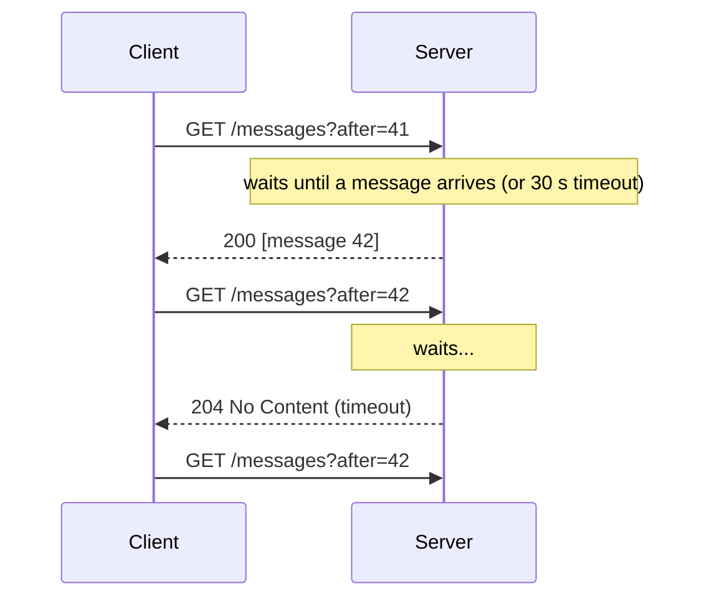
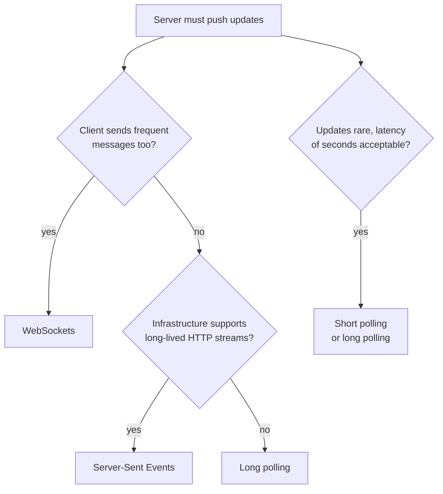
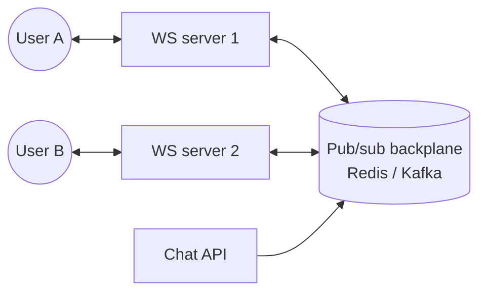

## Simple definition

HTTP was designed for **request and response**: the client asks, the server answers. Chat, live scores, notifications, collaborative editing and dashboards need the **server to send data when something happens**. There are four ways to achieve this on the web, from the oldest to the most capable.

| Technique | Direction | Connection | Overhead |
|---|---|---|---|
| Short polling | Client asks repeatedly | New request each time | High; mostly empty responses |
| **Long polling** | Server answers when data exists | Request held open, then re-opened | Medium |
| **Server-Sent Events (SSE)** | Server → client | One long-lived HTTP response | Low |
| **WebSockets** | Both directions | One upgraded TCP connection | Lowest per message |

## Short polling

The client sends a request every few seconds ("anything new?"). Simple and stateless, but most responses are empty, latency is up to one polling interval, and many clients polling frequently waste server capacity.

## Long polling

Also called a **hanging GET**. The client sends a request; if there is no new data, the server **does not reply with an empty response** but holds the request open until data is available or a timeout expires. After each response the client immediately sends a new request.



- ✅ Works everywhere plain HTTP works; near-real-time.
- ❌ Each message costs a full request/response with headers; the server holds many open requests; messages arriving between requests must be buffered (use a cursor like `after=42`).

## WebSockets

A WebSocket starts as an HTTP request with an `Upgrade: websocket` header; after the handshake, the same TCP connection becomes a **full-duplex** channel where either side can send frames at any time, with only a few bytes of framing overhead.

```text
GET /chat HTTP/1.1
Upgrade: websocket
Connection: Upgrade
Sec-WebSocket-Key: dGhlIHNhbXBsZSBub25jZQ==

HTTP/1.1 101 Switching Protocols
Upgrade: websocket
```

- ✅ Lowest latency and overhead; bidirectional; a **persistent connection**.
- ❌ Stateful connections complicate scaling, load balancing and deployments; some proxies and firewalls interfere; you design your own message protocol (or use STOMP on top).

Use for chat, multiplayer games, collaborative editors, trading screens.

## Server-Sent Events

The client opens a normal HTTP request with `Accept: text/event-stream`, and the server keeps the response open, writing events as text lines. The browser's `EventSource` API **reconnects automatically** and sends the last event ID so the server can resume.

```text
HTTP/1.1 200 OK
Content-Type: text/event-stream

id: 101
event: price
data: {"symbol":"ACME","price":42.10}

id: 102
event: price
data: {"symbol":"ACME","price":42.15}
```

- ✅ Simple, plain HTTP (works with HTTP/2 multiplexing), automatic reconnection, efficient for one-way feeds.
- ❌ Server-to-client only (clients send via normal requests); text only; with HTTP/1.1, browsers limit connections per domain.

Use for notifications, live feeds, progress updates, and streaming LLM responses.

## Choosing



## Scaling persistent connections

Each open connection consumes memory and a file descriptor on the server (and, with thread-per-connection servers, a thread). Design points:

- **Non-blocking servers** (Netty, Spring WebFlux) or virtual threads handle hundreds of thousands of idle connections per node.
- **Connection-aware load balancing:** layer 7 balancers must support the upgrade and long timeouts; distribute connections evenly, since they are long-lived.
- **Routing messages to the right connection:** user A's connection is on server 3, but the event arrives at server 7. Use a **pub/sub backplane** (Redis pub/sub, Kafka, a message broker) to which every connection server subscribes, or a presence registry mapping users to servers.
- **Deployments:** draining servers drops connections; clients must reconnect with backoff and jitter and resume from their last event ID, or reconnect storms follow.
- **Heartbeats** (ping/pong) detect dead connections behind NATs and proxies.



## In Spring

- **WebSockets:** `spring-websocket` with a raw `WebSocketHandler`, or STOMP over WebSocket with `@MessageMapping` and a simple or external (RabbitMQ) broker relay.
- **SSE:** return `SseEmitter` from Spring MVC, or a `Flux<ServerSentEvent<T>>` from WebFlux.
- **Long polling:** `DeferredResult` in Spring MVC completes the response later from another thread.

See [Spring WebFlux and Project Reactor](/spring/web/webflux-and-reactive-programming).

## Common mistakes

> [!MISTAKE] Choosing WebSockets for one-way notifications
> If the server only pushes, SSE gives automatic reconnection and plain-HTTP compatibility with far less infrastructure work.

- **No resume mechanism**, losing messages during reconnects.
- **Proxy timeouts** shorter than the idle period, silently cutting connections; send heartbeats.
- **Assuming all users connect to one server**, with no backplane.

## Quick check

**How does long polling differ from short polling?**
The server holds the request open until data is available instead of returning an empty response immediately.

**What makes WebSockets full-duplex?**
After the HTTP upgrade handshake, both client and server can send frames independently over one persistent TCP connection.

**When is SSE a better fit than WebSockets?**
For one-way server-to-client streams, where its plain-HTTP transport and automatic reconnection simplify infrastructure.

**How do you deliver a message to a user connected to a different server?**
Through a pub/sub backplane or a presence registry that routes the message to the server holding the user's connection.

## Related topics

- [Spring WebFlux and Project Reactor](/spring/web/webflux-and-reactive-programming)
- [Message Queues and Delivery Semantics](/system-design/building-blocks/message-queues-and-delivery-semantics)
- [Load Balancing and Proxies](/system-design/building-blocks/load-balancing)

## References

- System Design Notes (handwritten, LinkedIn): long polling vs WebSockets vs Server-Sent Events.
- [RFC 6455: The WebSocket Protocol](https://www.rfc-editor.org/rfc/rfc6455).
- [HTML Living Standard: Server-sent events](https://html.spec.whatwg.org/multipage/server-sent-events.html).
