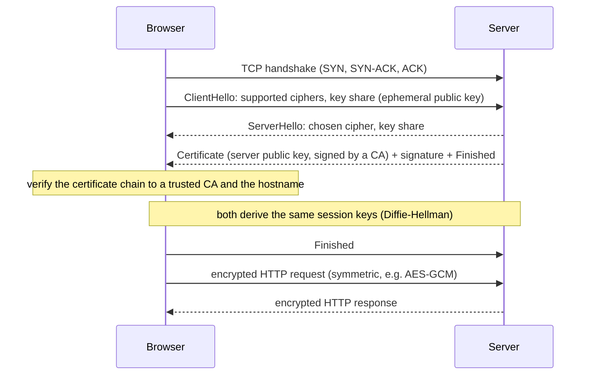

## Simple definition

Security is a requirement of every design, not an add-on. Three mechanisms appear in nearly every system design discussion:

- **HTTPS (HTTP over TLS)** protects data in transit: confidentiality, integrity and server authentication.
- **Password hashing** protects credentials at rest, even if the database leaks.
- **Authenticated API access** — tokens or signed requests — proves who is calling an API and that the request was not tampered with.

## How HTTPS works

HTTPS is HTTP sent through a **TLS** connection. TLS uses both kinds of cryptography:

| | Asymmetric (public-key) | Symmetric |
|---|---|---|
| Keys | Public key (shared) + private key (secret) | One shared secret key |
| Speed | Slow | Fast |
| Used in TLS for | Authenticating the server and agreeing on a key | Encrypting all application data |

The flow (simplified, TLS 1.3):



1. **Certificate check:** the server proves its identity with a certificate signed by a **certificate authority (CA)** the browser trusts, binding the domain name to the server's public key. This stops man-in-the-middle attacks.
2. **Key exchange:** client and server use **ephemeral Diffie-Hellman** to agree on a shared secret without ever sending it. Because keys are ephemeral, recorded traffic cannot be decrypted later even if the server's private key leaks (**forward secrecy**).
3. **Session encryption:** all data is encrypted with fast **symmetric** ciphers (AES-GCM, ChaCha20-Poly1305) with integrity protection.

**Why switch to symmetric encryption?** Asymmetric encryption is far too slow for bulk data and limits the size of what it can encrypt. It is used only to authenticate and agree on a key; symmetric encryption carries the data.

Operational points: terminate TLS at the load balancer or gateway (and re-encrypt internally, or use **mTLS** between services in a zero-trust network), automate certificate renewal (ACME/Let's Encrypt), enable HSTS, and disable old protocol versions. TLS 1.3 needs one round trip for the handshake (zero for resumed sessions).

## Storing passwords safely

Never store passwords in plain text, and never encrypt them reversibly. Store a **salted, slow hash**.

| Mistake | Why it fails |
|---|---|
| Plain text | One leak exposes every account, and every other site where users reused the password |
| Encryption | Whoever gets the key decrypts everything |
| Fast hash (MD5, SHA-256) | Attackers try billions of guesses per second on GPUs; identical passwords have identical hashes; precomputed **rainbow tables** reverse common ones |

The correct scheme:

1. Generate a unique random **salt** per password (16+ bytes). It need not be secret; it is stored next to the hash.
2. Compute `hash = slowHash(password, salt, costParameters)` with a **deliberately slow, adaptive** algorithm: **Argon2id** (recommended), **scrypt**, **bcrypt** or PBKDF2.
3. Store the algorithm, parameters, salt and hash together (bcrypt's output string contains all of them).
4. To verify a login, recompute with the stored salt and parameters and compare in constant time.

Salts make each hash unique, defeating rainbow tables and revealing nothing when two users share a password. Slowness (and memory hardness for Argon2 and scrypt) makes brute force expensive; increase the cost as hardware improves and rehash on next login.

```java
PasswordEncoder encoder = PasswordEncoderFactories.createDelegatingPasswordEncoder();
String stored = encoder.encode("correct horse battery staple");
// {bcrypt}$2a$10$N9qo8uLOickgx2ZMRZoMye...   ← algorithm id, cost, salt and hash in one string
boolean ok = encoder.matches(attempt, stored);
```

Spring Security's `DelegatingPasswordEncoder` stores the algorithm ID as a prefix, so you can migrate from bcrypt to Argon2 without forcing password resets. Add a **pepper** (a secret key held outside the database, e.g. in an HSM) for defence in depth, rate-limit login attempts, and support multi-factor authentication.

## Securing API access

Two common designs:

### Token-based

The client authenticates once (login, OAuth 2.0 flow) and receives an **access token**, sent on each request in `Authorization: Bearer ...`. Tokens are either opaque (looked up in a store) or self-contained **JWTs** signed by the issuer and verified by any service. Short lifetimes plus refresh tokens limit damage from theft. This is the standard for user-facing APIs; see [OAuth 2.0, OpenID Connect and JWT](/spring/security/oauth2-oidc-and-jwt).

### HMAC request signing

For server-to-server APIs (payment providers, cloud APIs like AWS Signature V4), each client has an **access key ID** and a **secret key**. The client signs each request; the secret never travels over the network.

1. Build a canonical string: method, path, sorted query parameters, important headers, a **timestamp**, a **nonce** and a hash of the body.
2. Compute `signature = HMAC-SHA256(secretKey, canonicalString)`.
3. Send the key ID, timestamp, nonce and signature in headers.
4. The server looks up the secret by key ID, recomputes the HMAC and compares in constant time.
5. It rejects requests whose timestamp is outside a short window (e.g. 5 minutes) or whose nonce was already used, preventing **replay attacks**.

```java
Mac mac = Mac.getInstance("HmacSHA256");
mac.init(new SecretKeySpec(secret, "HmacSHA256"));
String canonical = String.join("\n", method, path, sortedQuery, timestamp, nonce, sha256Hex(body));
String signature = HexFormat.of().formatHex(mac.doFinal(canonical.getBytes(StandardCharsets.UTF_8)));
```

HMAC signing proves the caller holds the secret **and** that the request content was not modified — something a bearer token alone does not do.

| | Bearer token | HMAC signature |
|---|---|---|
| Secret sent on each request | The token itself | Never |
| Protects request integrity | No (rely on TLS) | Yes |
| Replay protection | Token expiry | Timestamp + nonce |
| Typical use | User-facing APIs, OAuth 2.0 | Server-to-server, webhooks, cloud APIs |

**Webhooks** use the same idea in reverse: the provider signs the payload so the receiver can verify it came from the provider.

## Common mistakes

> [!MISTAKE] Hashing passwords with SHA-256
> A general-purpose hash is designed to be fast, which is exactly what an attacker wants. Use Argon2id, scrypt or bcrypt with a per-user salt.

- **Comparing signatures with `equals`**, leaking timing information; use `MessageDigest.isEqual`.
- **Disabling certificate validation** in HTTP clients "for testing" and shipping it.
- **Long-lived tokens without revocation.**
- **Logging secrets, tokens or full request bodies with credentials.**

## Quick check

**Why does HTTPS use both asymmetric and symmetric encryption?**
Asymmetric cryptography authenticates the server and establishes a shared key; symmetric encryption is much faster for the actual data.

**What does the certificate prove?**
That the public key belongs to the domain, as vouched for by a trusted certificate authority.

**Why salt password hashes?**
So identical passwords produce different hashes and precomputed tables are useless.

**Why must password hashing be slow?**
To make brute-force guessing expensive if the hashes leak.

**How does HMAC signing prevent replay attacks?**
The signed request includes a timestamp and nonce; the server rejects old timestamps and reused nonces.

## Related topics

- [Spring Security Filter Chain](/spring/security/security-filter-chain)
- [OAuth 2.0, OpenID Connect and JWT](/spring/security/oauth2-oidc-and-jwt)
- [API Gateway with Spring Cloud Gateway](/microservices/fundamentals/api-gateway)

## References

- Alex Xu. *ByteByteGo System Design Handbook*: how does HTTPS work; how to store passwords safely in the database; how to design a secure web API access for your website; payment security.
- [RFC 8446: TLS 1.3](https://www.rfc-editor.org/rfc/rfc8446).
- [OWASP Password Storage Cheat Sheet](https://cheatsheetseries.owasp.org/cheatsheets/Password_Storage_Cheat_Sheet.html).
