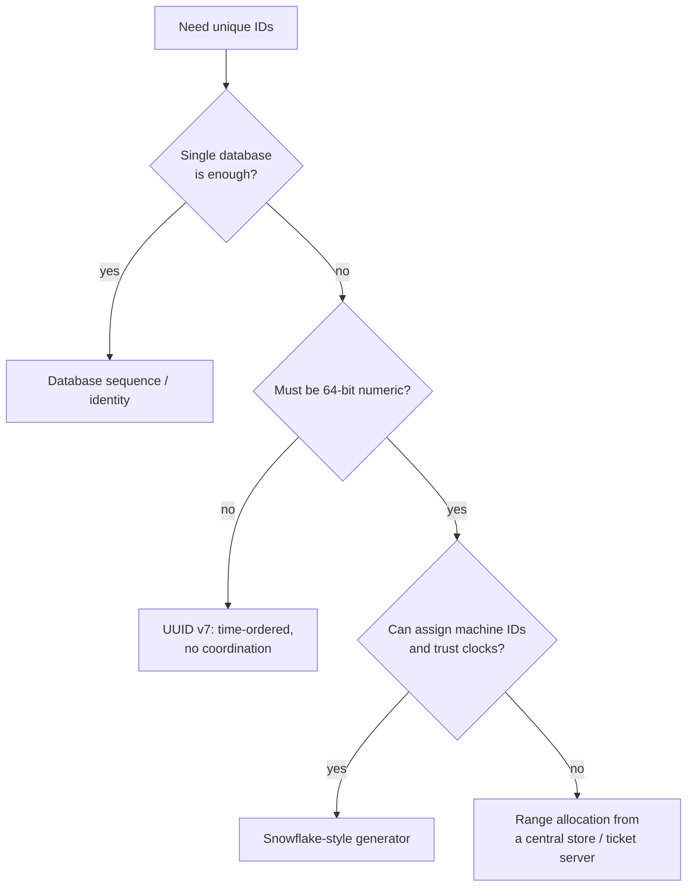

## Simple definition

Every order, message and post needs a unique ID. On one database, `AUTO_INCREMENT` does it. Across many servers and databases, generating IDs that are unique **without coordinating on every request** is a design problem in its own right — and a common interview question.

Typical requirements for social-media-scale IDs (as ByteByteGo lists them):

- **Globally unique**
- **Roughly sorted by time** (newer IDs are larger), so they index well and support "latest first"
- **Numerical, 64 bits** (fits a `long`, compact in indexes)
- **Highly scalable and low latency**: tens of thousands per second per node, no single point of failure.

## Options

| Approach | How | Pros | Cons |
|---|---|---|---|
| **Database auto-increment** | One database's sequence | Simple, compact, ordered | Single point of failure and bottleneck |
| **Multi-master with step** | *k* databases; each increments by *k* (server 1: 1, 4, 7; server 2: 2, 5, 8...) | Scales writes a little | Not time-ordered across servers; hard to add servers |
| **UUID v4** | 122 random bits | No coordination at all; generated anywhere | 128 bits, not sortable, poor B-tree locality (random inserts) |
| **UUID v7** | 48-bit Unix millisecond timestamp + random bits | Time-ordered, no coordination, standard (RFC 9562) | 128 bits |
| **Ticket server** | A dedicated service hands out IDs (Flickr used MySQL `REPLACE INTO` on two servers, odd and even) | Numeric, simple | Extra hop; must be made highly available |
| **Range (segment) allocation** | Each node fetches a block of 1,000 IDs from a central store and hands them out locally | Few central calls, numeric | Gaps on restart; ordering only within a node |
| **Snowflake** | Timestamp + machine ID + per-millisecond sequence, generated locally | 64-bit, time-sortable, no coordination per ID | Depends on clocks; machine IDs must be assigned |

## Snowflake

Twitter's Snowflake packs an ID into a signed 64-bit integer:

```text
| 1 bit | 41 bits                          | 5 bits      | 5 bits     | 12 bits        |
| sign  | timestamp (ms since custom epoch)| datacenter  | machine    | sequence       |
|   0   | ~69 years of milliseconds        | 32 DCs      | 32 / DC    | 4096 per ms    |
```

- **Timestamp:** milliseconds since a custom epoch (e.g. the system's launch date). Because it is in the high bits, IDs sort by time.
- **Datacenter + machine ID:** assigned at startup (configuration, or a coordination service such as ZooKeeper/etcd), so two machines never produce the same ID.
- **Sequence:** incremented for each ID within the same millisecond on one machine; reset every millisecond. 4,096 IDs per millisecond per machine is ~4 million per second.

```java
public final class SnowflakeIdGenerator {
    private static final long EPOCH = Instant.parse("2026-01-01T00:00:00Z").toEpochMilli();
    private static final int MACHINE_BITS = 10, SEQUENCE_BITS = 12;
    private static final long MAX_SEQUENCE = (1L << SEQUENCE_BITS) - 1;

    private final long machineId;
    private long lastMillis = -1;
    private long sequence;

    public SnowflakeIdGenerator(long machineId) {
        if (machineId < 0 || machineId >= (1L << MACHINE_BITS)) throw new IllegalArgumentException();
        this.machineId = machineId;
    }

    public synchronized long nextId() {
        long now = System.currentTimeMillis();
        if (now < lastMillis) {
            throw new IllegalStateException("clock moved backwards by " + (lastMillis - now) + " ms");
        }
        if (now == lastMillis) {
            sequence = (sequence + 1) & MAX_SEQUENCE;
            if (sequence == 0) {                         // 4096 used this ms: wait for the next one
                while ((now = System.currentTimeMillis()) <= lastMillis) Thread.onSpinWait();
            }
        } else {
            sequence = 0;
        }
        lastMillis = now;
        return ((now - EPOCH) << (MACHINE_BITS + SEQUENCE_BITS))
                | (machineId << SEQUENCE_BITS)
                | sequence;
    }
}
```

### Clock problems

Snowflake relies on the wall clock, which can **jump backwards** after NTP corrections (see [The Trouble with Distributed Systems](/data-systems/distributed-systems-faults)). If it does, the generator could repeat IDs. Options: refuse to generate (as above) until the clock catches up, wait out small rollbacks, or keep the last timestamp and keep incrementing it ("logical" time) for a while. Also run NTP with slewing (gradual adjustment) rather than stepping.

### Tuning the layout

The bit allocation is a design choice: fewer timestamp bits shorten the lifetime; more machine bits allow more generators; more sequence bits allow more IDs per millisecond. Systems with low concurrency can give the sequence fewer bits. Variants include Sonyflake (10 ms units, longer lifetime) and Instagram's scheme (shard ID in place of the machine ID, generated inside PostgreSQL).

## Choosing



## Common mistakes

> [!MISTAKE] Random UUIDs as clustered primary keys
> UUID v4 values are random, so inserts land on random B-tree pages, causing page splits and poor cache use in InnoDB-style clustered indexes. Use UUID v7 or a time-ordered numeric ID.

- **Exposing sequential IDs** in public URLs, letting users enumerate resources or estimate business volume; use opaque public IDs.
- **Duplicate machine IDs** after autoscaling or container restarts; lease them from a coordination service.
- **Assuming time-ordered IDs are strictly ordered across machines**; clock skew makes them only roughly ordered.

## Quick check

**Why not use UUID v4 everywhere?**
It is 128 bits and random, so it is not time-sortable and causes poor index locality.

**What are the parts of a Snowflake ID?**
A sign bit, a millisecond timestamp, datacenter and machine IDs, and a per-millisecond sequence number.

**How many IDs can one Snowflake generator produce per millisecond?**
4,096 with a 12-bit sequence.

**What happens if the clock moves backwards?**
The generator could repeat IDs, so it must refuse or wait until the clock passes the last timestamp, or continue from the last timestamp logically.

**When is UUID v7 a good choice?**
When IDs need to be time-ordered and coordination-free, and 128 bits is acceptable.

## Related topics

- [The Trouble with Distributed Systems: clocks](/data-systems/distributed-systems-faults)
- [Partitioning (Sharding)](/data-systems/partitioning)
- [Designing a URL Shortener](/system-design/case-studies/url-shortener)

## References

- Alex Xu. *ByteByteGo System Design Handbook*: do you know how to generate globally unique IDs?
- Twitter Engineering. "Announcing Snowflake." 2010.
- [RFC 9562: Universally Unique IDentifiers (UUIDs)](https://www.rfc-editor.org/rfc/rfc9562), including UUID version 7.
