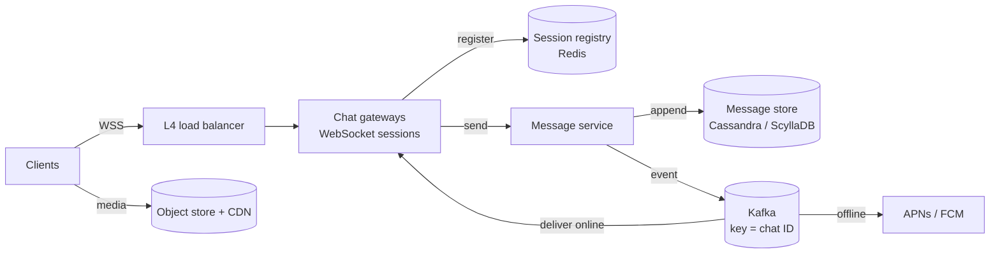
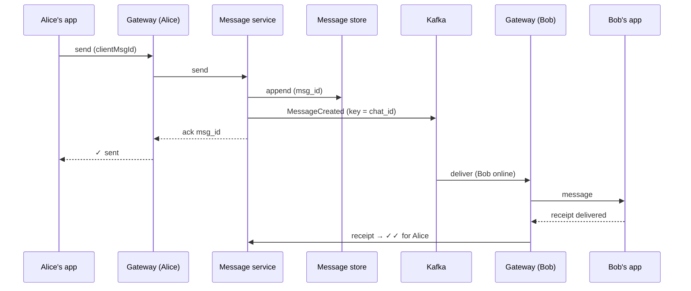

## Overview

A chat system delivers messages between users in near real time, keeps history, and works when phones go offline and come back. WhatsApp and Discord are the reference points: both keep a **persistent connection** per device and store messages in a **horizontally partitioned, write-optimised store**. This design follows the [18-step framework](/system-design/introduction).

## Functional requirements

1. One-to-one chats and group chats (up to 500 members).
2. Send text and media; receive in real time when online.
3. Message history on every device; offline devices catch up on reconnect.
4. Delivery and read receipts; online/last-seen presence.
5. Push notification when the recipient's app is not connected.

## Nonfunctional requirements

- Low latency: p99 delivery under 300 ms between online users in the same region.
- **Per-chat ordering**: everyone sees a chat's messages in the same order.
- **Durability**: an acknowledged message is never lost.
- High availability; millions of concurrent connections.
- Privacy: end-to-end encryption for one-to-one chats.

## Capacity estimates

| Assumption | Value |
|---|---|
| Daily active users | 500 million |
| Messages per user per day | 40 |
| Average message (with metadata) | 200 bytes |
| Peak concurrent connections | 100 million |

- Messages: 500 M × 40 = **20 billion/day** ≈ 230,000/s average, ~700,000/s peak.
- Storage: 20 B × 200 B = **4 TB/day** ≈ 1.5 PB/year (before replication) — a wide-column store, partitioned.
- Connections: at ~100,000–500,000 idle WebSockets per gateway node (non-blocking I/O), 100 M connections need **200–1,000 gateway servers**.

## API design

Real-time traffic uses frames over one WebSocket; REST is used for history and media.

```text
→ {"type":"send","clientMsgId":"c-91f…","chatId":"g-42","body":"<ciphertext>"}
← {"type":"ack","clientMsgId":"c-91f…","msgId":7363419844562943,"ts":1730457600123}
← {"type":"message","chatId":"g-42","msgId":7363419844562945,"from":"u-7","body":"…"}
→ {"type":"receipt","chatId":"g-42","upTo":7363419844562945,"kind":"read"}
```

```http
GET /v1/chats/g-42/messages?before=7363419844562945&limit=50
POST /v1/media           → presigned upload URL
```

`clientMsgId` makes sends **idempotent**: a resend after a dropped connection returns the same `msgId`.

## Data model

| Table (wide-column) | Partition key | Clustering key | Columns |
|---|---|---|---|
| `messages` | `(chat_id, bucket)` | `msg_id DESC` | sender, body, type |
| `chat_members` | `chat_id` | `user_id` | role, last_read_msg_id |
| `user_chats` (inbox) | `user_id` | `last_activity DESC` | chat_id, unread count |

`msg_id` is a [Snowflake-style ID](/system-design/building-blocks/unique-id-generation): time-sortable, so the clustering key orders a chat. `bucket` (for example a 10-day window) keeps partitions bounded for very active channels. Discord's message store uses the same idea — partition by channel and time bucket — which is why reads of "the latest 50 messages" touch one partition.

## High-level architecture





## Component responsibilities

- **Gateways** terminate WebSockets, authenticate the device, keep heartbeats, and forward frames. They hold no durable state; a crashed gateway only drops connections, which clients re-establish.
- **Session registry** maps `user/device → gateway` (with TTL refreshed by heartbeats). It also backs **presence**.
- **Message service** validates membership, assigns `msg_id`, persists, then publishes.
- **Delivery consumers** (in the gateway tier or a fan-out tier) read the event stream, look up recipients' gateways and push frames; recipients without a session get a push notification.

## Data flow: sending a message



**Store first, then fan out.** The ack to the sender is sent only after the message is durable, so a crash can never "unsend" an acknowledged message. Fan-out is asynchronous and at-least-once; clients deduplicate by `msg_id`.

## Ordering

Global ordering is unnecessary; **per-chat ordering** is what users see. Two mechanisms give it:

- Kafka partitions keyed by `chat_id`, so a chat's events are consumed in order.
- Time-sortable `msg_id`s, assigned by the message service, with clients sorting by `msg_id`. For strict monotonicity within a chat, route each chat to one sequencer (by hash) or keep a per-chat counter.

## Offline devices and multi-device sync

Each device stores the highest `msg_id` it has seen per chat (a cursor). On reconnect it asks for everything after its cursors (`user_chats` tells it which chats changed). The server never needs per-device queues for history; the message table *is* the queue. While offline, the device gets a push notification through APNs/FCM to wake it.

## Group chats

For small groups (≤ 500), fan out on write: one event, delivered to each member's gateway. For very large channels (Discord servers with 100k+ members), do not push every message to every member: deliver only to members currently viewing the channel and let others fetch on open. This mirrors the [news feed](/system-design/case-studies/news-feed) celebrity problem.

## Presence

Gateways publish heartbeat-driven presence to the registry; "last seen" is written on disconnect. Presence changes are fanned out only to contacts who are online and subscribed, and are **rate-limited and coalesced**, because presence traffic can exceed message traffic.

## Media

Clients upload media directly to object storage with a presigned URL; the message carries only the object key (encrypted with the message key for E2EE). Thumbnails are generated asynchronously; downloads come from the CDN.

## Security: end-to-end encryption

WhatsApp uses the **Signal Protocol**: each device has identity and pre-keys published to the server; senders establish a session (X3DH key agreement) and encrypt each message with a ratcheting key (Double Ratchet), giving forward secrecy. The server stores and forwards **ciphertext only** and cannot read messages. Consequences for the design: server-side search and moderation of content are impossible; group messages are encrypted per member device (or with sender keys); backups need their own encryption.

## Database selection

A wide-column store (Cassandra, ScyllaDB, HBase) fits: huge write volume, append-mostly, access by `(chat, time range)`, and linear horizontal scaling. Discord moved trillions of messages from Cassandra to ScyllaDB, cutting from 177 to 72 nodes and stabilising p99 read latency, and added a data-service layer that **coalesces identical concurrent reads** of hot channels to protect the database. Metadata (users, chat membership) fits a relational store.

## Scaling and failure handling

- Gateways scale horizontally; connections are long-lived, so drain and reconnect gradually during deploys (clients reconnect with jittered backoff).
- Message store partitions by chat; hot channels are bounded by time buckets.
- If Kafka is slow, delivery is delayed but messages are safe in the store; clients also sync on reconnect.
- Region failure: clients reconnect to another region; messages replicate across regions asynchronously.

## Observability

Connection count per gateway, send-to-deliver latency, ack latency, push notification rate, Kafka consumer lag, hot partitions in the message store.

## Trade-offs

- At-least-once delivery + client dedup is simpler than exactly-once.
- Per-chat ordering instead of global ordering keeps the system partitionable.
- E2EE gives privacy at the cost of server-side features.

## Interview follow-up questions

**How do you know which server Bob is connected to?** The session registry maps users and devices to gateways, refreshed by heartbeats.

**How do read receipts work in groups?** Each member stores `last_read_msg_id`; the sender sees counts or per-member state, updated with coalesced receipt events.

**What happens if a gateway crashes?** Its clients reconnect elsewhere and sync from their cursors; nothing durable was on the gateway.

## Summary

- Persistent WebSockets through stateless gateways plus a session registry.
- Store first, then fan out at least once; dedupe by message ID.
- Partition messages by chat and time bucket in a wide-column store; order by time-sortable IDs.
- Offline devices sync by cursor and are woken by push notifications.

## Related topics

- [Long Polling, WebSockets and Server-Sent Events](/system-design/building-blocks/real-time-communication)
- [Unique ID Generation](/system-design/building-blocks/unique-id-generation)
- [Designing a Notification Service](/system-design/case-studies/notification-service)
- [Partitioning (Sharding)](/data-systems/partitioning)

## References

- Discord Engineering. "[How Discord Stores Trillions of Messages](https://discord.com/blog/how-discord-stores-trillions-of-messages)." 2023.
- ScyllaDB. "[How Discord Stores Trillions of Messages](https://resources.scylladb.com/blog/how-discord-stores-trillions-of-messages)."
- Signal. [The Double Ratchet Algorithm](https://signal.org/docs/specifications/doubleratchet/) and [X3DH](https://signal.org/docs/specifications/x3dh/).
- Alex Xu. *System Design Interview – An Insider's Guide*. Chapter 12: Design a chat system.
