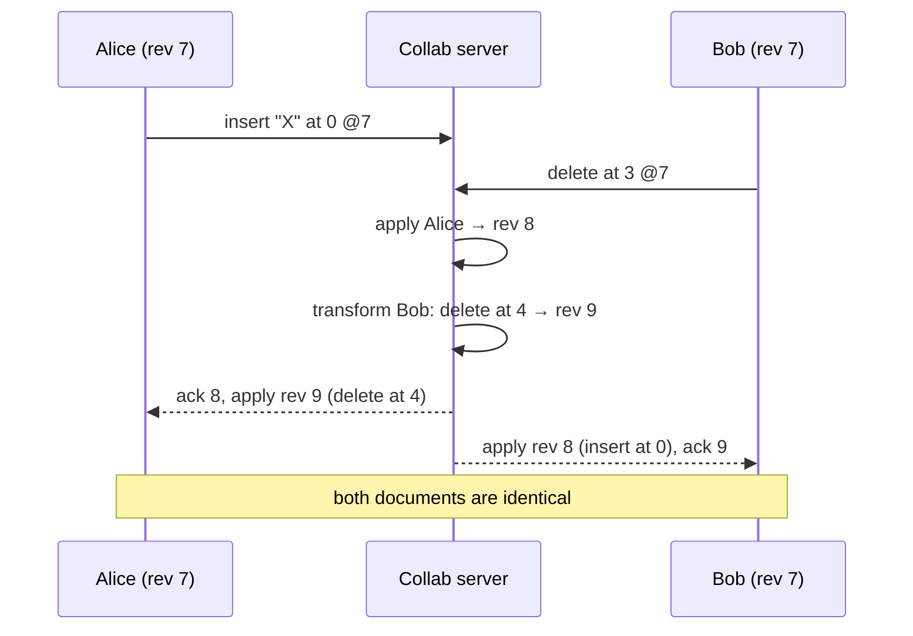
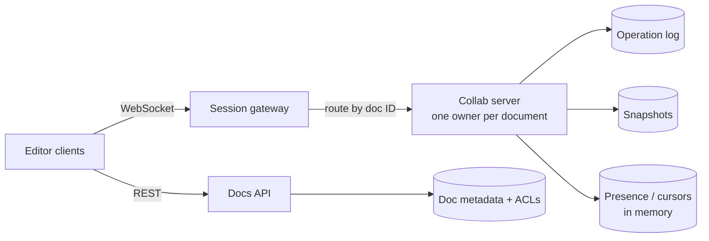

## Overview

In Google Docs several people type into the same document at once and see each other's changes within a fraction of a second, and everyone ends up with the **same text**. ByteByteGo's "design Google Docs" interview question centres on the hard part: merging concurrent edits so all copies **converge** while each user's intent is preserved. Follows the [18-step framework](/system-design/introduction).

## Functional requirements

1. Multiple users edit a document concurrently; changes appear in real time.
2. Show collaborators' cursors and presence.
3. Version history; restore old versions.
4. Comments, sharing and permissions (view, comment, edit).
5. Offline editing that syncs later.

## Nonfunctional requirements

- Edit propagation < 200 ms between users in the same region.
- **Convergence:** all replicas reach the same state.
- No lost edits; durable history.
- Most documents have 1–5 concurrent editors; some have hundreds of viewers.

## Why naive approaches fail

- **Locking paragraphs** is clunky and fails offline.
- **Last write wins** on the whole document loses everyone else's typing.
- **Sending positions blindly** breaks: Alice inserts at position 0 while Bob deletes at position 3; when Bob's delete arrives at Alice, position 3 now refers to a different character.

Each edit is an operation whose meaning depends on the document state it was made against. Concurrent operations must be **transformed** or designed to commute.

## Operational transformation (OT)

OT (Xerox PARC, 1989; used by Google Docs) works with a **central server**:

1. Every client sends operations tagged with the **revision** it was based on.
2. The server applies operations in one **total order**, appending each to a **revision log**.
3. If an incoming operation was based on an older revision, the server **transforms** it against every operation applied since: `transform(op, earlierOp)` adjusts positions (an insert before your position shifts you right; a delete before you shifts you left).
4. The server broadcasts the transformed operation; clients apply it, transforming against their own pending local operations.



Each operation is a [Command](/design-patterns/behavioral/command) object; the revision log gives undo and history for free. The cost: transformation functions for every pair of operation types (insert, delete, format, table edits...) are notoriously hard to get right, and OT relies on the server for ordering.

## CRDTs: the alternative

**Conflict-free replicated data types** give each character a unique, ordered identifier (for example a position between its neighbours plus a replica ID), so concurrent inserts and deletes **commute**: replicas can apply operations in any order and still converge, without a central server transforming anything.

| | OT | CRDT |
|---|---|---|
| Central server required | Yes (for ordering) | No; works peer-to-peer and offline |
| Complexity | Transformation functions | Identifier design, metadata growth |
| Memory | Small document state | Extra metadata per character (tombstones), mitigated by compaction |
| Used by | Google Docs | Figma (CRDT-inspired), Apple Notes, libraries Yjs and Automerge |

For a server-centred product like Google Docs, OT is proven. For offline-first and local-first apps, CRDTs are often the better choice.

## High-level architecture

- **Route all editors of a document to one collab server** (consistent hashing on document ID, with a lease so only one owner exists). That server holds the document in memory, orders operations and broadcasts them. Documents are independent, so the system scales by document.
- **Operation log** is the source of truth: append-only, per document, replicated.
- **Snapshots** every N operations make loading fast: load the latest snapshot and replay the log tail.
- **Presence and cursors** are ephemeral, broadcast but not persisted, and throttled.

## Offline editing

Clients queue local operations with their base revision. On reconnect they send the queue; the server transforms them against everything that happened meanwhile. Long offline periods produce large transformations; CRDT-based designs handle this more naturally.

## Version history

Named versions point to a revision number; any revision can be reconstructed from a snapshot plus operations. Old operations can be compacted into periodic snapshots to save space.

## Permissions and security

Check access on session join and on every operation (permissions can change mid-session). Viewers receive operations but cannot send them. Comments are a separate service anchored to text ranges (which must also be transformed as text changes).

## Failure handling

If a collab server dies, its lease expires and another server takes ownership, loading snapshot + log; clients reconnect and resend unacknowledged operations (deduplicated by client operation IDs).

## Trade-offs

- One owner per document simplifies ordering, but very large live documents can saturate one server.
- OT needs the server; CRDTs need more metadata.
- Real-time cursors and presence add traffic; throttle them.

## Interview follow-up questions

**How do two users editing the same word converge?** The server totally orders the operations and transforms the later one against the earlier, so both clients apply equivalent changes.

**How would you support 1,000 viewers of a live document?** Fan out operations through a broadcast tier separate from the collab owner; viewers do not send operations.

**Why not just lock paragraphs?** Locks block collaboration, need lock timeouts and fail offline; OT and CRDTs let everyone edit concurrently.

## Summary

- Convergence of concurrent edits is the core problem.
- OT: central server orders and transforms operations; used by Google Docs.
- CRDTs: commutative operations; good for offline and peer-to-peer.
- Route each document to one owner; persist an operation log with snapshots.

## Related topics

- [Long Polling, WebSockets and Server-Sent Events](/system-design/building-blocks/real-time-communication)
- [Replication: multi-leader conflicts and CRDTs](/data-systems/replication)
- [Command Pattern](/design-patterns/behavioral/command)

## References

- Alex Xu. *ByteByteGo System Design Handbook*: interview question — design Google Docs.
- C. A. Ellis, S. J. Gibbs. "Concurrency Control in Groupware Systems." SIGMOD 1989.
- Martin Kleppmann et al. "[Local-first software](https://www.inkandswitch.com/local-first/)." Ink & Switch, 2019.
- Evan Wallace. "[How Figma's multiplayer technology works](https://www.figma.com/blog/how-figmas-multiplayer-technology-works/)." 2019.
