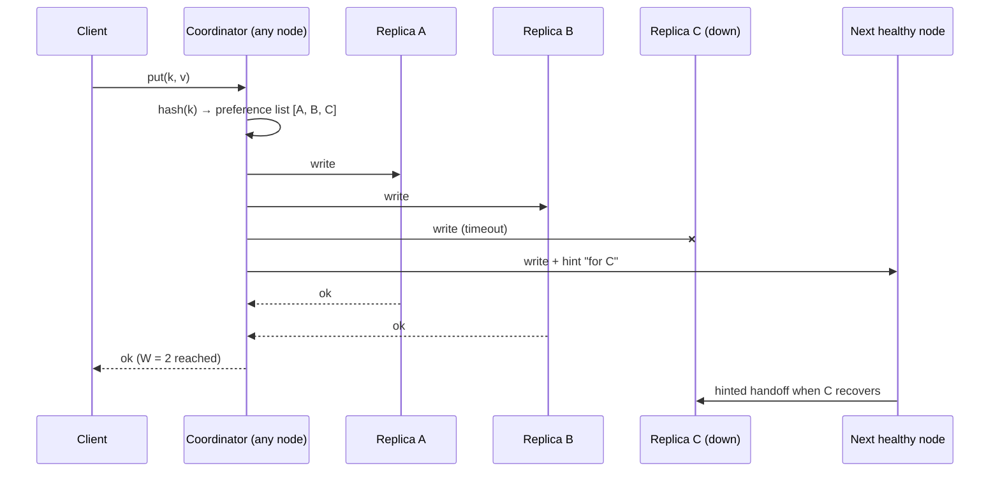

## Overview

Designing a key-value store is a favourite interview question because it combines nearly every idea in [Data-Intensive Systems](/data-systems): partitioning, replication, quorums, conflict resolution, failure detection and storage engines. The reference design is Amazon's **Dynamo** (2007), whose ideas live on in Cassandra, Riak, ScyllaDB and DynamoDB's internals.

## Requirements

- `put(key, value)` and `get(key)`; values up to ~1 MB.
- **Always writable** (an AP system): a shopping cart must accept writes even during failures.
- Horizontally scalable to hundreds of nodes; automatic handling of node joins and failures.
- Tunable consistency per request; low latency (single-digit ms p99 within a data centre).

## Capacity and CAP choice

Assume 100 TB of data, 1 million requests/s, replication factor 3. Each node holds ~2 TB; ~300 nodes. During a [network partition](/system-design/building-blocks/cap-theorem-and-pacelc) we prefer availability and accept conflicting versions, resolved later.

## High-level architecture



## Partitioning

Keys are placed on a **[consistent hash ring](/system-design/building-blocks/consistent-hashing)** with virtual nodes. Adding a node moves only ~1/N of the keys; virtual nodes spread load evenly and let bigger machines take more ranges.

## Replication

Each key is stored on the first **N** distinct physical nodes clockwise from its position — its **preference list** — placed in different racks or zones. Any node can act as **coordinator** for a request (clients may route directly to a replica to save a hop).

## Tunable consistency: quorums

With N replicas, a write succeeds when **W** acknowledge and a read when **R** respond.

| Setting | Behaviour |
|---|---|
| W + R > N (e.g. N=3, W=2, R=2) | Read and write sets overlap: a read sees the latest acknowledged write (barring edge cases) |
| W = 1, R = N | Fast writes, slow reads |
| W = N, R = 1 | Fast reads, writes fail if any replica is down |
| W + R ≤ N | Fastest, eventually consistent |

See [Replication: leaderless quorums](/data-systems/replication#leaderless-replication) for the edge cases where quorums still return stale data.

## Versioning and conflicts

With concurrent writes and partitions, replicas can hold **divergent versions**. Dynamo attaches a **vector clock** — a list of `(node, counter)` pairs — to each version:

- If one clock dominates another, the newer version replaces the older.
- If neither dominates, the versions are **concurrent siblings**: both are returned to the client, which merges them (Amazon's cart merges by union) and writes back the result.

Simpler systems (Cassandra) use **last-write-wins** with timestamps, which is easy but silently drops concurrent writes and depends on [clock accuracy](/data-systems/distributed-systems-faults). CRDTs (counters, sets) merge automatically.

## Handling failures

| Failure | Mechanism |
|---|---|
| Temporary node failure | **Sloppy quorum**: write to the next healthy node with a **hint**; **hinted handoff** returns data when the owner recovers |
| Stale replicas after recovery | **Read repair** on reads; **anti-entropy** with **Merkle trees**: replicas compare hash trees of key ranges and sync only differing branches |
| Node membership and failure detection | **Gossip protocol**: every second, each node exchanges membership and heartbeat state with a random peer; failures are suspected locally (phi accrual detector) |
| Data-centre failure | Replicas across data centres; per-request consistency levels such as `LOCAL_QUORUM` |

## Storage engine

Each node uses a **log-structured** engine: commit log for durability → in-memory memtable → sorted SSTables on disk, merged by compaction, with Bloom filters to skip files on reads. This gives the high write throughput the workload needs. See [Storage Engines](/data-systems/storage-engines).

## Read and write paths

- **Write:** coordinator → N replicas in parallel; each appends to its commit log and memtable; respond after W acks.
- **Read:** coordinator → R replicas (or all, using the first R responses); compare versions; return the newest or siblings; trigger read repair for stale replicas.

## Trade-offs

- Availability over strict consistency; conflicts are the price.
- Leaderless replication avoids failover but makes linearizable operations (uniqueness, compare-and-set) unavailable without an extra consensus layer (Cassandra's lightweight transactions use Paxos).
- Gossip scales, but membership converges gradually.

## Interview follow-up questions

**How do you add a node?** It takes virtual-node positions on the ring and streams the affected ranges from current owners; gossip spreads the new membership.

**How do you handle a hot key?** Consistent hashing cannot split one key; cache it, replicate reads, or split the key at the application level.

**When would you use a CP design instead?** For data needing linearizable updates, such as locks or balances; use a Raft-replicated store (etcd, TiKV, CockroachDB).

## Summary

- Consistent hashing partitions; preference lists replicate to N nodes.
- Quorums (W, R) tune consistency versus latency per request.
- Vector clocks or LWW handle concurrent versions; read repair and Merkle trees heal replicas.
- Sloppy quorums, hinted handoff and gossip keep the store writable through failures.

## Related topics

- [Replication](/data-systems/replication)
- [Consistent Hashing](/system-design/building-blocks/consistent-hashing)
- [Storage Engines](/data-systems/storage-engines)
- [CAP Theorem and PACELC](/system-design/building-blocks/cap-theorem-and-pacelc)

## References

- Giuseppe DeCandia et al. "Dynamo: Amazon's Highly Available Key-Value Store." SOSP 2007.
- Avinash Lakshman, Prashant Malik. "Cassandra: A Decentralized Structured Storage System." 2010.
- Alex Xu. *System Design Interview – An Insider's Guide*. Chapter 6: Design a key-value store.
