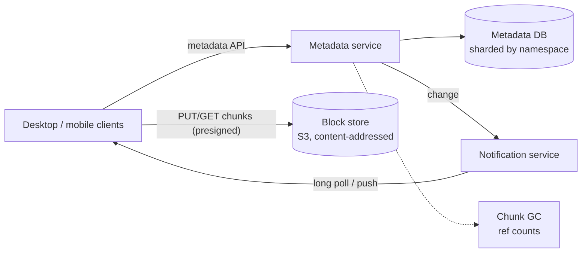

## Overview

A file sync service keeps a folder identical across a user's laptop, phone and the cloud, and lets users share files. The key insight is to **separate metadata from content**: files are split into **content-addressed chunks** stored in object storage, while a strongly consistent metadata service records which chunks make up each file version. This also covers the "file upload service" design. Follows the [18-step framework](/system-design/introduction).

## Functional requirements

1. Upload, download, update, delete files and folders.
2. Automatic sync across devices; offline changes sync later.
3. File versions and restore; sharing with permissions.
4. Large files (up to 50 GB) and resumable transfers.

## Nonfunctional requirements

- Durability above all: never lose a file (11 nines in the block store).
- Strong consistency of metadata (no device sees a file version that references missing chunks).
- Minimise bandwidth: only transfer what changed.

## Capacity estimates

| Assumption | Value |
|---|---|
| Users | 100 million, 10 million daily active |
| Storage per user | 10 GB average |
| Files changed per DAU per day | 20 |

- Total storage: 100 M × 10 GB = **1 EB** logical; deduplication across users typically saves a large fraction.
- Metadata writes: 10 M × 20 / 86,400 ≈ **2,300/s** — a sharded relational store handles this.

## Chunking and deduplication

Split each file into chunks (e.g. 4 MB) and name each chunk by its **SHA-256 hash**.

- **Deduplication:** identical chunks (within a user's files, or across users) are stored once.
- **Delta sync:** editing the middle of a 1 GB file changes a few chunks; only those are uploaded.
- **Resumability:** each chunk uploads independently.

**Content-defined chunking** (rolling hash such as Rabin fingerprints to choose boundaries) keeps chunk boundaries stable when bytes are inserted near the start of a file, so one insertion does not change every subsequent chunk.

## Data model (metadata)

| Table | Key columns |
|---|---|
| `files` | `file_id`, `namespace_id` (user or shared folder), `path`, `latest_version`, `deleted` |
| `file_versions` | `file_id`, `version`, `size`, `chunk_list` (ordered hashes), `modified_by`, `created_at` |
| `chunks` | `hash`, `size`, `ref_count`, storage location |
| `journal` | `namespace_id`, `cursor` (monotonic), `file_id`, `change_type` |

The **journal** is an ordered log of changes per namespace; clients sync by asking for changes after their cursor.

## High-level architecture



## Upload flow

1. The client detects a change (filesystem watcher), chunks the file and hashes the chunks.
2. It sends the list of hashes to the metadata service ("commit intent").
3. The service replies with the hashes it does not already have.
4. The client uploads only missing chunks directly to the block store with presigned URLs.
5. The client commits the new version; the metadata service verifies all chunks exist, then atomically writes the version and a journal entry.

The commit is the **atomic point**: until it succeeds, other devices never see a version referencing missing chunks.

## Download and sync flow

Other devices hold a long-poll (or push) connection to the notification service. When the namespace changes, they request journal entries after their cursor, fetch the new version's chunk list, download only chunks they lack, and reassemble the file locally.

## Conflicts

Two devices edit the same file offline. When the second commits, its base version is no longer the latest. Options: automatic merge (not possible for arbitrary binary files) or, the usual choice, keep both: save the second as `report (Ana's conflicted copy).docx`. Detect conflicts with the base version in the commit (optimistic concurrency, see [Transactions](/data-systems/transactions-and-isolation)).

## Versioning and deletion

Every commit creates a version; old versions remain restorable for a retention period. Deleting a file marks it deleted; chunks are garbage-collected when their reference count reaches zero and retention has passed.

## Sharing and permissions

Shared folders are separate **namespaces** with their own journal and ACL; a user's view mounts several namespaces. Links use unguessable tokens with optional expiry and password.

## Scaling and storage

- Metadata DB sharded by `namespace_id` (all of one namespace's changes stay on one shard, keeping its journal strongly ordered).
- Block store: object storage with replication or erasure coding across zones; cold chunks move to cheaper tiers.
- Notification service holds millions of idle connections (see [real-time communication](/system-design/building-blocks/real-time-communication)).

## Security

Encrypt chunks at rest and in transit; presigned URLs are short-lived and scoped to specific chunk hashes. Cross-user deduplication can leak information ("does anyone have this file?"); some services deduplicate only within an account or use convergent encryption with care.

## Trade-offs

- Content addressing gives dedup and delta sync, but needs reference counting and GC.
- Strongly consistent metadata limits scaling to sharding by namespace, which is natural.
- Conflicted copies are simple and safe, but leave users to merge.

## Interview follow-up questions

**Why not store files directly in the database?** Large binaries bloat the database and backups; object storage is cheaper, more durable and serves bytes directly to clients.

**How do you upload a 50 GB file over a flaky connection?** Chunk it, upload chunks independently with retries, and commit when all are present.

**How do clients know what changed?** A per-namespace journal with monotonic cursors.

## Summary

- Split files into content-addressed chunks: dedup, delta sync, resumability.
- Separate strongly consistent metadata from the block store.
- Commit versions atomically after chunks are present; sync by journal cursor.
- Handle conflicts with conflicted copies; garbage-collect unreferenced chunks.

## Related topics

- [Choosing a Database: block, file and object storage](/system-design/building-blocks/choosing-a-database)
- [Designing a Video Streaming Platform](/system-design/case-studies/video-streaming)
- [Long Polling, WebSockets and SSE](/system-design/building-blocks/real-time-communication)

## References

- Alex Xu. *System Design Interview – An Insider's Guide*. Chapter 15: Design Google Drive.
- Alex Xu. *ByteByteGo System Design Handbook*: upload large files; interview question — design S3; block, file and object storage.
- Dropbox Tech Blog. "Streaming file synchronization" and "Rewriting the heart of our sync engine" (Nucleus).
