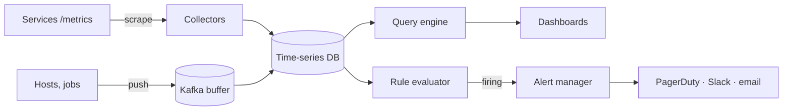

## Overview

A monitoring system collects numeric measurements (CPU, request rate, error count, latency histograms) from thousands of servers, stores them as **time series**, draws dashboards and **alerts** humans when something is wrong. ByteByteGo covers the "metrics monitoring and alerting system" and the question "which database shall I use for metrics?". Follows the [18-step framework](/system-design/introduction).

## Functional requirements

1. Collect metrics from services, hosts, containers and jobs.
2. Query with aggregation (sum, rate, percentile) over time ranges; dashboards.
3. Alert rules evaluated continuously; notifications via email, chat, paging.
4. Retention: raw data 7 days, downsampled data 1 year.

## Nonfunctional requirements

- Scale: 1,000 services, 100,000 hosts/pods, ~10 million active series.
- Ingestion latency under a minute; dashboards load in seconds.
- The monitoring system must be **more available than what it monitors**, and must keep working during incidents (when load spikes).

## Capacity estimates

- 10 M series × 1 sample / 15 s ≈ **670,000 samples/s**.
- A sample is (timestamp, float64) = 16 bytes raw; **Gorilla-style compression** (delta-of-delta timestamps, XOR floats) brings it to ~1.4 bytes.
- 670 k × 1.4 B × 86,400 ≈ **80 GB/day** compressed; 7 days ≈ 560 GB, plus downsampled long-term data.

## Data model

A **series** is a metric name plus a set of labels; each series is a list of (timestamp, value) samples.

```text
http_server_requests_seconds_count{service="orders", method="POST", status="201", instance="10.0.4.7:8080"}
```

> [!WARNING] Cardinality is the main scaling risk
> Every unique label combination is a new series. A label such as `userId` or `orderId` can create millions of series and take down the database. Keep label values bounded.

Metric types: counters (monotonic), gauges, histograms (buckets for percentiles), summaries.

## Collection: pull versus push

| | Pull (Prometheus scrapes `/metrics`) | Push (agents send to a collector, OTLP) |
|---|---|---|
| Discovery | Needs service discovery (Kubernetes, Consul) | Clients must know the endpoint |
| Liveness | A failed scrape is itself a signal | Silence is ambiguous |
| Short-lived jobs | Miss them (need a push gateway) | Natural |
| Firewalls / NAT | Collector must reach targets | Targets reach out |

Most large systems use both: pull inside clusters, push (OpenTelemetry) for jobs, serverless and edge. See [Observability with Micrometer and OpenTelemetry](/microservices/operations/observability-micrometer-opentelemetry).

## High-level architecture





## Storage: a time-series database

General-purpose databases struggle with this write pattern (huge append-only volume, queries over time ranges, rarely updates). A TSDB:

- appends samples to an in-memory **head block** per series and a WAL
- cuts immutable **blocks** (e.g. 2 hours) to disk, compressed per series, with an inverted index from labels to series IDs
- **compacts** blocks into larger ones and applies **retention** and **downsampling** (5-minute and 1-hour rollups for old data)
- shards by series hash and replicates for availability; long-term storage goes to object storage (Thanos, Mimir, Cortex) with a query layer that fans out.

Examples: Prometheus, VictoriaMetrics, InfluxDB, TimescaleDB, M3. The design is an LSM-style append-and-compact engine specialised for time; see [Storage Engines](/data-systems/storage-engines).

A **Kafka buffer** decouples ingestion from storage, absorbs bursts and lets the TSDB be upgraded without data loss; stream processors (Flink) can compute aggregates before storage.

## Querying

Queries select series by labels, then aggregate over time (`rate`, `sum by (service)`, `histogram_quantile`). Precompute expensive, frequently used queries with **recording rules**. Cache dashboard query results for repeated time ranges.

## Alerting

1. A **rule evaluator** runs alert expressions every 15–60 s, e.g. `error_ratio > 0.02 for 5m`.
2. Firing alerts go to an **alert manager**, which:
   - **deduplicates** the same alert from replicas,
   - **groups** related alerts (one page for a whole cluster outage, not 500),
   - applies **inhibition** (suppress symptoms when a root-cause alert fires) and **silences** (maintenance windows),
   - **routes** by team and severity, with escalation.
3. Notifications must be reliable (retries, multiple channels); test the alert path regularly ("dead man's switch" alert that always fires).

**SLO burn-rate alerts** page when the error budget is being consumed too fast (e.g. 2% of a 30-day budget in 1 hour), which catches real user impact with few false positives — better than alerting on raw CPU.

## Reliability of the monitoring system

Run collectors and rule evaluators redundantly (two Prometheus replicas scraping the same targets), keep the alerting path independent of the main storage cluster, and monitor the monitoring (meta-monitoring) from a separate location.

## Trade-offs

- Pull is simple and gives liveness; push handles ephemeral workloads.
- Downsampling saves storage but loses detail for old incidents.
- Strict cardinality limits protect the system but restrict debugging; use logs and traces for high-cardinality detail.

## Interview follow-up questions

**Why not use a relational database?** Write volume, compression and time-range aggregation patterns favour a specialised TSDB; PostgreSQL with TimescaleDB is the middle ground.

**How do you avoid alert storms?** Group, inhibit and deduplicate in the alert manager; alert on symptoms and SLOs rather than every cause.

**How do you compute p99 across servers?** Aggregate histogram buckets, then compute the quantile; never average percentiles.

## Summary

- Series = metric + labels; watch cardinality.
- Collect by pull and push; buffer with Kafka at scale.
- Store in a compressed, append-only TSDB with retention and downsampling.
- Evaluate rules continuously; dedupe, group and route alerts; prefer SLO burn-rate alerts.

## Related topics

- [Observability with Micrometer and OpenTelemetry](/microservices/operations/observability-micrometer-opentelemetry)
- [Storage Engines](/data-systems/storage-engines)
- [Reliability, Scalability and Maintainability: percentiles](/data-systems/reliability-scalability-maintainability)

## References

- Alex Xu. *ByteByteGo System Design Handbook*: metrics monitoring and alerting system; which database shall I use for the metrics collecting system.
- Tuomas Pelkonen et al. "Gorilla: A Fast, Scalable, In-Memory Time Series Database." VLDB 2015.
- [Prometheus documentation](https://prometheus.io/docs/) and Google SRE Workbook, "Alerting on SLOs."
