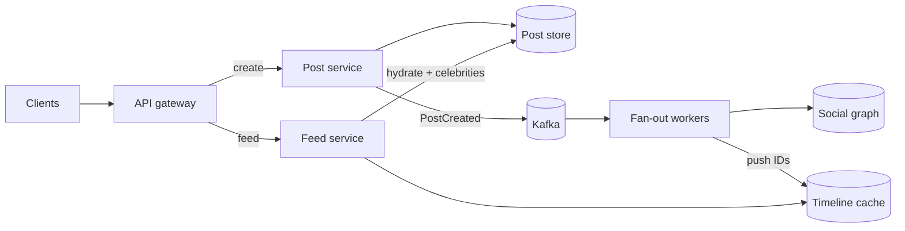

## Overview

A news feed shows each user the recent posts of the accounts they follow, newest or best first. It is the canonical example of **fan-out**: one post must appear in the feeds of every follower, and follower counts range from zero to hundreds of millions. Kleppmann uses Twitter's home timeline as his main example of describing load. This design follows the [18-step framework](/system-design/introduction).

## Functional requirements

1. Users publish posts (text, images, video).
2. Users see a home feed of posts from accounts they follow.
3. Feed is paginated (infinite scroll); new posts appear on refresh.
4. Optional ranking ("top" rather than chronological).

## Nonfunctional requirements

- Feed load p99 < 500 ms; posting may take a little longer.
- Highly available; eventual consistency is acceptable (a post may appear in followers' feeds a few seconds later).
- Read-heavy: feeds are read far more than posts are written.

## Capacity estimates

| Assumption | Value |
|---|---|
| Daily active users | 300 million |
| Posts per day | 500 million |
| Feed loads per user per day | 10 |
| Average followers | 200 |

- Writes: 500 M / 86,400 ≈ **5,800 posts/s** (peak ~12,000).
- Reads: 3 billion feed loads/day ≈ **35,000/s** (peak ~100,000).
- Fan-out on write: 5,800 × 200 = **1.2 million timeline inserts/s** on average.
- Timeline cache: keep 800 post IDs (8 bytes) per active user: 300 M × 6.4 KB ≈ **2 TB** of Redis — large but feasible across a cluster; store IDs, not posts.

## API design

```http
POST /v1/posts                       { "text": "...", "mediaIds": ["m1"] }   → 201 { "postId": ... }
GET  /v1/feed?cursor=<opaque>&limit=20  → { "posts": [...], "nextCursor": "..." }
```

Cursor pagination (by post ID or rank score), not offsets: new posts arriving at the top would shift offsets and duplicate items.

## Data model

- `posts(post_id, author_id, text, media, created_at)` — partitioned by `post_id`.
- `follows(follower_id, followee_id)` — stored in both directions (followers of X, followees of Y), the social graph.
- `timeline:{user_id}` — Redis list or sorted set of recent post IDs.

## Fan-out on write versus fan-out on read

| | Fan-out on write (push) | Fan-out on read (pull) |
|---|---|---|
| On post | Insert post ID into every follower's timeline | Store once |
| On feed load | Read one precomputed list | Query every followee, merge, sort |
| Cost | Write amplification = followers | Read amplification = followees |
| Latency | Fast reads | Slow reads for users following many accounts |
| Problem case | **Celebrities**: 100 M followers → 100 M writes per post | Heavy readers |

**The hybrid approach:** push for ordinary accounts; for accounts with more than, say, 100,000 followers, do not fan out. At read time, merge the user's precomputed timeline with recent posts from the few celebrities they follow. Inactive users can be skipped during fan-out and have their timeline rebuilt on next login.

## High-level architecture





## Data flow

**Post:** store the post → publish `PostCreated` → fan-out workers page through the author's followers (skipping inactive ones), `LPUSH` the post ID to each `timeline:{follower}` and `LTRIM` to 800 entries. If the author is a celebrity, skip fan-out.

**Read feed:** read post IDs from `timeline:{me}` → fetch recent posts from followed celebrities → merge by time or score → **hydrate**: fetch post bodies, author profiles and counters (batched, from caches) → filter (blocked users, deleted posts) → rank → return a page and a cursor.

## Ranking

A chronological feed sorts by `post_id`. A ranked feed scores candidates (recency, affinity with the author, engagement, content type) with a model, which turns the feed service into a **candidate retrieval → ranking → filtering** pipeline. Precomputed timelines become the main candidate source; others include topic and recommendation sources.

## Caching

Several caches, each with a different job: timelines (post IDs), posts (by ID), user profiles, social graph, and counters (likes, replies) kept separately because they change constantly. Celebrities' recent posts are hot keys; cache them locally in feed servers.

## Database selection and scaling

- Posts: wide-column or sharded relational store keyed by `post_id`.
- Social graph: sharded by user, stored both directions; or a graph store.
- Timelines: Redis Cluster, replicated; can be rebuilt from posts + graph, so losing a shard is an inconvenience, not data loss.
- Fan-out workers scale with Kafka partitions; a burst of posts increases lag (feeds a little stale), not errors.

## Failure handling

If fan-out lags, feeds are slightly stale. If the timeline cache is lost, rebuild lazily on read (pull model) while rate-limiting the rebuild. Deleted posts may remain in timelines as IDs; hydration filters them.

## Trade-offs

- Hybrid fan-out balances write amplification against read latency.
- Storing IDs, not posts, keeps timelines small and edits consistent.
- Eventual consistency in exchange for availability and speed.

## Interview follow-up questions

**Where do you draw the celebrity threshold?** Where the cost of fan-out (followers × posts per day) exceeds the extra read cost for their followers; measure and tune, often a few hundred thousand followers.

**How do you show "new posts" without reloading?** Poll a lightweight endpoint with the newest ID seen, or push a hint over an existing connection ([SSE](/system-design/building-blocks/real-time-communication)).

**How do you handle a user following 5,000 accounts?** Precomputed timelines make that cheap for push accounts; limit how many celebrity sources are merged at read time.

## Summary

- Fan-out is the core problem; use push for most accounts and pull for celebrities.
- Timelines store post IDs in Redis; hydrate and rank at read time.
- Paginate with cursors; accept eventual consistency.

## Related topics

- [Reliability, Scalability and Maintainability](/data-systems/reliability-scalability-maintainability) — describing load with fan-out
- [Caching Strategies](/system-design/building-blocks/caching-strategies)
- [Designing a Chat System](/system-design/case-studies/chat-system)

## References

- Martin Kleppmann. *Designing Data-Intensive Applications*. Chapter 1 (Twitter's home timeline).
- Raffi Krikorian. "Timelines at Scale." QCon San Francisco, 2012, summarised in [High Scalability: The architecture Twitter uses to deal with 150M active users](https://highscalability.com/the-architecture-twitter-uses-to-deal-with-150m-active-users/).
- Alex Xu. *ByteByteGo System Design Handbook*: how does Twitter work.
