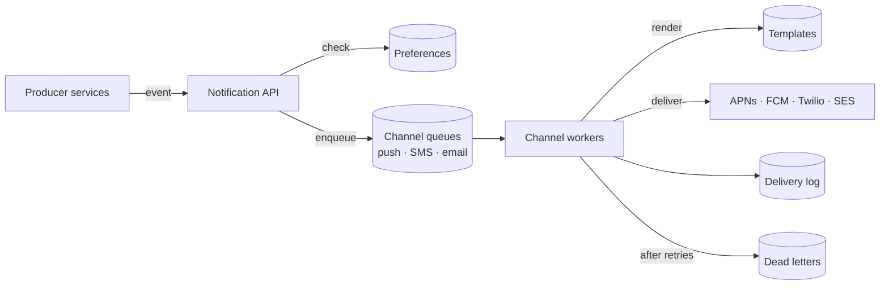
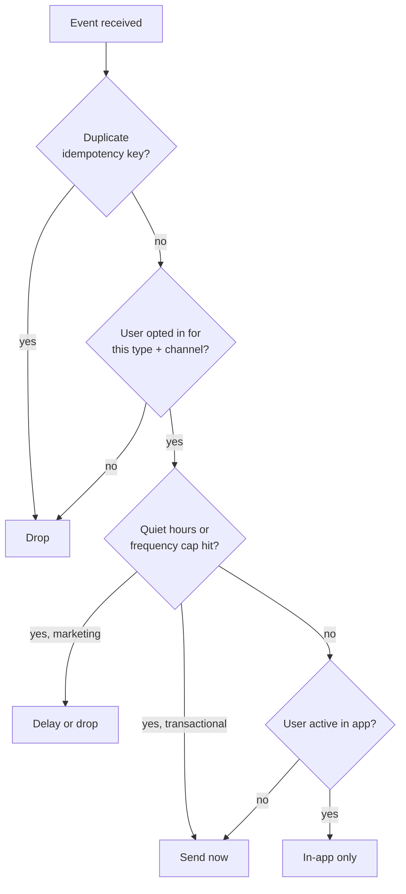

## Overview

Almost every product sends notifications: order confirmations, password resets, chat messages, marketing campaigns. A **notification service** centralises this so product teams send an event ("order shipped to user 42") and the service decides **whether, where and how** to deliver it. ByteByteGo's flowchart of how Slack decides to send a notification shows why "a simple feature" is not simple: a dozen checks (muted channels, do-not-disturb, active on desktop, mention type, thread settings) run before anything is sent.

## Functional requirements

1. Channels: mobile push (APNs, FCM), SMS, email, in-app.
2. Producers send events with a type, recipient and data; the service renders templates per channel and locale.
3. Respect user preferences: opt-outs per type and channel, quiet hours, frequency caps.
4. Scheduled and bulk (campaign) notifications.
5. Track status: sent, delivered, opened, failed.

## Nonfunctional requirements

- Transactional notifications (password reset) within seconds; marketing can be slower.
- No duplicates for the same event; no lost notifications for critical types.
- Isolation: a slow SMS provider must not delay push notifications.
- Scalable for bursts (campaigns, breaking news).

## Capacity estimates

Assumptions: 10 million push, 1 million SMS and 5 million emails per day; campaigns reach 50 million users within 30 minutes.

- Average ~200/s, but campaigns need **~28,000/s** for 30 minutes — design for bursts with queues and horizontally scaled workers.
- Delivery log: 66 M events/day × 200 B ≈ 13 GB/day.

## API design

```http
POST /v1/notifications
Idempotency-Key: order-981-shipped

{ "type": "ORDER_SHIPPED", "userId": "u-42", "data": { "orderId": "981", "eta": "2026-11-03" },
  "priority": "transactional" }

202 Accepted { "notificationId": "n-77" }
```

## Data model

- `user_preferences(user_id, type, channel, enabled)`, `quiet_hours`, `locale`, `timezone`.
- `devices(user_id, device_token, platform, last_seen)` — push tokens; remove tokens the provider reports invalid.
- `templates(type, channel, locale, version, body)`.
- `notification_log(notification_id, user_id, channel, status, provider_id, timestamps)`.

## High-level architecture





## The decision flow



## Component responsibilities

- **API**: authenticates producers, validates payloads, enforces idempotency (unique key with a TTL), and writes the request.
- **Preference and suppression checks**: opt-outs, quiet hours in the user's time zone, caps, and "already seen in app".
- **Channel queues**: one per channel and priority, so a burst of marketing email cannot delay password resets.
- **Workers**: render templates, call providers, handle provider responses, retry with backoff, update status.
- **Scheduler**: holds delayed and scheduled notifications; campaign service expands audiences in batches.

## Reliability

- Producers publish events through a [transactional outbox](/microservices/data-consistency/transactional-outbox) so notifications are not lost when a business transaction commits.
- Delivery is **at least once**; dedupe with the idempotency key and a per-channel `(notification_id, channel)` unique constraint.
- Retries with exponential backoff and jitter for transient provider errors (5xx, 429); no retry for permanent errors (invalid token, unsubscribed number) — clean those up.
- After N attempts, move to a dead-letter queue and alert.
- Fallback channels for critical messages (push failed → SMS).

## Rate limiting and provider limits

Providers impose throughput limits (SMS per sender number, email sending quotas). Workers apply a [token bucket](/system-design/case-studies/rate-limiter) per provider and per user, and campaigns are throttled to protect both providers and users.

## Tracking

Providers return message IDs and later callbacks (delivered, bounced, opened via tracking pixel or app event). Store events in the delivery log, stream them to analytics, and expose status to producers.

## Security and compliance

Do not put sensitive data in push payloads (they appear on lock screens); send a reference and let the app fetch details. Honour unsubscribe links and legal requirements (CAN-SPAM, GDPR consent, TCPA for SMS). Sign provider callbacks (verify webhooks).

## Observability

Queue depth and age per channel, provider latency and error rates, delivery and open rates per type, DLQ volume, duplicates suppressed.

## Trade-offs

- Centralising notifications gives consistent preferences and tracking, but creates a shared dependency that must be highly available.
- Per-channel queues add components but isolate failures.
- At-least-once with dedup rather than exactly-once.

## Interview follow-up questions

**How do you avoid sending a notification twice when the producer retries?** The idempotency key is stored with a unique constraint; repeats return the original notification ID.

**How do you send a campaign to 50 million users?** Expand the audience in batches into the queue, throttle by provider limits, and spread over a time window, honouring preferences and time zones.

**How do you handle invalid push tokens?** Providers report them; remove or mark the device so you stop sending.

## Summary

- Producers send events; the service decides whether, where and how to notify.
- Preferences, quiet hours, caps and dedup run before delivery.
- Per-channel queues and workers isolate providers; retries, DLQs and fallbacks give reliability.
- Track every notification's lifecycle.

## Related topics

- [Message Queues and Delivery Semantics](/system-design/building-blocks/message-queues-and-delivery-semantics)
- [Idempotency](/microservices/reliability/idempotency)
- [Designing a Rate Limiter](/system-design/case-studies/rate-limiter)
- [Designing a Chat System](/system-design/case-studies/chat-system)

## References

- Alex Xu. *ByteByteGo System Design Handbook*: flowchart of how Slack decides to send a notification.
- Alex Xu. *System Design Interview – An Insider's Guide*. Chapter 10: Design a notification system.
- Apple. [Sending notification requests to APNs](https://developer.apple.com/documentation/usernotifications/sending-notification-requests-to-apns); Firebase Cloud Messaging documentation.
