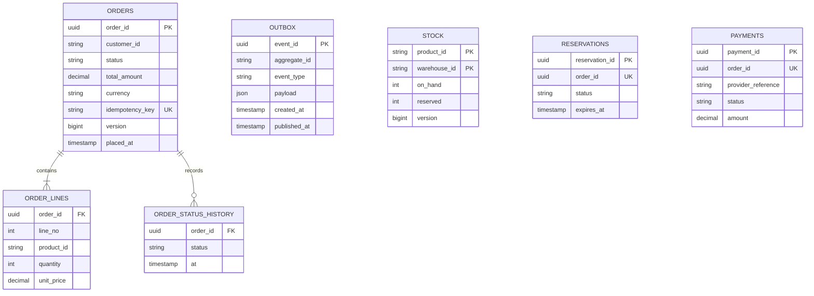
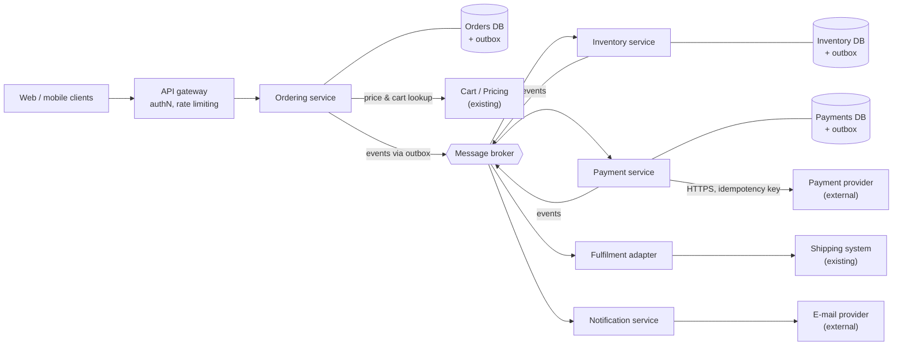
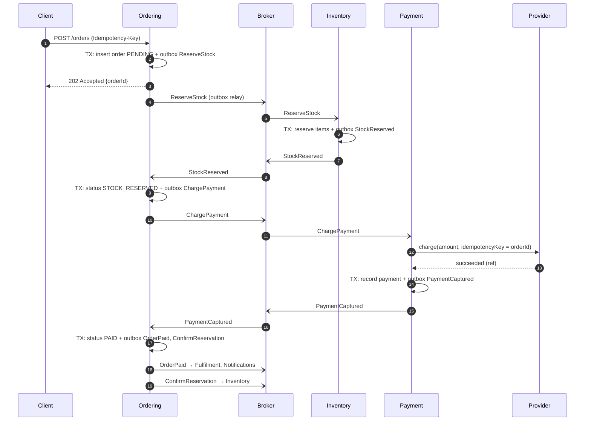
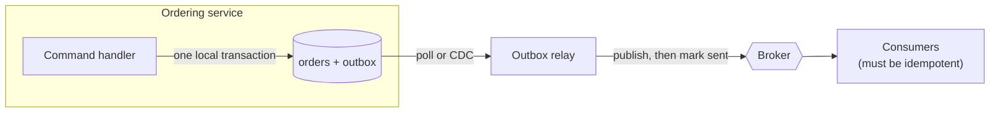
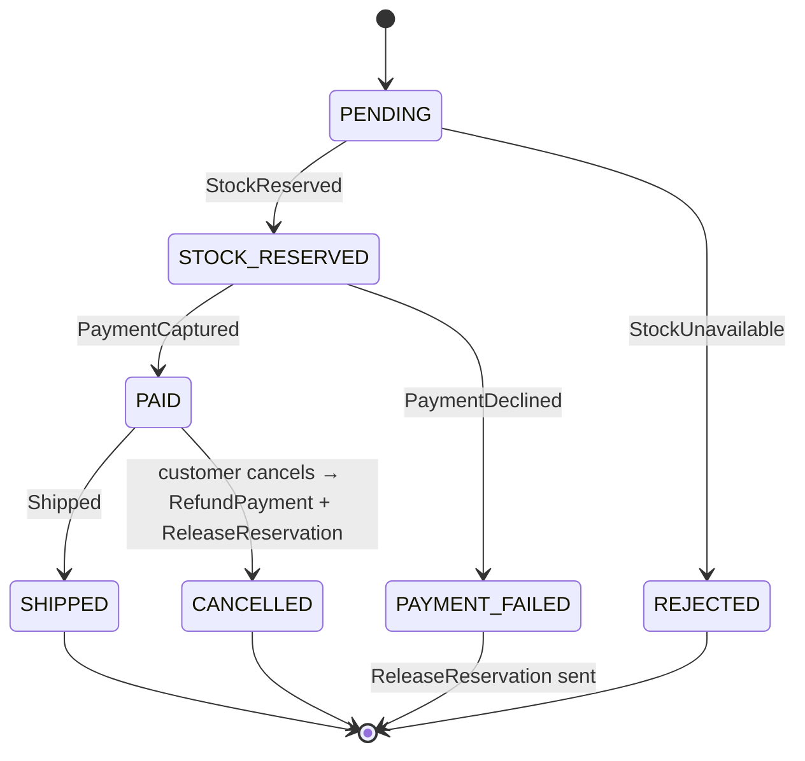

## Overview

This case study designs the system that takes a customer's order in an online shop, reserves stock, takes payment and hands the order to fulfilment. It follows the [18-step framework](/system-design/introduction) and reuses the retail domain from the [DDD articles](/domain-driven-design/fundamentals).

The ordering core is implemented as a runnable Spring Boot service in [Hexagonal Architecture with Spring Boot](/hexagonal-architecture/spring-boot-implementation). This page designs the system around it.

## Functional requirements

In scope:

1. A customer places an order containing one or more products from their cart.
2. Stock is reserved so that the same item is not sold twice.
3. The customer is charged once, through an external payment provider.
4. The customer can view the order's status and history.
5. The customer can cancel an order before it is shipped; the payment is refunded.
6. Paid orders are passed to the shipping system.
7. Customers are notified of status changes (e-mail).

Out of scope: catalogue management, pricing and promotions engine, search, returns and exchanges, warehouse operations.

## Nonfunctional requirements

| Attribute | Requirement |
|---|---|
| Correctness | A customer is **never charged twice** for one order. A confirmed order is never lost. |
| Availability | Order placement: 99.95% monthly. Order history may degrade (stale) during incidents. |
| Latency | p99 under 500 ms for placing an order, **excluding** the payment provider's time; order status reads p99 under 200 ms. |
| Consistency | Stock overselling is avoided through reservations; brief inconsistencies between services are acceptable if they are reconciled within minutes. |
| Durability | Orders retained for 7 years for legal and accounting reasons. |
| Security | Card data never touches our systems (the provider's hosted fields or tokens handle it), keeping our PCI DSS scope small. Customers see only their own orders. |

## Traffic and capacity estimates

**Assumptions** — no figures were given, so these are stated explicitly and should be confirmed:

| # | Assumption | Value |
|---|---|---|
| A1 | Daily active users | 10 million |
| A2 | Orders per DAU per day | 0.05 (one order every 20 days) |
| A3 | Order-status and history reads per order | 10 over the order's life |
| A4 | Peak-to-average ratio | 5× normally; **20×** during a flash sale |
| A5 | Average order size | 3 lines; about 2 KB stored per order including lines |
| A6 | Order events (status changes) per order | About 6 |
| A7 | Retention | 7 years |

**Calculations:**

```text
Orders/day          = 10,000,000 × 0.05                  = 500,000
Average orders/s    = 500,000 / 86,400                   ≈ 6
Peak orders/s       = 6 × 5                              ≈ 30
Flash-sale orders/s = 6 × 20                             ≈ 120

Status reads/day    = 500,000 × 10                       = 5,000,000
Average reads/s     = 5,000,000 / 86,400                 ≈ 58
Peak reads/s        = 58 × 5                             ≈ 290

Events/day          = 500,000 × 6                        = 3,000,000
Peak events/s       = 3,000,000 / 86,400 × 20            ≈ 700  (flash sale)

Order storage/year  = 500,000 × 365 × 2 KB               ≈ 365 GB
Order storage/7 y   ≈ 2.6 TB  (before replicas and indexes)
```

**Conclusions:**

- Write rates — even 120 orders per second during a flash sale — are well within a single relational primary's capacity. **Orders do not need sharding.**
- The hot spot during flash sales is **stock reservation for a few popular products**, not order volume. Many concurrent writes to the same stock row cause lock contention.
- Event volume (hundreds per second at peak) is comfortable for any mainstream message broker.
- Storage grows steadily; plan to **archive** orders older than about 2 years from the transactional database to cheaper storage while keeping them queryable for the 7-year retention.

## Architecture choice: services or modular monolith?

Before drawing services, apply the [decision criteria](/microservices/fundamentals/microservices-vs-modular-monolith#how-to-decide).

| Factor | Situation (assumed) |
|---|---|
| Teams | Four teams: Ordering, Inventory, Payments integration, Fulfilment & notifications |
| Load profile | Inventory has flash-sale spikes; ordering and notifications have very different scaling and release needs |
| Compliance | Payment integration benefits from isolation for audit |
| Platform | Container platform, CI/CD and observability already exist |

With four teams, differing scaling needs and an existing platform, **separate services per bounded context** are justified.

> [!TRADEOFF] With one team, choose the modular monolith
> If a single team of five owned all of this, the same bounded contexts as **modules in one Spring Boot application**, communicating through in-process events with a transactional outbox, would meet every requirement above with far less operational cost. The design below keeps the same boundaries, so either deployment is possible.

## API design

Public API (through the API gateway):

```http
POST /orders
Idempotency-Key: 8f14e45f-ceea-467f-a8c5-4b1d6d5e3c2a
Content-Type: application/json

{ "cartId": "c-7781", "shippingAddressId": "a-12", "paymentToken": "tok_…" }

→ 202 Accepted
Location: /orders/3f2b…
{ "orderId": "3f2b…", "status": "PENDING" }
```

```http
GET  /orders/{orderId}                       → 200 { status, lines, total, history[] }
GET  /customers/me/orders?cursor=…&limit=20  → 200 { items[], nextCursor }
POST /orders/{orderId}/cancel                → 202 Accepted | 409 Conflict (already shipped)
```

Design decisions:

- **`202 Accepted`, not `201 Created` with a final status**, because reserving stock and charging happen asynchronously. The client polls `GET /orders/{id}`, or receives a push notification.
- **`Idempotency-Key` header**: if the client retries after a network failure, the server returns the original result instead of creating a second order.
- **Cursor-based pagination** for order history: it remains stable while new orders are being added, unlike offset pagination.
- Prices are **not** accepted from the client; the server reads them from the cart and pricing services.

## Data model

Each service owns its data. No service reads another's tables.



Ordering owns `ORDERS`, `ORDER_LINES`, `ORDER_STATUS_HISTORY` and its own `OUTBOX`. Inventory owns `STOCK` and `RESERVATIONS`. Payments owns `PAYMENTS`. Each service has its own outbox table.

Key access patterns and the indexes they need:

| Access pattern | Index |
|---|---|
| Get order by ID | Primary key |
| A customer's orders, newest first | `(customer_id, placed_at DESC)` |
| Detect a duplicate submission | Unique `idempotency_key` |
| Find stuck orders (pending longer than 15 minutes) | `(status, placed_at)` |
| Unpublished outbox events | `(published_at)` where null, or a partial index |

## High-level architecture





## Component responsibilities

| Component | Responsible for | Not responsible for |
|---|---|---|
| API gateway | TLS termination, authentication (token validation), rate limiting, routing | Business rules |
| Ordering service | Order aggregate and lifecycle; idempotent order creation; **orchestrating the order saga**; order queries | Stock levels, payment details |
| Inventory service | Stock levels; reservations with expiry; confirming or releasing reservations | Prices, orders |
| Payment service | Charging and refunding through the provider; idempotency towards the provider; reconciliation | Deciding whether an order should be charged |
| Message broker | Durable, at-least-once delivery of events and commands | Business logic, exactly-once guarantees |
| Fulfilment adapter | Translating paid orders into the shipping system's format (an anti-corruption layer) | Warehouse operations |
| Notification service | Sending e-mails from events; deduplication; templates | Deciding *when* an order changes state |

## Data flow

The core workflow spans three services, so it cannot be one ACID transaction. It is a **saga**: a sequence of local transactions, each publishing an event that triggers the next step, with **compensating actions** if a later step fails.

This design uses an **orchestrated saga**: the Ordering service holds the saga state (inside the `Order` aggregate) and sends commands. Orchestration keeps the workflow visible in one place, which matters for a core business process. Choreography — each service reacting to the others' events with no central coordinator — is a valid alternative for simpler flows.



### The transactional outbox

Every step must **change its own database and publish a message atomically**. Writing to the database and then publishing to the broker is unsafe: if the process crashes between the two, the state changes but no message is ever sent (or the reverse).

The **transactional outbox** solves this. The service writes the event to an `OUTBOX` table **in the same local transaction** as the state change. A separate relay — a polling publisher, or change data capture such as Debezium reading the database log — publishes outbox rows to the broker and marks them as published.



The relay can publish a message and then crash before marking it as sent, so the message will be published again. The outbox therefore gives **at-least-once** delivery, and **every consumer must be idempotent**. Consumers record processed event IDs in an inbox table, or make their updates naturally idempotent — for example, "set status to PAID if it is STOCK_RESERVED".

### Order state machine



## Caching

- **Order status reads**: about 290 per second at peak — modest. Serve from the Ordering database's **read replica** first; add a cache only if measurements require it. If a cache is added, invalidate on the `Order*` events and use a short TTL (for example, 30 seconds) as a safety net.
- **Prices and product details** at order time: always read from the authoritative pricing service, never from a cache, so that the customer is charged the confirmed price. Cache only for display.
- **Idempotency results**: store the response for each `Idempotency-Key` for 24 hours (in the orders database, or in a cache with persistence) so that retries get the same answer.

## Database selection

| Service | Choice | Reason |
|---|---|---|
| Ordering | Relational (for example, PostgreSQL) | Transactions for order + outbox; relational queries for history; modest write rate |
| Inventory | Relational | Atomic conditional updates (`UPDATE … SET reserved = reserved + :q WHERE on_hand - reserved >= :q`); strong consistency for stock |
| Payments | Relational | Auditability, unique constraints for idempotency |
| Order history archive | Object storage in a columnar format, queryable by a SQL engine | Cheap long-term retention |

A document or wide-column store would also work for orders, but nothing in the access patterns requires one, and relational transactions make the outbox simple.

## Scaling

- **Stateless services** scale horizontally behind the gateway. Ordering needs few instances; notifications scale with queue depth.
- **Read replicas** handle order-history reads.
- **Flash-sale stock contention** is the real bottleneck. Options, from simplest:
  1. Atomic conditional `UPDATE` statements (no read-then-write), so each reservation is a single short row lock.
  2. **Split hot stock** into several buckets (for example, 10 rows of 100 units each) and reserve from a random bucket, which spreads lock contention.
  3. Put a **queue** in front of reservations for the hot product and process them sequentially, giving customers a "you're in the queue" experience.
  4. Pre-allocate a fixed quantity of stock to the sale in an in-memory store with atomic decrements, reconciling with the database afterwards.
- **Broker partitions** keyed by `orderId` preserve per-order event ordering while allowing parallel consumers.

## Failure handling

| Failure | Effect | Handling |
|---|---|---|
| Client retries `POST /orders` after a timeout | Possible duplicate order | `Idempotency-Key` with a unique constraint; the retry returns the original order |
| Ordering crashes after its DB commit, before publishing | Event never sent | Transactional outbox: the relay publishes it on recovery |
| Duplicate event delivery | Double processing | Idempotent consumers (inbox table or conditional updates) |
| Stock unavailable | Order cannot proceed | `StockUnavailable` → order `REJECTED`; customer notified |
| Payment declined | No payment | `PAYMENT_FAILED` → compensating `ReleaseReservation` |
| Payment provider times out | **Unknown** outcome — the charge may or may not have happened | Never blindly re-charge with a new key. Retry with the **same idempotency key** (the order ID), or query the provider by that key. If still unknown, mark the payment `UNKNOWN` and let a reconciliation job resolve it. |
| Payment succeeded but `PaymentCaptured` was not processed | Customer charged, order stuck in `STOCK_RESERVED` | Outbox guarantees eventual publication; a stuck-order monitor alerts on orders in a non-final state for more than 15 minutes |
| Reservation never confirmed (saga stalled) | Stock locked indefinitely | Reservations have an **expiry** (for example, 15 minutes); a sweeper releases expired ones |
| Inventory service down | Orders stay `PENDING` | Commands wait durably in the broker; order placement still returns `202`; the backlog drains on recovery. Alert on queue age. |
| Broker down | No events flow | Outbox rows accumulate safely in each database; the relay resumes later |
| E-mail provider down | Notifications delayed | Retry with exponential backoff and jitter; dead-letter queue after N attempts; notifications never block the order flow |

> [!KEY] Timeouts mean "unknown", not "failed"
> When a call to a payment provider times out, you do not know whether the charge happened. Treat the outcome as *unknown*, and resolve it with idempotency keys and reconciliation — never by charging again with a new key.

Synchronous calls — from the gateway to Ordering, and from Ordering to Cart/Pricing — use **timeouts**, **limited retries with backoff** for idempotent reads, and a **circuit breaker**, so that a slow pricing service fails fast instead of exhausting Ordering's threads.

## Security

- **Authentication** at the gateway (OAuth 2.0 / OpenID Connect tokens); services validate the token's signature and claims again ("zero trust" inside the network) or rely on mutual TLS between services.
- **Authorisation**: a customer can read and cancel only their own orders. Check `order.customerId == token.subject` in the Ordering service, not only at the gateway.
- **Payment data**: card details go directly from the browser to the provider (hosted fields or a token); our systems store only tokens and references.
- **Idempotency keys** are scoped per customer, so one customer cannot replay another's key.
- **Rate limiting** per customer and per IP address on `POST /orders` protects against abuse and bots during flash sales.
- **Encryption** in transit (TLS everywhere) and at rest; personal data such as addresses is minimised and access-controlled for GDPR-style obligations.
- **Secrets** (provider API keys) are kept in a secrets manager, never in configuration files.

## Observability

- **Metrics** (RED per service: rate, errors, duration), plus business metrics: orders placed per minute, payment success rate, saga completion time, and orders stuck per state.
- **Distributed tracing** with OpenTelemetry. Trace context is propagated through HTTP headers **and message headers**, so one trace follows an order across all services.
- **Structured logs** carrying `orderId` and `traceId`.
- **Alerts** on symptoms customers feel: payment success rate dropping, saga completion p99 rising, outbox backlog age, consumer lag, and orders stuck in a non-final state.

## Bottlenecks

1. **Hot stock rows during flash sales** — addressed by the strategies under Scaling.
2. **Payment provider latency and rate limits** — outside our control. Bound concurrency towards the provider (a bulkhead) and queue the excess.
3. **Outbox relay throughput** — polling at hundreds of events per second is fine; switch to change data capture if volume grows by an order of magnitude.
4. **Order-history queries for heavy users** — served from replicas, with archiving to keep tables lean.

## Design alternatives

| Alternative | Why not chosen (for these requirements) |
|---|---|
| **Modular monolith** | Preferable for a single team; rejected here only because of the four-team structure and different scaling profiles. See the trade-off above. |
| **Synchronous orchestration over HTTP** (Ordering calls Inventory, then Payment, in one request) | Simpler to read, but availability multiplies across services, and a crash mid-request leaves inconsistent state without an outbox. |
| **Choreographed saga** | No central coordinator; fine for short flows, but the order workflow is core business logic that benefits from one visible owner. |
| **Distributed transaction (two-phase commit)** | Not supported by brokers or most payment providers; it couples availability and holds locks across services. |
| **Event sourcing for orders** | Provides a full history and temporal queries, but adds event-schema evolution and projection complexity that the requirements do not justify; a status-history table covers the audit need. |

## Trade-offs

- **Eventual consistency for a responsive API.** The customer sees `PENDING` for a moment instead of a final answer. In exchange, order placement stays available when Inventory or Payments are degraded.
- **Operational complexity for team autonomy.** Four services, a broker and outbox relays cost more to run than one application. This is justified by four independent teams, not by load.
- **At-least-once delivery plus idempotency** instead of exactly-once delivery. This is simpler and more robust, but every consumer must be written carefully.
- **Reservations with expiry** prevent overselling, at the cost of temporarily locking stock that may never be bought.

## Interview follow-up questions

**How do you guarantee a customer is never charged twice?**
Use an idempotency key end to end: the client's key for order creation, and the order ID as the idempotency key towards the provider. Add a unique constraint on `order_id` in `PAYMENTS`, make the `ChargePayment` handler idempotent, and treat timeouts as unknown, resolving them by querying the provider rather than re-charging.

**What if the payment succeeds but the order service never hears about it?**
The payment service records the payment and its outbox event in one transaction, so the event is eventually published. A monitor alerts on orders stuck in `STOCK_RESERVED`, and nightly reconciliation compares provider settlements with order states.

**How would you handle 100× traffic during a flash sale?**
Shed or queue load at the edge with rate limiting and a waiting room; split hot stock rows or pre-allocate sale stock; scale stateless services; and protect the payment provider with a bulkhead and queue.

**Why not use two-phase commit?**
The broker and the payment provider do not participate in XA transactions. 2PC also blocks resources while waiting for the coordinator and reduces availability to that of the least available participant.

**How would this change for a single team?**
Keep the same bounded contexts as modules in one Spring Boot application, with in-process events and an outbox (for example, Spring Modulith's event publication registry). Saga steps that touch only local modules could even use a single database transaction.

> [!INTERVIEW] Spend your time on the hard parts
> In an interview, the boxes are the easy part. Most of the signal comes from idempotency, the outbox, unknown payment outcomes and the flash-sale hot spot. Get to them early.

## Summary

- Requirements and labelled assumptions show that order volume is modest; the hard problems are **correctness** (double charges, lost events) and **contention** (hot stock).
- A saga with a transactional outbox and idempotent consumers keeps services consistent without distributed transactions.
- Payment timeouts are treated as unknown and resolved with idempotency keys and reconciliation.
- Services are justified by team structure; a modular monolith with the same boundaries is the right choice for a single team.

## Related topics

- [Introduction to System Design](/system-design/introduction)
- [Microservices versus Modular Monolith](/microservices/fundamentals/microservices-vs-modular-monolith)
- [Hexagonal Architecture with Spring Boot](/hexagonal-architecture/spring-boot-implementation) — the Ordering core as code
- [What Is a Bounded Context?](/domain-driven-design/strategic/bounded-context)
- [Diagram Building Blocks](/system-design/diagram-patterns)

## References

- Chris Richardson. *Microservices Patterns*. Manning, 2018. Sagas and the transactional outbox; also [microservices.io](https://microservices.io/patterns/data/transactional-outbox.html).
- Hector Garcia-Molina and Kenneth Salem. "Sagas". *ACM SIGMOD*, 1987.
- Martin Kleppmann. *Designing Data-Intensive Applications*. O'Reilly, 2017. Chapters 9 and 11.
- Brandur Leach. "[Implementing Stripe-like Idempotency Keys in Postgres](https://brandur.org/idempotency-keys)", 2017.
- [IETF draft: The Idempotency-Key HTTP Header Field](https://datatracker.ietf.org/doc/draft-ietf-httpapi-idempotency-key-header/).
- [Debezium documentation: Outbox Event Router](https://debezium.io/documentation/reference/transformations/outbox-event-router.html).
