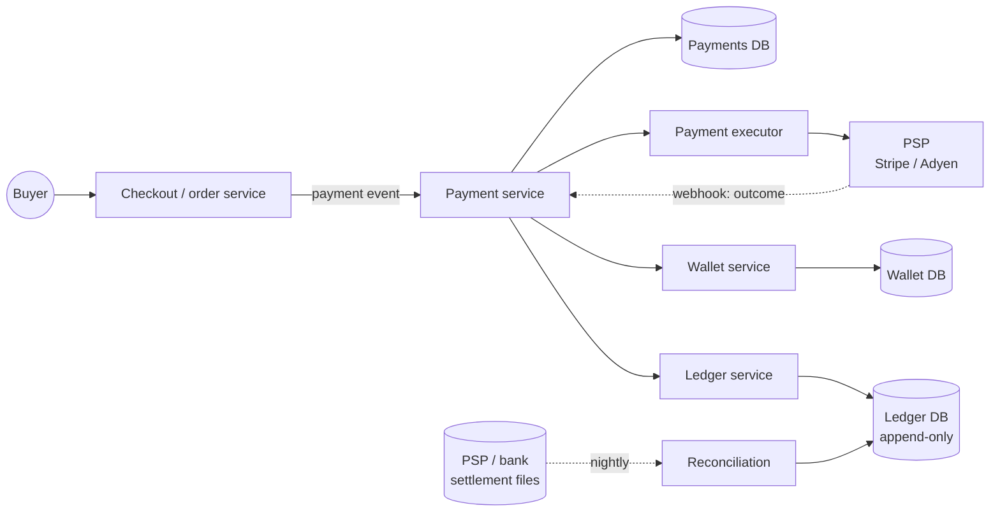
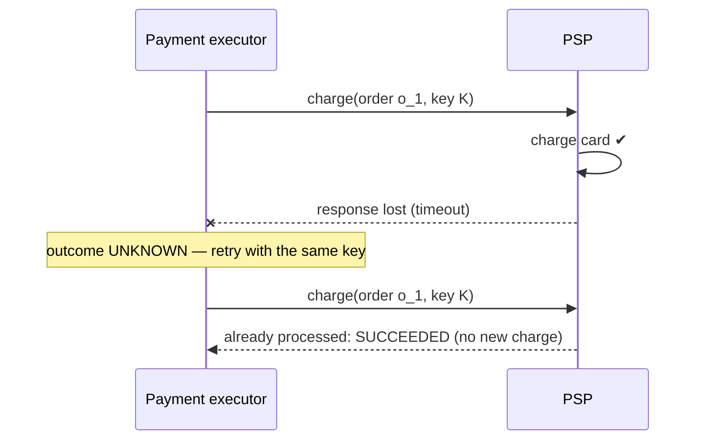

## Overview

When a customer clicks **Buy**, money must move from the buyer to the marketplace (**pay-in**), and later from the marketplace to sellers (**pay-out**). The payment system records every movement correctly, never charges twice, never loses money, and can prove it. Correctness matters far more than raw throughput. This design follows the [18-step framework](/system-design/introduction) and builds on the payment designs in the ByteByteGo handbook.

## Functional requirements

1. **Pay-in:** charge a buyer's card (or wallet) for a checkout, which may contain orders from several sellers.
2. **Pay-out:** transfer money to sellers on a schedule.
3. Record balances for sellers (wallet) and every money movement (ledger).
4. Refunds and chargebacks.
5. **Reconciliation** with payment providers and banks.

Card processing itself is delegated to a **payment service provider (PSP)** such as Stripe, Adyen or PayPal; we do not connect directly to card networks.

## Nonfunctional requirements

- **Correctness:** no double charges, no lost payments; every cent accounted for.
- **Reliability and fault tolerance:** external calls fail and time out; the system must recover to a correct state.
- **Auditability:** immutable history of every state change.
- **Security and compliance:** PCI DSS scope minimised; card data never stored by us.
- **Throughput is modest:** 1 million transactions/day ≈ 12 TPS average (peaks ×10). A relational database handles this easily.

## Capacity estimates

| Assumption | Value |
|---|---|
| Transactions per day | 1 million |
| Peak factor | 10× |
| Ledger entries per transaction | ~4 (double entry, fees) |

- Peak ≈ **120 TPS**; ledger writes ≈ 500/s peak.
- Storage: 4 M ledger rows/day × 200 bytes ≈ 0.8 GB/day ≈ **300 GB/year** — one relational primary with replicas, partitioned by month.

The design is driven by correctness, not scale.

## Money movement: clearing and settlement

Two concepts from the banking side shape the design:

- **Clearing** calculates who owes whom how much (netting: if Bank A owes Bank B $100 and B owes A $500, B pays A a net $400).
- **Settlement** is when real money moves between banks' reserve accounts at a settlement bank.

So "payment succeeded" from the PSP means the card was authorised and captured; the money actually reaches our bank account days later in a **settlement**, accompanied by a **settlement file**. Our records must match those files.

## API design

```http
POST /v1/payments
Idempotency-Key: 8d2f0a8e-6c3b-4b8f-9b33-0b2c1f6a7e10

{
  "checkoutId": "chk_123",
  "buyerId": "u_42",
  "currency": "EUR",
  "orders": [
    { "orderId": "o_1", "sellerId": "s_7", "amount": "49.90" },
    { "orderId": "o_2", "sellerId": "s_9", "amount": "15.00" }
  ]
}

202 Accepted   { "paymentId": "pay_789", "status": "PENDING", "redirectUrl": "https://psp.example/hosted/..." }
```

```http
GET /v1/payments/pay_789   →   { "status": "SUCCEEDED", "orders": [ ... ] }
POST /v1/webhooks/psp      ←   PSP notifies the final outcome (signed)
```

Amounts are decimals in strings (or integers in minor units), never floating point.

## Data model

| Table | Key columns |
|---|---|
| `payment_event` | `checkout_id` (unique), `buyer_id`, `status`, `created_at` |
| `payment_order` | `payment_order_id`, `checkout_id`, `seller_id`, `amount`, `currency`, `status`, **`idempotency_key` (unique)**, `psp_token`, `attempts`, `ledger_updated`, `wallet_updated` |
| `ledger_entry` | `entry_id`, `transaction_id`, `account`, `debit`, `credit`, `currency`, `created_at` (append-only) |
| `wallet` | `seller_id`, `balance`, `version` |

`payment_order.status` moves through a [state machine](/design-patterns/behavioral/state): `NOT_STARTED → EXECUTING → SUCCEEDED | FAILED` (with `UNKNOWN` for timeouts awaiting resolution).

## High-level architecture



## Component responsibilities

- **Payment service:** accepts payment events, validates and risk-checks them, stores them, and orchestrates the steps (a saga orchestrator).
- **Payment executor:** executes one payment order via the PSP; owns retries and idempotency toward the PSP.
- **PSP:** moves money from the card; hosts the payment page so card data never touches our servers.
- **Wallet:** sellers' balances.
- **Ledger:** the financial source of truth, recorded with **double-entry bookkeeping**.
- **Reconciliation:** compares our records with PSP and bank settlement files.

## Data flow (pay-in)

Following the sequence in ByteByteGo's design:

1. The buyer clicks Buy; a **payment event** goes to the payment service.
2. The payment service stores the event.
3. One event can contain **several payment orders** (one per seller); the service calls the executor for each.
4. The executor stores each payment order (`NOT_STARTED`).
5. The executor calls the PSP (registering the order with our idempotency key; the buyer enters card details on the PSP's **hosted payment page**).
6. On success, the payment service updates the seller's **wallet** balance.
7. The wallet service stores the new balance (optimistic locking on `version`).
8. The payment service calls the **ledger**.
9. The ledger appends the entries.
10. Nightly, the PSP and banks send **settlement files**, which reconciliation compares against the ledger.

Steps 6–9 are driven from durable state (an outbox), so a crash between them resumes rather than skipping or repeating.

## Avoiding double charges: exactly-once

The most serious failure is charging a customer twice. As the ByteByteGo handbook puts it, an operation is executed **exactly once** if it is executed **at least once** and **at most once** at the same time:

- **At least once — retries.** Network errors and timeouts are retried with exponential backoff (and jitter), up to a limit, then the order goes to a dead-letter queue for investigation.
- **At most once — idempotency.** Every request carries an **idempotency key** (a UUID generated by the client per payment attempt, sent as the `Idempotency-Key` header and stored with a unique constraint). A repeated request with the same key returns the stored result instead of charging again. The executor passes its own idempotency key to the PSP, which deduplicates too (Stripe and PayPal support this).



> [!KEY] A timeout is not a failure
> When a call to the PSP times out, the charge may have happened. Mark the order `UNKNOWN`, then retry with the **same** idempotency key or query the PSP for the status. Never retry with a new key, and never report failure to the user until the outcome is known.

Within our own database, the idempotency key's **unique constraint** makes concurrent duplicate requests safe: the second insert fails, and the API returns the first request's result.

## The ledger: double-entry bookkeeping

Every transaction is recorded as at least two entries whose debits and credits are equal, so the sum of all entries is always zero. Paying 100 EUR for an order:

| Account | Debit | Credit |
|---|---|---|
| Buyer (card via PSP) | 100.00 | |
| Seller payable (s_7) | | 95.00 |
| Platform fee revenue | | 5.00 |

The ledger is **append-only**: corrections are new entries (a refund reverses with opposite entries), never updates. This gives an audit trail and makes errors detectable: if the books do not balance, something is wrong.

## Reconciliation

Reconciliation compares records across systems to confirm amounts match: the order system ($200 purchase), the PSP's transaction record ($200), and the ledger (debit buyer $200, credit seller $200). It is often called the most painful part of payments. Typical problems and remedies:

| Problem | Remedy |
|---|---|
| Different data formats (`2022/01/01` vs `Jan 1, 2022`) | A normalisation layer transforming every source into one format |
| Massive data volume | Batch processing (end of day, Spark) or streaming (Flink) for near-real-time reconciliation |
| **Cut-off time differences** (23:59:55 internally, 00:00:30 at the PSP) | Classify as a **temporary break**; re-run against the next day's file before raising it |
| Real discrepancies | Classify (fixable automatically, fixable manually, unknown) and route to finance operations |

Even with exactly-once processing inside our system, discrepancies arise from external systems, so reconciliation is always required.

## Pay-out

On a schedule (daily or weekly), the system aggregates each seller's available balance, creates pay-out orders, and calls a pay-out provider or bank transfer API — with the same idempotency, state machine and ledger entries as pay-in. Cross-currency pay-outs go through **foreign exchange**: the provider sells one currency from a funding pool and pays out in the seller's currency, and the FX rate and fee become ledger entries.

## Database selection

A **relational database** with ACID transactions, unique constraints, and serializable or carefully locked updates for wallets. Proven, auditable, and sufficient for the throughput. Ledger tables partitioned by time; backups and point-in-time recovery mandatory. See [Transactions and Isolation Levels](/data-systems/transactions-and-isolation).

## Scaling

Scale is modest; prefer simplicity. Read replicas for reporting; partition ledger tables by month; separate the reconciliation workload (batch on replicas or a warehouse). Asynchronous processing between steps through a durable queue (Kafka) with idempotent consumers.

## Failure handling

| Failure | Handling |
|---|---|
| PSP timeout | Mark `UNKNOWN`; retry with the same idempotency key or query status; webhook confirms |
| PSP down | Circuit breaker; queue payment orders; optionally route to a backup PSP |
| Crash between wallet and ledger updates | Steps driven from the outbox and order flags (`wallet_updated`, `ledger_updated`); resumption is idempotent |
| Webhook delivered twice or out of order | Verify signature; deduplicate by event ID; apply state transitions only forward |
| Poison message | Dead-letter queue and manual review |

## Security

- **Hosted payment page / tokenisation:** card details go directly to the PSP; we store only a token, which keeps us out of most PCI DSS scope.
- HTTPS everywhere, mTLS between internal services; **signed webhooks** (HMAC) verified on receipt (see [Security Fundamentals](/system-design/building-blocks/security-fundamentals)).
- Encryption at rest, strict access control and audit logs for the payments database.
- Fraud and risk checks before execution (velocity limits, device fingerprinting, 3-D Secure).
- Protection against request tampering: amounts computed server-side from orders, never trusted from the client.

## Observability

Payment success rate per PSP and method, latency, count of orders in `UNKNOWN`, retry and DLQ volumes, reconciliation break counts and ageing, ledger balance checks (sum of entries = 0) as a continuous invariant check.

## Bottlenecks

Hot wallet rows for very large sellers (serialise updates or shard balances into sub-accounts), and the PSP's rate limits.

## Design alternatives

- **Synchronous charge in the checkout request** — simpler, but timeouts leave the user and system in doubt; an asynchronous flow with webhooks is more robust.
- **Event-sourced ledger** with a stream processor maintaining balances.
- **Choreographed saga** instead of the orchestrating payment service; orchestration is clearer for money flows.

## Trade-offs

- Correctness over latency: payment confirmation may take seconds.
- Relational and simple over distributed and scalable, because volume is low and integrity is paramount.
- Asynchrony and reconciliation accept temporary inconsistency, resolved by explicit processes.

## Interview follow-up questions

**How do you prevent a double charge if the user clicks Pay twice?** The client sends the same idempotency key for the same checkout attempt; the unique constraint on the key and the PSP's idempotency return the first result.

**What if the PSP charged the card but our database update failed?** The webhook or a status query discovers the success; reconciliation catches anything still missing.

**Why not store balances only, without a ledger?** Balances alone cannot explain how they were reached, cannot be audited, and errors are undetectable; the ledger is the source of truth and balances are derived.

## Summary

- Delegate card processing to a PSP with hosted pages; store tokens, not cards.
- Exactly-once = retries (at least once) + idempotency keys (at most once); a timeout means "unknown".
- Record every movement in an append-only double-entry ledger.
- Reconcile with settlement files daily; discrepancies are normal and must be handled.

## Related topics

- [Designing an Order Management System](/system-design/case-studies/order-management-system)
- [Message Queues and Delivery Semantics](/system-design/building-blocks/message-queues-and-delivery-semantics)
- [Transactions and Isolation Levels](/data-systems/transactions-and-isolation)
- [HTTPS, Password Storage and API Request Signing](/system-design/building-blocks/security-fundamentals)

## References

- Alex Xu. *ByteByteGo System Design Handbook*: design a payment system; avoid double charge; reconciliation; money movement; foreign exchange in payment; payment security.
- Alex Xu, Sahn Lam. *System Design Interview – An Insider's Guide, Volume 2*. Chapter: Payment system.
- [Stripe API: idempotent requests](https://docs.stripe.com/api/idempotent_requests).
