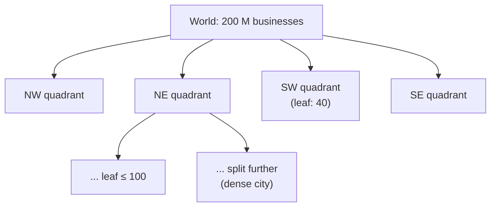
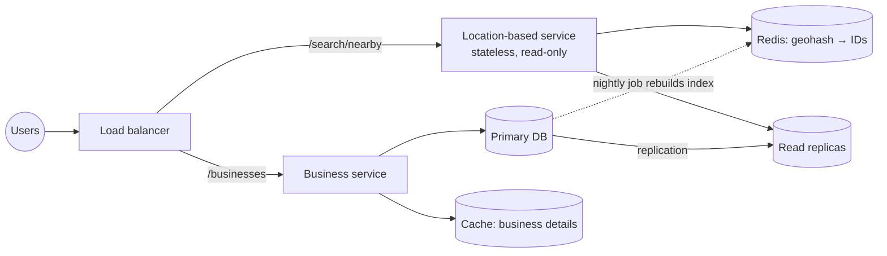

## Overview

A **proximity service** answers "what is near me?": restaurants within 1 km, hotels near a landmark, drivers near a pickup point. Yelp and Google Maps rely on one. The interesting part is the **geospatial index**: how to find nearby points among hundreds of millions quickly. This design follows the [18-step framework](/system-design/introduction) and expands the ByteByteGo handbook's Yelp and quadtree discussions.

## Functional requirements

1. Given a location (latitude, longitude) and a radius, return businesses within the radius, optionally filtered by category.
2. Business owners add, update or delete businesses; changes may appear the next day.
3. Users view business details.

## Nonfunctional requirements

- **Low latency** search (p99 < 200 ms).
- **High availability** and handling of peak traffic in dense cities at lunchtime.
- **Read-heavy:** searches vastly outnumber business updates.
- Data privacy: user locations are sensitive and not stored longer than needed.

## Capacity estimates

| Assumption | Value |
|---|---|
| Daily active users | 100 million |
| Searches per user per day | 5 |
| Businesses | 200 million |

- Search QPS: 100 M × 5 / 86,400 ≈ **5,800/s** (peak several times higher).
- Geospatial index size: 200 M businesses × (8-byte ID + geohash/coordinates ≈ 24 bytes) ≈ **6 GB** with overhead; ByteByteGo estimates a quadtree at about 1.71 GB. Either way it **fits in memory on one server**.
- Business details: 200 M × 1 KB ≈ 200 GB — a normal database with caching.

## API design

```http
GET /v1/search/nearby?lat=37.776&lon=-122.416&radius=1000&category=restaurant
200 OK
{ "total": 42, "businesses": [ { "id": 343, "name": "...", "distanceM": 120 }, ... ] }

GET  /v1/businesses/343
POST /v1/businesses        PUT /v1/businesses/343        DELETE /v1/businesses/343
```

Paginate search results; the client fetches details for the visible page only.

## Data model

- `business(id, name, address, category, lat, lon, ...)` — relational, read-heavy.
- `geospatial_index` — derived from `business`: geohash → business IDs, or an in-memory quadtree.

## Why not just query latitude and longitude?

```sql
SELECT id FROM business
WHERE lat BETWEEN :lat - :d AND :lat + :d
  AND lon BETWEEN :lon - :d AND :lon + :d;
```

Even with indexes on `lat` and `lon`, a B-tree index works on **one dimension**: the database fetches every business in the latitude band (a strip around the whole planet) and every business in the longitude band, then intersects them. That is far too much data. We need to map two dimensions to one, so that **nearby points have nearby keys**.

## Option 1: geohash

Geohash recursively divides the world into grids:

1. Split the planet along the equator and prime meridian: longitude [−180, 0] → bit 0, [0, 180] → bit 1; latitude [−90, 0] → 0, [0, 90] → 1.
2. Divide each cell into four again, alternating longitude and latitude bits.
3. Encode the bits in base32: `9q8yyk` is a cell in San Francisco.

| Geohash length | Cell size (approx.) | Use for radius |
|---|---|---|
| 4 | 39 km × 19.5 km | 20 km |
| 5 | 4.9 km × 4.9 km | 2 km |
| 6 | 1.2 km × 0.6 km | 1 km / 500 m |
| 7 | 153 m × 153 m | — |

**Shared prefix ⇒ nearby.** All businesses in a cell share its prefix, so search becomes a prefix (range) query on an ordinary index:

```sql
SELECT business_id FROM geohash_index WHERE geohash LIKE '9q8yy%';
```

**Boundary issues:** two points can be very close but in different cells with no common prefix (on either side of the equator or a cell edge). The fix is to search the user's cell **plus its eight neighbours**, which are computable from the geohash. If too few results come back, drop a character (a larger cell) and repeat.

Geohash is simple, fits any database with a string index (or Redis `GEOSEARCH`), and updates are trivial (recompute one row's geohash).

## Option 2: quadtree

A **quadtree** is an in-memory tree that recursively splits a region into four quadrants **until no leaf has more than, say, 100 businesses**. Dense downtown areas get deep, small cells; oceans stay as one big leaf. This adapts to density, which fixed geohash grids do not (a single geohash cell in Manhattan may hold thousands of businesses, while one in the ocean holds none).



- **Search:** walk from the root to the leaf containing the user; if it has enough businesses, return them, otherwise add businesses from neighbouring leaves.
- **Build:** at server start-up, from all businesses: O(n log n), a few minutes for 200 million. While building, the server cannot serve traffic, so **roll out new server versions to a small subset of servers at a time** to avoid a brownout.
- **Updates:** adding or removing a business means updating the tree in memory (and rebalancing). Since updates may be applied the next day, rebuild nightly or apply incremental changes carefully (locking).

## Option 3: Google S2 and others

**S2** maps the sphere onto a **Hilbert curve**, giving each cell a 64-bit ID where nearby points tend to have nearby IDs. It handles arbitrary regions (geofences) well and is used by Google Maps and Tinder. **R-trees** (PostGIS, spatial indexes in databases) are another classic.

| | Geohash | Quadtree | S2 |
|---|---|---|---|
| Storage | Database index or Redis | In memory on each server | Library + database/in-memory |
| Adapts to density | No (fixed precision) | **Yes** | Yes (cell coverings) |
| Updates | Trivial | Tree updates or rebuild | Moderate |
| Complexity | Low | Medium | Higher |

**Choice:** geohash in the database (or Redis) for simplicity and easy updates; consider a quadtree when density varies hugely and "k nearest" queries are common.

## High-level architecture



## Component responsibilities

ByteByteGo splits the system into two services:

- **Location-based service (LBS):** given a location and radius, return nearby business IDs. Read-only, high QPS, stateless, scales horizontally.
- **Business service:** CRUD for businesses (low QPS writes) and business details (high QPS reads, cacheable).

## Data flow

1. The client sends location and radius.
2. The LBS computes the geohash precision for the radius, the user's cell and its eight neighbours.
3. It fetches business IDs for those nine cells (Redis or the index table on replicas).
4. It computes exact distances, filters by radius and category, sorts and paginates.
5. The client fetches details for the visible businesses from the business service (served mostly from cache).

## Caching

- Geohash cell → business IDs, for each precision used, in Redis (a few GB).
- Business ID → details, in Redis.
- Caching by raw user coordinates is useless (every location differs); caching by **cell** works because many users share cells.

## Database selection and scaling

Writes are rare; reads are many; the dataset fits on one server. ByteByteGo's key point applies: **do not jump to sharding**. The whole geospatial index fits in the working set of a modern database server, so the bottleneck is read throughput, solved with **read replicas** (and caching), which are far simpler than application-level sharding. Business details (200 GB) may be sharded by business ID if needed, but replicas usually suffice.

Deploy in several regions close to users; data is mostly static, so asynchronous replication to regional replicas works well.

## Failure handling

- Cache miss storms after a restart: warm caches before taking traffic.
- Replica lag: newly added businesses appear later — acceptable per requirements.
- Quadtree option: staggered restarts so rebuilding servers never take a large share of capacity offline.

## Security and privacy

Do not log precise user locations; round or discard them after the search. Rate-limit search APIs to prevent scraping of the business database. Authenticate business owners for updates.

## Observability

Search latency per region, results-per-query distribution (too few results means the precision choice is wrong), cache hit rates, replica lag.

## Bottlenecks

Dense areas with huge numbers of businesses per cell (paginate, choose finer precision, or switch to a quadtree), and lunchtime peaks in big cities.

## Design alternatives

- PostGIS with a GiST (R-tree) index for a single-database solution.
- Elasticsearch `geo_point` with `geo_distance` queries, combining text search and location.
- Redis `GEOADD`/`GEOSEARCH` (geohash-based sorted sets).

## Trade-offs

- Geohash: simple and update-friendly, but not density-adaptive and needs neighbour queries.
- Quadtree: adaptive, but in-memory, slower to build and harder to update.
- Read replicas over sharding: simpler, at the cost of replication lag for new businesses.

## Interview follow-up questions

**How would you return the k nearest businesses rather than all within a radius?** Expand the search ring by ring (geohash neighbours or quadtree leaves) until k candidates are found, then sort by distance.

**How would you support moving objects such as drivers?** Very different write load: drivers update every few seconds, so keep their positions in memory (Redis geo sets) with short TTLs, and shard by region.

**Why is caching by user location ineffective?** Coordinates are almost always unique; cache by geohash cell instead.

## Summary

- Two-dimensional proximity needs a one-dimensional key with locality: geohash, quadtree or S2.
- Geohash: prefix queries plus eight neighbours; quadtree: density-adaptive, in memory.
- Separate the read-heavy location service from the business service.
- Estimate first: the index fits on one server, so read replicas beat sharding.

## Related topics

- [Caching Strategies](/system-design/building-blocks/caching-strategies)
- [Partitioning (Sharding)](/data-systems/partitioning)
- [Storage Engines: spatial indexes](/data-systems/storage-engines)
- [Scaling from Zero to Millions of Users](/system-design/building-blocks/scaling-from-zero-to-millions)

## References

- Alex Xu. *ByteByteGo System Design Handbook*: how do we find nearby restaurants on Yelp; quadtree; back-of-the-envelope estimation.
- Alex Xu, Sahn Lam. *System Design Interview – An Insider's Guide, Volume 2*. Chapter 1: Proximity service.
- [Geohash](https://en.wikipedia.org/wiki/Geohash); [S2 Geometry](http://s2geometry.io/).
