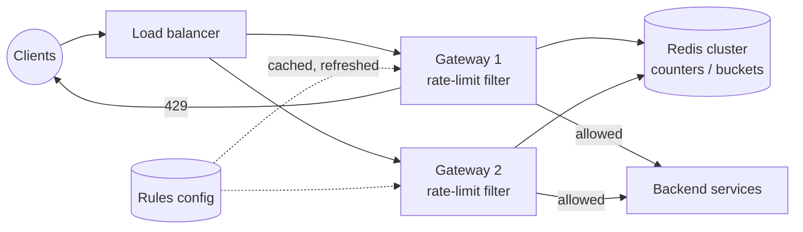

## Overview

A **rate limiter** caps how many requests a client may make in a time period, for example 100 requests per minute per API key. It protects services from abuse and denial-of-service, controls cost (paid third-party APIs), and keeps one noisy tenant from starving others. This case study designs a distributed rate limiter for an API platform, following the [18-step framework](/system-design/introduction).

## Functional requirements

1. Limit requests per client identity (API key, user ID or IP) and per rule (endpoint, plan).
2. Rules are configurable without redeploying: `{ "plan": "free", "endpoint": "/search", "limit": 100, "window": "1m" }`.
3. Rejected requests get **HTTP 429 Too Many Requests** with headers telling the client when to retry.
4. Works across many API servers (a client's requests hit different servers).

## Nonfunctional requirements

- **Low latency:** adds < 2 ms to each request.
- **Highly available and fault tolerant:** if the limiter fails, the API keeps working (fail open, by default).
- **Accurate enough:** small overshoot at boundaries is acceptable; large bursts are not.
- **Memory efficient:** millions of clients.

## Capacity estimates

Assumptions: 10 million active API keys, 50,000 requests/s at peak, one or two rules per request.

- Limiter operations: ~100,000/s at peak — one Redis cluster with a few shards handles this.
- Memory with a counter per key and window: 10 M × ~100 bytes ≈ **1 GB**. Sliding logs would need far more (one entry per request).

## Where to put the limiter

| Placement | Pros | Cons |
|---|---|---|
| Client side | Saves round trips | Untrusted; easily bypassed |
| **API gateway / middleware** (chosen) | One place for all services; rejects before work is done | Gateway must reach the counter store quickly |
| Inside each service | Fine-grained, business-aware limits | Duplicated logic in every service |

The [API gateway](/microservices/fundamentals/api-gateway) is the natural place; Spring Cloud Gateway's `RequestRateLimiter` filter implements a Redis token bucket.

## Algorithms

| Algorithm | How | Pros | Cons |
|---|---|---|---|
| **Token bucket** | A bucket holds up to *b* tokens, refilled at *r* per second; each request takes one | Allows short bursts up to *b*; memory-efficient; widely used (AWS, Stripe) | Two parameters to tune |
| **Leaky bucket** | Requests enter a FIFO queue processed at a fixed rate | Smooth, constant outflow | Bursts fill the queue and delay recent requests |
| **Fixed window counter** | Count per window (`12:00–12:01`); reject above the limit | Simplest, tiny memory | Up to **2× the limit** across a window boundary |
| **Sliding window log** | Store each request timestamp; count those in the last window | Exact | Memory per request |
| **Sliding window counter** | Current window count + previous window count × overlap fraction | Smooth, small memory, approximation good in practice | Slightly approximate |

The fixed-window boundary problem: with a limit of 100/min, a client sends 100 requests at 12:00:59 and 100 at 12:01:00 — 200 requests in two seconds, all allowed.

The sliding window counter fixes most of it: at 12:01:15, with 80 requests in the previous minute and 30 so far in the current one, the estimate is `30 + 80 × (45/60) = 90`.

**Choice:** token bucket for per-client API limits (bursts are natural for real clients), sliding window counter where smoothness matters.

## API and responses

```http
HTTP/1.1 429 Too Many Requests
Retry-After: 12
RateLimit-Limit: 100
RateLimit-Remaining: 0
RateLimit-Reset: 12
Content-Type: application/problem+json

{ "type": "https://api.example.com/problems/rate-limited", "title": "Too many requests", "status": 429 }
```

Successful responses also carry `RateLimit-Remaining` so well-behaved clients can slow down. (These header names follow the IETF RateLimit header fields draft; `X-RateLimit-*` is the older convention.)

## Data model

Per client and rule, in Redis:

- Token bucket: a hash `rl:{apiKey}:{rule}` with fields `tokens` and `updatedAtMillis`, with a TTL slightly longer than a full refill.
- Rules: stored in a configuration database, cached in every gateway instance and refreshed on change.

## High-level architecture



## Data flow and the race condition

A naive implementation reads the counter, checks it, and writes it back — two gateways can both read 99 and both allow, exceeding the limit. The check-and-update must be **atomic**. In Redis, use a **Lua script**, which runs atomically on the server:

```lua
-- KEYS[1] = bucket key; ARGV = capacity, refill per ms, now ms, requested tokens
local b = redis.call('HMGET', KEYS[1], 'tokens', 'ts')
local capacity, rate, now, req = tonumber(ARGV[1]), tonumber(ARGV[2]), tonumber(ARGV[3]), tonumber(ARGV[4])
local tokens = tonumber(b[1]) or capacity
local ts = tonumber(b[2]) or now
tokens = math.min(capacity, tokens + (now - ts) * rate)          -- refill since last request
local allowed = tokens >= req
if allowed then tokens = tokens - req end
redis.call('HSET', KEYS[1], 'tokens', tokens, 'ts', now)
redis.call('PEXPIRE', KEYS[1], math.ceil(capacity / rate) + 1000)
return { allowed and 1 or 0, math.floor(tokens) }
```

Use the Redis server's time (`TIME`) or tolerate small clock differences between gateways. For a fixed or sliding window counter, `INCR` + `EXPIRE` in a script or pipeline is enough.

The same algorithm in-process (for a single instance or a local pre-filter):

```java
final class TokenBucket {
    private final long capacity;
    private final double refillPerNano;
    private double tokens;
    private long lastRefill = System.nanoTime();

    TokenBucket(long capacity, Duration refillPeriod) {
        this.capacity = capacity;
        this.refillPerNano = (double) capacity / refillPeriod.toNanos();
        this.tokens = capacity;
    }

    synchronized boolean tryAcquire() {
        long now = System.nanoTime();
        tokens = Math.min(capacity, tokens + (now - lastRefill) * refillPerNano);
        lastRefill = now;
        if (tokens >= 1) { tokens -= 1; return true; }
        return false;
    }
}
```

Libraries: Bucket4j (with Redis or Hazelcast back ends), Resilience4j's `RateLimiter` for client-side limits on outgoing calls ([Circuit Breakers and Resilience4j](/microservices/reliability/circuit-breakers-and-resilience4j)).

## Scaling

- Shard Redis by key; each client's bucket lives on one shard.
- **Local pre-limiting:** each gateway keeps an in-memory bucket allowing `limit / gatewayCount`, syncing with Redis periodically — fewer Redis calls, slightly less accuracy.
- **Multi-region:** synchronising counters across regions on every request is too slow. Use per-region limits (global limit split by expected traffic share) with asynchronous reconciliation, accepting some overshoot.

## Failure handling

- **Redis unavailable or slow:** **fail open** (allow requests, rely on local limits) for availability; fail closed only for limits that protect something critical (e.g. SMS sending costs). Use a short timeout (a few ms) on the Redis call.
- **Hot clients:** one abusive key concentrates on one shard; block it earlier with a local deny list or at the edge (WAF).
- **Clock skew:** use Redis time inside the script.

## Security

Identify clients reliably: authenticate the API key before rate limiting per key; limit by IP only for anonymous traffic (and beware many users behind one NAT). Layer limits: edge/WAF per IP for DDoS, gateway per key for fairness, service-level for expensive operations.

## Observability

Count allowed and rejected requests per rule and plan, Redis latency, fail-open events, and top rejected clients. Alert on sudden spikes of 429s (a client bug or an attack).

## Bottlenecks

Redis round trips per request (mitigated with local pre-limits and pipelining) and hot keys.

## Design alternatives

- Fixed window with `INCR`/`EXPIRE` — simplest, accepts boundary bursts.
- Leaky bucket via a queue — for smoothing traffic to a fragile downstream (shaping, not rejecting).
- Service mesh rate limiting (Envoy's global rate limit service).

## Trade-offs

- Token bucket allows bursts that a strict window would forbid — usually desirable.
- Fail open favours availability over strict enforcement.
- Approximate distributed counting trades accuracy for latency.

## Interview follow-up questions

**How do you rate-limit by multiple dimensions (per user and per IP)?** Evaluate each rule independently and reject if any is exceeded; a single Lua script can check several keys atomically if they hash to the same Redis slot (use hash tags).

**How do you give paid customers higher limits?** Rules keyed by plan; the gateway resolves the client's plan from the authenticated token.

**What is the difference between rate limiting and load shedding?** Rate limiting enforces per-client fairness; load shedding drops excess traffic when the whole service is overloaded, regardless of client.

## Summary

- Put the limiter at the gateway; respond with 429 and retry headers.
- Token bucket for bursty APIs, sliding window counter for smooth limits; avoid naive fixed windows.
- Make check-and-update atomic (Redis Lua); fail open with short timeouts.
- Use local pre-limits and per-region budgets to scale.

## Related topics

- [API Gateway with Spring Cloud Gateway](/microservices/fundamentals/api-gateway)
- [Circuit Breakers and Resilience4j](/microservices/reliability/circuit-breakers-and-resilience4j)
- [Caching Strategies: Redis](/system-design/building-blocks/caching-strategies)
- [Designing a URL Shortener](/system-design/case-studies/url-shortener)

## References

- Alex Xu. *System Design Interview – An Insider's Guide*. Chapter 4: Design a rate limiter.
- Stripe Engineering. "[Scaling your API with rate limiters](https://stripe.com/blog/rate-limiters)."
- IETF draft. [RateLimit header fields for HTTP](https://datatracker.ietf.org/doc/draft-ietf-httpapi-ratelimit-headers/).
