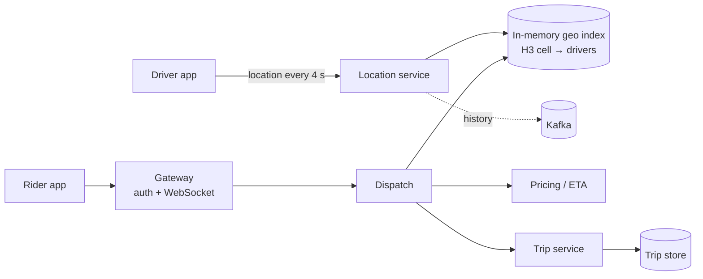
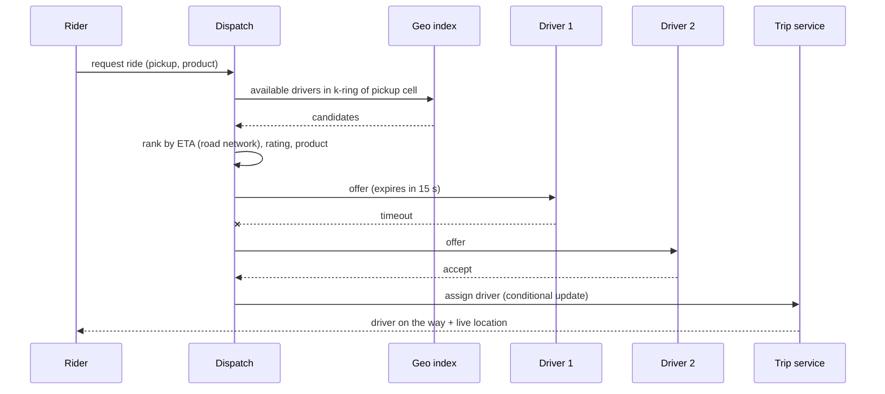
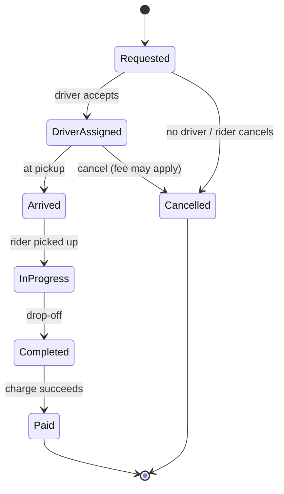

## Overview

A ride-sharing service matches riders with nearby drivers in seconds, tracks the trip on a map, and charges at the end. It looks like the [proximity service](/system-design/case-studies/proximity-service), with one crucial difference: **the points move**. Millions of drivers send their location every few seconds, so the geospatial index is write-heavy and must live in memory. Follows the [18-step framework](/system-design/introduction).

## Functional requirements

1. Drivers go online and stream their location.
2. Riders see nearby cars and an ETA and price estimate, then request a ride.
3. The system offers the ride to a suitable driver; the driver accepts.
4. Both see each other in real time during pickup and the trip.
5. Trip completes; payment is charged; both rate each other.

## Nonfunctional requirements

- Matching in a few seconds; location freshness of a few seconds.
- A driver must never be assigned to two trips at once (strong consistency on assignment).
- Highly available per city/region; graceful degradation.

## Capacity estimates

| Assumption | Value |
|---|---|
| Active drivers at peak | 5 million |
| Location update interval | 4 seconds |
| Ride requests at peak | 1,000 per second |

- Location writes: 5 M / 4 s = **1.25 million updates/s**. A database row update per ping is not viable; keep current positions **in memory**, append history to a log.
- Location payload ~100 bytes → 125 MB/s of ingress.

## High-level architecture



## Location tracking and the geo index

Drivers stream locations over a persistent connection. The location service updates an **in-memory index**: grid cell → set of available drivers, plus driver → (cell, position, status, timestamp). Updates move a driver between cells only when it crosses a boundary.

**Uber's H3** divides the globe into hexagonal cells at 16 resolutions; each cell has a 64-bit ID, and children have one-seventh of the parent's area. Hexagons have a single neighbour distance (unlike squares, whose diagonal neighbours are farther), so a **k-ring** (all cells within k steps) approximates a circle well — ideal for "drivers within ~2 km". [Geohash](/system-design/case-studies/proximity-service) or S2 cells work similarly.

Shard the index **by region/city** (and by cell within a big city); a city's drivers and riders are served by the same shard, which keeps dispatch local. Stale entries expire if a driver stops sending updates.

## Dispatch flow

- Candidates are ranked by **ETA over the road network**, not straight-line distance (a driver across a river is far).
- Offers go to one driver at a time (or a small batch) with a timeout.
- **Assignment must be atomic**: the trip service sets `driver.status = ASSIGNED` with a compare-and-set (or a lock with a lease) so two concurrent requests cannot claim the same driver. This is one of the few strongly consistent operations in the system.
- At large scale, dispatch matches in short **batches** (every few seconds per area) to optimise global assignment rather than greedy nearest-driver.

## Trip state machine

A trip is a classic [State pattern](/design-patterns/behavioral/state) lifecycle:

Persist transitions with optimistic locking; publish trip events for billing, notifications and analytics.

## ETA and pricing

ETA uses a routing engine on a road graph with live traffic (from aggregated driver speeds). **Surge pricing** compares demand (requests) with supply (available drivers) per H3 cell over short windows in a stream processor, and applies a multiplier that rebalances supply.

## Payments

When the trip completes, the payment service charges the stored method with an idempotency key per trip and pays out drivers later — see [Designing a Payment System](/system-design/case-studies/payment-system).

## Failure handling

- Location service node failure: drivers reconnect to another node and the next ping repopulates the index (state is soft).
- Dispatch failure mid-offer: offers have expiry; the request is retried.
- Region failure: fail over city shards to another region; trip state is replicated.

## Trade-offs

- Soft, in-memory location state trades durability for speed (history goes to Kafka).
- Strong consistency only where needed (assignment, payments); everything else eventually consistent.
- Sharding by city keeps operations local but complicates trips crossing boundaries.

## Interview follow-up questions

**Why not store locations in a database?** 1.25 million writes per second of short-lived data; only the latest position matters for matching, so memory plus a log is far cheaper.

**How do you prevent double-booking a driver?** Atomic compare-and-set on driver status in one place (or a lease from a consensus-backed store).

**How do you show the car moving smoothly?** Send updates over WebSocket and interpolate on the client between points.

## Summary

- Millions of location updates per second live in an in-memory, cell-based geo index (H3).
- Dispatch searches nearby cells, ranks by road ETA and offers with timeouts.
- Driver assignment is atomic; trips are state machines.
- Shard by region; pricing reacts to supply and demand per cell.

## Related topics

- [Designing a Proximity Service](/system-design/case-studies/proximity-service)
- [State Pattern](/design-patterns/behavioral/state)
- [Designing a Payment System](/system-design/case-studies/payment-system)
- [Long Polling, WebSockets and SSE](/system-design/building-blocks/real-time-communication)

## References

- Uber Engineering. "[H3: Uber's Hexagonal Hierarchical Spatial Index](https://www.uber.com/blog/h3/)." 2018.
- Alex Xu, Sahn Lam. *System Design Interview – An Insider's Guide, Volume 2*. Chapters on proximity service and nearby friends.
