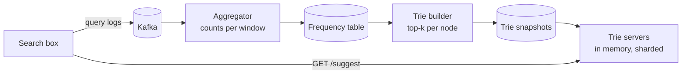

## Overview

As a user types "sys", the search box suggests "system design", "system of a down", "sysadmin". **Search autocomplete** must return the top suggestions for a prefix in under 100 ms while users type several characters per second, so the serving path is pure in-memory lookup and all heavy work happens offline. Follows the [18-step framework](/system-design/introduction).

## Functional requirements

1. Return the top 5 suggestions for a prefix, ranked by popularity.
2. Suggestions update with trending queries (hourly or faster).
3. Filter offensive and unsafe suggestions.

## Nonfunctional requirements

- p99 latency < 100 ms end to end, including the network.
- Highly available; slightly stale suggestions are acceptable.
- Scale: 10 million DAU, 10 searches per day, ~20 keystrokes per search.

## Capacity estimates

- Requests: 10 M × 10 × 20 / 86,400 ≈ **23,000/s** (peak ~50,000) — before debouncing and caching.
- New data: 100 M queries/day × 20 bytes ≈ 2 GB/day of logs.
- Distinct queries kept: ~100 million; trie with top-k at each node: tens of GB, sharded.

## API design

```http
GET /v1/suggest?q=sys&locale=en
200 OK
Cache-Control: max-age=3600
{ "suggestions": ["system design", "system of a down", "sysadmin", "systemctl", "syscall"] }
```

## The data structure: a trie with cached top-k

A **trie** (prefix tree) stores characters on paths from the root; every prefix is a node. Finding the top 5 for a prefix naively means walking to the prefix node and then searching its whole subtree — too slow for short prefixes.

Two optimisations make lookups O(prefix length):

1. **Limit prefix length** (e.g. 50 characters).
2. **Cache the top-k completions at every node.** Each node stores its 5 best queries with counts. A lookup walks to the prefix node and returns its list.

```java
final class TrieNode {
    final Map<Character, TrieNode> children = new HashMap<>();
    List<String> topK = List.of();           // precomputed at build time, read-only when serving
}

List<String> suggest(TrieNode root, String prefix) {
    TrieNode node = root;
    for (char c : prefix.toCharArray()) {
        node = node.children.get(c);
        if (node == null) return List.of();
    }
    return node.topK;
}
```

The cost is memory (each query appears in up to 50 ancestors' lists) and build time, both acceptable because the trie is built offline and served read-only.

## High-level architecture





## Data flow

**Offline (data-gathering) path:** search queries are logged to Kafka → aggregated into counts per query over a time window (with decay so old popularity fades) → filtered (blocklists, minimum count) → the trie builder produces a new trie snapshot → servers load the snapshot and swap atomically.

**Online (query) path:** the client debounces keystrokes (e.g. 50–100 ms) → request to the nearest region → the trie server for the prefix's shard returns the cached top-k.

For **trending** queries, a stream processor maintains counts over short windows (minutes) and merges a small "trending" overlay into results without rebuilding the full trie.

## Scaling the trie

- **Shard by prefix**: `a–f`, `g–m`... is uneven (many words start with "s"). Shard by measured load, or by hash of the first two or three characters, with a shard map in the gateway.
- **Replicate** each shard for read throughput and availability.
- Store snapshots in object storage so new servers start quickly.

## Caching

- **Browser cache:** responses for a prefix are cacheable for an hour; typing "sys", deleting and retyping costs nothing.
- **CDN/edge cache** for the shortest, most common prefixes.
- **Client-side filtering:** after fetching "sys", the client can filter locally for "syst" until results run short.

## Personalisation and safety

Blend global suggestions with the user's recent searches (kept client-side or in a per-user store). Filter suggestions through blocklists and classifiers before they enter the trie, and have a fast path to remove a suggestion immediately (a deny-list checked at serving time).

## Failure handling

If a trie server fails, replicas serve; if the build pipeline fails, keep serving the previous snapshot. Autocomplete should degrade silently: the search box still works without suggestions.

## Trade-offs

- Precomputed top-k per node: fast reads, large memory, slow updates — fine for read-heavy, slowly changing data.
- Freshness versus cost: full rebuilds weekly or daily plus a streaming trending overlay.

## Interview follow-up questions

**How would you support multiple languages?** Unicode tries per locale; normalise case and accents.

**How do you remove a harmful suggestion right now?** A serving-time deny-list consulted before returning results, then removal in the next build.

**Why not query the database with `LIKE 'sys%'`?** At 50,000 requests/s and a 100 ms budget, a database prefix scan plus ranking is too slow and too expensive; the trie answers from memory.

## Summary

- A trie with top-k cached at each node answers in O(prefix length).
- Build offline from aggregated query logs; serve read-only snapshots from memory.
- Shard and replicate by prefix; debounce and cache aggressively.
- Add a streaming overlay for trends and a deny-list for safety.

## Related topics

- [Stream Processing](/data-systems/stream-processing)
- [Batch Processing](/data-systems/batch-processing)
- [Caching Strategies](/system-design/building-blocks/caching-strategies)

## References

- Alex Xu. *System Design Interview – An Insider's Guide*. Chapter 13: Design a search autocomplete system.
- Prefixy: [A scalable prefix search service for autocomplete](https://prefixy.github.io/).
