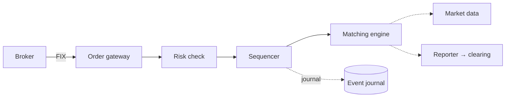

## Overview

An exchange matches buy and sell orders for securities. Its requirements are unlike a typical web system: **latency is measured in microseconds**, **fairness** demands a strict, deterministic order of events, and **correctness** cannot be compromised. ByteByteGo describes how a modern exchange achieves microsecond latency by keeping the **critical path** short and doing everything on it in memory. Follows the [18-step framework](/system-design/introduction).

## Functional requirements

1. Brokers place, cancel and modify limit and market orders.
2. Match orders by **price-time priority**; report executions.
3. Publish market data: trades and order-book depth.
4. Risk checks before orders reach the book.

## Nonfunctional requirements

- Matching latency in microseconds; predictable p99.9 (jitter matters more than mean).
- Deterministic, auditable ordering; recoverable state.
- High availability with failover in seconds or less.
- Throughput: tens of thousands of symbols, millions of orders per second at peak.

## The critical path



Only gateway → risk → sequencer → matching engine is on the latency-critical path. Market data, reporting, clearing and settlement happen **off** the critical path, fed by the sequenced event stream.



## The order book

For each symbol, the order book holds resting orders on two sides:

- **Bids** (buy) sorted by price descending, **asks** (sell) by price ascending.
- At each price level, orders queue in **time order** (FIFO).

An incoming buy at or above the best ask **matches** against the asks, best price first and oldest first within a price, until filled or the price no longer crosses; any remainder rests on the bid side. ByteByteGo notes the data-structure requirements: constant-time lookup of the best level, constant-time add and cancel. A typical implementation: a sorted map (or array indexed by price tick) of price levels, each a doubly linked list of orders, plus a hash map from order ID to its list node for O(1) cancel.

```java
final class PriceLevel {
    final long price;
    final ArrayDeque<Order> orders = new ArrayDeque<>();   // FIFO: time priority
    PriceLevel(long price) { this.price = price; }
}

final class OrderBook {
    final TreeMap<Long, PriceLevel> bids = new TreeMap<>(Comparator.reverseOrder());
    final TreeMap<Long, PriceLevel> asks = new TreeMap<>();
    // a production book avoids TreeMap and boxing: arrays by price tick, object pools, no allocation
}
```

Prices are integers in ticks, never `double`.

## Determinism: sequencer and journal

The **sequencer** stamps every inbound event (order, cancel) with a monotonically increasing sequence number and writes it to an **event journal** before the matching engine processes it. Because the matching engine is a deterministic state machine, **replaying the journal reproduces the exact order book**. This is event sourcing applied to a single, very fast process (see [Stream Processing](/data-systems/stream-processing)), and it gives:

- fairness: one total order of events
- auditability: the journal is the record
- recovery and failover: a standby engine replays (or continuously consumes) the same journal.

## Single-threaded, in-memory matching

The **LMAX architecture** (Martin Fowler's write-up) showed that a single Java thread, holding all state in memory and processing sequenced events without locks, can execute millions of orders per second in its business-logic core. Key ideas:

- **No locks, no contention:** one thread owns the order book; parallelism comes from **sharding by symbol** across engines and cores.
- **The Disruptor:** a pre-allocated lock-free ring buffer feeds events to the engine and carries results out, with mechanical sympathy for CPU caches.
- **No garbage on the hot path:** pre-allocated objects and pools avoid GC pauses; tune with low-latency collectors or off-heap memory.
- **Pin threads to cores**, disable power saving, use kernel-bypass networking and busy-spinning instead of blocking for the lowest latency.

These ideas apply Doug Lea's design forces in the extreme: confinement instead of locking (see [Designing Concurrent Objects](/java/advanced/concurrent-object-design)).

## Market data

Executions and book changes become a market-data feed. Exchanges publish via **UDP multicast** with sequence numbers (receivers detect gaps and request retransmission) to co-located clients, and via aggregated feeds (snapshots + incremental updates) to others.

## Risk and gateway

The gateway authenticates brokers, validates and throttles orders; risk checks (credit limits, price bands, fat-finger checks, position limits) run **before** sequencing so invalid orders never touch the book. Pre-trade risk is kept in memory too.

## High availability

Run a **primary and hot standby** matching engine consuming the same sequenced stream; the standby's state is identical, so failover is fast. The sequencer itself is replicated (the journal is written to multiple disks or replicas before acknowledgement). A disaster-recovery site replays the journal.

## Why the usual web architecture does not apply

| Typical web system | Exchange |
|---|---|
| Stateless services + database | Stateful in-memory engine; journal is the database |
| Horizontal scaling of one service | Shard by symbol; each shard single-threaded |
| Milliseconds are fine | Microseconds; jitter is the enemy |
| Eventual consistency acceptable | Strict total order per symbol |

## Trade-offs

- Extreme latency optimisation costs flexibility and engineering effort.
- Single-threaded engines are simple and fast but bounded by one core per symbol shard.
- Event sourcing makes recovery and audit straightforward, at the cost of careful versioning of event formats.

## Interview follow-up questions

**How do you guarantee fairness?** One sequencer assigns a total order; matching follows price-time priority deterministically.

**How do you recover after a crash?** Load the latest snapshot and replay the journal from its sequence number; or fail over to a hot standby that consumed the same stream.

**How do you scale to many symbols?** Partition symbols across matching engines; each engine is independent.

## Summary

- Keep the critical path short and in memory: gateway, risk, sequencer, matching.
- Order books: price levels with FIFO queues; integer prices; O(1) cancel.
- A sequencer and journal make matching deterministic, auditable and recoverable.
- Single-threaded engines sharded by symbol (LMAX, Disruptor) beat locking.

## Related topics

- [Concurrency Design Patterns](/java/advanced/concurrency-design-patterns)
- [Designing Concurrent Objects](/java/advanced/concurrent-object-design)
- [Stream Processing: event sourcing](/data-systems/stream-processing)
- [Designing a Payment System](/system-design/case-studies/payment-system)

## References

- Alex Xu. *ByteByteGo System Design Handbook*: how does a modern stock exchange achieve microsecond latency; match buy and sell orders; stock exchange design.
- Martin Fowler. "[The LMAX Architecture](https://martinfowler.com/articles/lmax.html)." 2011.
- LMAX. [Disruptor](https://lmax-exchange.github.io/disruptor/) technical paper.
- Alex Xu, Sahn Lam. *System Design Interview – An Insider's Guide, Volume 2*. Chapter: Stock exchange.
